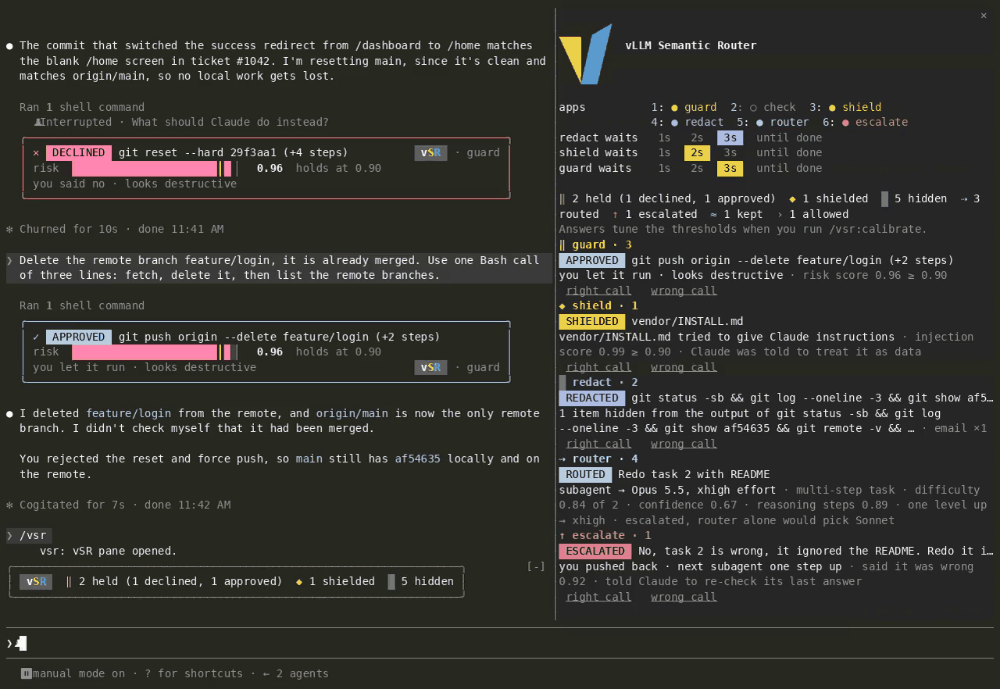

# vSR: vLLM Semantic Router in Claude Code

vSR gives Claude Code's subagents a cheaper model when their task is easy, holds risky Bash commands
for you to confirm, and hides personal data and secrets before Claude reads them. A small decision
model from the vLLM Semantic Router project (vela3-lite, about 2.3 GB of RAM) makes these calls on
your machine or on a runtime you host; your requests still go to Claude as usual. It does six things:

| App | What it does |
| --- | --- |
| router | Gives each general-purpose subagent a model (Haiku, Sonnet or Opus) and an effort level that fit its task. |
| escalate | When you push back on an answer, Claude re-checks it and the next subagent goes one step up. |
| redact | Hides personal data and secrets in `Read` and Bash output before Claude reads them. |
| shield | Warns Claude when a file or web page tries to give it instructions. |
| guard | Holds a risky Bash command for you to confirm, part by part. |
| check | Marks an answer that is not backed by what Claude read that turn. Off by default: see [Check](#check). |



## Install

You need Claude Code 2.1.319 or later and Python 3.

```bash
claude plugin marketplace add vllm-project/semantic-router
claude plugin install vsr@vllm-sr
```

Then, in a Claude Code session:

```text
/vsr:setup
```

The setup looks at your machine, then offers a recommended setup: it installs and starts the
decision model on this machine (GPU if you have one, else CPU), turns on five apps with the measured
defaults (check stays off, see [Check](#check)), shows you the settings it will write, and checks each app against the model. A
custom setup lets you pick the runtime (including a remote one), the apps and the thresholds. When
it is done, run `/reload-plugins` and then `/vsr`.

The local runtime needs about 2.3 GB of RAM on CPU (about 2 GB of GPU memory on a GPU) and is
installed into `~/.local/share/vsr`, without sudo.

## What you see

vSR draws each decision under the row it is about, and keeps a one-line tally, in a dim frame,
above the prompt. `/vsr` opens a pane with every decision of the session and the current setup.

The top of the `/vsr` pane, under the logo, holds the controls, which you can change at any time:

- `apps`: one entry per app, `● guard` when on and a dim `○ check` when off. Click one, or press its
  digit (`1` to `6`) while the pane has focus, to turn it on or off.
- `redact waits`, `shield waits`, `guard waits`: how long each protective app waits for the decision
  model, `1s`, `2s`, `3s` or `until done`; the chosen one is highlighted in the app's colour. The row
  of an app that is off is dim, and you can still pick its wait.

The same changes work as commands: `/vsr redact off`, `/vsr check on`, `/vsr guard wait done`,
`/vsr shield wait 3`. Each change is saved like one made in `/config`, and vSR reloads with it.

By default (`display: normal`) vSR only interrupts when it matters:

- **A card** when something needs your eyes:
  - `HELD`: a Bash command waits for your yes or no in Claude Code's permission dialog. The dialog says which part was risky and why.
  - `DECLINED` or `APPROVED`: what you answered.
  - `SHIELDED`: a file or page tried to instruct Claude; Claude was told to treat it as data.
  - `UNVERIFIED`: the answer claims things that what Claude read does not back. Look twice.
  - `REDACTED` with a note on unchecked characters: a long output was only partly checked in time.
  - `WITHHELD`: redact or shield waits `until done` and could not finish its check, so Claude got
    no output from that file or command. The card says why.
- **One line in a dim frame**, set apart from Claude's reply, when vSR changed something, or the
  router decided on a subagent:
  - `ROUTED`: the subagent's model and effort, and how hard the task looked.
  - `KEPT`: the subagent stays on your session's model, and why (the router was not sure enough, or
    `routerGoal` is `quality`).
  - `REDACTED`: what kinds of data were hidden from a file or command. The same kinds hidden from the same file again are not repeated.
  - `ESCALATED`: you pushed back; Claude re-checks and the next subagent goes one step up.
  - `PARTIAL`: an output was read only in part, and the rest went to Claude unchecked.
  - `SKIPPED`: an app got no answer in time, and the line says what went unchecked (for example
    `ticket.txt went to Claude unchecked for personal data`); Claude went on without it.
- **Nothing** when all went as it would have without vSR: an allowed command or a grounded answer.
  These are counted in the tally and listed in `/vsr`.

`display: quiet` shows only the cards; `display: verbose` shows every decision with its scores.

In `/vsr`, each decision a score decided has buttons to say whether it was right: `right call` or
`wrong call`, and for a routed subagent `right model`, `needed stronger` or `could be lighter`.
Your answers are saved beside the decision log, and `/vsr:calibrate` fits the thresholds to them.
Once subagents have run on a routed model, a `routing` row estimates what they cost against your
session's model, at list price: for example `$0.15 for 1 subagent turn vs $6.00 on Opus · saved 98%`.
It is an estimate. Haiku 5.5 is priced for prompts up to 100K tokens (longer ones cost five times as
much, so their saving is overstated), and a model with no known price is left out.

When the decision model cannot be reached, the tally says `model offline` and which checks stopped,
a toast says so once, and vSR steps aside: Claude works as it would without vSR (guard's fixed rules
still hold), and vSR tries the model again every minute. An app that waits `until done` does not
step aside: redact and shield withhold what they cannot check, and guard holds every command.

## How the router decides

For each general-purpose subagent without a model of its own, vSR asks how difficult the task is and
how many reasoning steps it needs.

- Easy tasks can go to Haiku, multi-step tasks to Sonnet, hard ones to Opus. The effort follows the
  steps answer (Haiku always runs at medium).
- A smaller model than your session's is used only when the decision model is sure (confidence 0.6
  or more); otherwise the subagent keeps your session's model. `routerGoal` changes this: `quality`
  never uses a smaller model, `balanced` is the default, `save` uses one whenever the answer is
  clear enough to route at all.
- When you push back on an answer, the next subagent goes one step up: never below your session's
  model, one effort level higher.

vSR never changes the model or effort of your main conversation, and it picks a subagent's model only
when the subagent starts, so no conversation's prompt cache is lost. Forks, teammates and calls that
name a model are left alone. So is a subagent you resume: it keeps the model it ran on. A
subagent routed to your session's own tier keeps your session's exact model (a pinned
`claude-opus-4-8` stays itself).

## Guard

Before a Bash command runs, vSR splits it into the commands it runs (at `&&`, `||`, `;`, a lone `&`
and new lines; pipes, quotes including `$'...'`, `$(...)`, subshells, comments and heredoc bodies are
respected) and asks about each part in turn whether it needs a person's review. When a part scores
0.9 or more, Claude Code's permission dialog asks you, with the reason. All parts share one wait,
`guardWait` (3 s by default). A part the decision model could not check in that time (slow, offline
or an error answer) lets the command run with a `SKIPPED` row, as redact and shield step aside; only
the fixed rules below and a score already over the line hold it. With `until done` guard waits up to
60 s and holds a command it could not check. A command of more than 12 parts is always held.

The 0.9 line is measured on vela3-lite. Another model can score the same command far lower: vela3-fast
gives `git push --force origin main` 0.02. So at session start vSR asks the decision model about that
command once, and when it scores under the line a toast says guard would let commands like it run.

Some commands are always held, whatever the score and even while the decision model is offline:
recursive deletes of `/`, your home directory or a top-level system directory, `mkfs`, `dd` to a
device (not `/dev/null` and the like), fork bombs, recursive permission changes on `/`, and scripts
from `curl` or `wget` run by a shell or by `python`, `perl`, `ruby`, `node` or `php` (a pipe, `<(...)`,
`< <(...)` or `$(...)`). These rules see through subshells, `{ ...; }` groups, function bodies, `case`
arms, `sudo`, `env`, `nohup` and similar wrappers, `bash -c` strings, every stage of a pipe, text a
shell reads from `echo`, `printf`, a heredoc or a here-string (`echo 'rm -rf ~' | sh`), and the
`$(...)` an unquoted heredoc body runs. The guard only tightens: it never allows what Claude Code
would ask about or refuse.

## Check

Check is off by default because it is slow without a GPU. When a turn ends, it gives the decision
model up to 8,000 characters of what Claude read and 8,000 of Claude's answer. A CPU runtime reads
about 0.35 to 0.6 ms per character, so a long answer takes 5 to 10 s. That is past check's 3 s limit,
so check would mostly show `SKIPPED`. It never holds Claude up, though: past the limit it steps aside.

Turn it on when the decision model runs on a GPU, on this machine or behind a remote runtime's API
(`/vsr:setup`, Custom, then pick check), or with `/plugin configure vsr@vllm-sr`. A GPU runtime is
several times faster than a CPU one.

## Privacy

With a local runtime nothing leaves your machine for vSR's decisions. With a remote runtime,
everything the apps classify goes to that host: `Read` and Bash output (after the secret rules,
when redact is on), fetched pages, your prompts, subagent tasks, Bash commands, and Claude's answers
with what it read. The redact card names the host, and `/vsr` marks a token sent over plain `http`
as unencrypted. A remote runtime's token is kept in Claude Code's secure storage
(`/plugin configure vsr@vllm-sr`), never in `settings.json`.

A System One API serves several decision models and answers only a question that names one: the
Router's own listener, which serves it beside the routed model calls when the listener's `apis`
include `systemone`, or a hosted one such as `https://app.vllm-sr.ai/v1/decisions`. Point
`runtimeUrl` at its `/v1/decisions`, set `runtimeModel` to one it lists at `/v1/systemone/models`,
and set the listener's API key as the token when it takes one. A hosted API has no `/health`, so vSR
checks that it is up through its model list instead.
The router app asks two `score` questions, which vela3-lite answers and models of the runtime's
`vela3` family, such as vela3-fast, do not: on a model that lists no `score` question type, vSR says
so once at session start and the router app steps aside, so a subagent keeps its default model unless
escalate moves it up.

Redact hides names, emails, phone numbers, card numbers, IP addresses (only text shaped like an IPv4 or
IPv6 address, so a pinned version such as `2.32.3` stays), addresses, ID numbers and
secrets (API keys, tokens, private keys, passwords in config files and connection URLs). It waits
`redactWait` (3 s by default) for the decision model, and shield then waits `shieldWait` (2 s by
default) on a `Read` or a fetched page; when redact ran out of time the model is still busy, so shield
steps aside with it and one `SKIPPED` row says both (unless shield waits `until done`). On CPU redact reads about the first 8,000 characters of an output in 3 s, and says so
when an output was longer. With `until done` it reads the whole output (up to 128,000 characters
and 60 s), and an output it cannot finish is withheld from Claude instead of passed on unchecked. The output of a
command that failed is hidden in too: Claude reads the error with the values replaced. If Claude then
tries to write a file with a redact tag such as `[vsr:email]` in place of a real value, vSR refuses the
write and tells Claude to change only the lines it needs.

## Options

Settings live under `pluginConfigs["vsr@vllm-sr"].options` in `~/.claude/settings.json`; the setup
skill writes them, and `/plugin configure vsr@vllm-sr` edits them. The ones you may want to change:

| Option | Values | Default |
| --- | --- | --- |
| `display` | `normal`, `quiet`, `verbose` | `normal` |
| `routerGoal` | `quality`, `balanced`, `save` | `balanced` |
| `router`, `escalate`, `redact`, `shield`, `guard` | on or off | on |
| `check` | on or off | off |
| `redactWait` | `1`, `2`, `3` (seconds) or `done` | `3` |
| `shieldWait` | `1`, `2`, `3` (seconds) or `done` | `2` |
| `guardWait` | `1`, `2`, `3` (seconds) or `done` | `3` |
| `logo` | `auto`, `image`, `smooth`, `blocks`, `off` | `auto` |
| `logPath` | an absolute path or one under `~/`; empty turns the log off | `~/.claude/vsr/decisions.jsonl` |
| `runtimeModel` | the model a remote runtime that serves several answers with; empty for one that serves one | empty |

A log path under `~/.claude/` follows `CLAUDE_CONFIG_DIR` when it is set. A relative path is refused
(it would put every project's commands into each project), and a file of your own already at the
path is left as it is rather than replaced by the log.

A wait in seconds is how long the app waits for the decision model before it lets through what it did
not check: redact and shield pass the rest of the output on unchecked (`PARTIAL` or `SKIPPED`), and
guard holds a command with a step it did not check. `done` waits until the check finishes, at most
60 s. If it cannot finish (a timeout, an error answer, the decision model offline, or an output read
only in part), redact and shield withhold the output from Claude (`WITHHELD`), and guard holds the
command, even while the model is offline. A call you cancel is not withheld. The router, escalate and
check keep their fixed waits (1.5 s, 1.5 s and 3 s).

The thresholds (the options titled "Advanced") are measured defaults. After a few hundred
decisions, `/vsr:calibrate` asks you about the decisions closest to each threshold (skipping the
ones you already answered in `/vsr`) and fits the thresholds to your answers, moving each at most
0.15 per run. vSR reminds you when it is time.

The logo, the vLLM Semantic Router V, sits at the top of the `/vsr` pane: a picture in kitty, Ghostty
and iTerm2 3.5 or later, and drawn in characters elsewhere (smooth wedge characters in terminals that draw them, such as VS Code
1.108 or later and GNOME Terminal; plain blocks in the rest).

## Troubleshooting

- **The tally says `model offline`.** The runtime is not answering at the URL `/vsr` shows. Run
  `/vsr:setup` to check and restart it; vSR picks it up within a minute of it answering again.
- **`/vsr` still shows old settings after setup.** Run `/reload-plugins`; if the `model` row or the
  controls at the top still differ, restart Claude Code.
- **Reads feel slower.** On an x86 CPU, redact and shield add up to their waits to a long output (by
  default 5 s on a `Read`, 3 s on Bash output), and guard about 0.25 s per command part; an Apple
  Silicon CPU is several times slower, so apps often step aside there and guard asks more often. A
  GPU runtime is several times faster; you can also shorten a wait or turn off apps you do not need
  at the top of `/vsr`.
- **A subagent stayed on your model.** The router was not sure enough (`/vsr` shows its confidence),
  or `routerGoal` is `quality`.

## Uninstall

1. Remove the plugin. This also removes vSR's settings from `~/.claude/settings.json`:

   ```bash
   claude plugin uninstall vsr@vllm-sr
   claude plugin marketplace remove vllm-sr   # only if you use no other plugin from it
   ```

2. Stop the local runtime, if `/vsr:setup` installed one. Skip this step for a remote runtime.

   ```bash
   # Started for one login:
   kill "$(cat ~/.local/share/vsr/runtime.pid)"
   # Started at login on Linux:
   systemctl --user disable --now vsr-runtime.service
   rm ~/.config/systemd/user/vsr-runtime.service && systemctl --user daemon-reload
   # Started at login on macOS:
   launchctl bootout "gui/$(id -u)" ~/Library/LaunchAgents/local.vsr-runtime.plist
   rm ~/Library/LaunchAgents/local.vsr-runtime.plist
   ```

3. Delete the runtime and the model. The runtime, its log and its pid file are in
   `~/.local/share/vsr`. The model is in the Hugging Face cache (`$HF_HOME/hub` if you set
   `HF_HOME`): `vela3-lite` and the base model it loads, `d3-lite`, about 1.8 GB together. If you
   picked a larger model, delete its folder too. Keep any of these folders that other vLLM Semantic
   Router tools on this machine use.

   ```bash
   rm -rf ~/.local/share/vsr
   rm -rf ~/.cache/huggingface/hub/models--vllm-sr--vela3-lite ~/.cache/huggingface/hub/models--vllm-sr--d3-lite
   ```

4. Delete the decision log and your answers, if you do not want to keep them (under
   `$CLAUDE_CONFIG_DIR/vsr` instead if you set `CLAUDE_CONFIG_DIR`):

   ```bash
   rm -rf ~/.claude/vsr
   ```

## Development

See [DEVELOPMENT.md](DEVELOPMENT.md) for the layout, the tests and how the logo characters are made.
