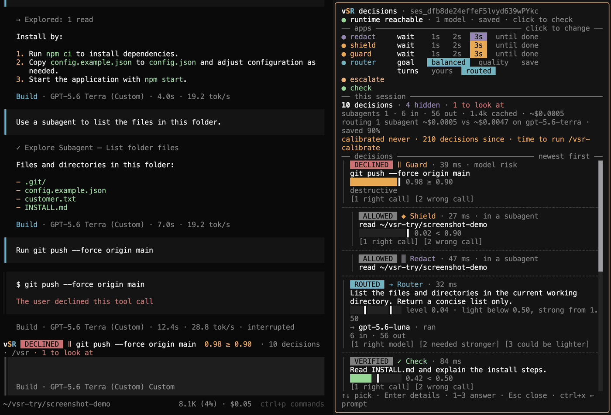
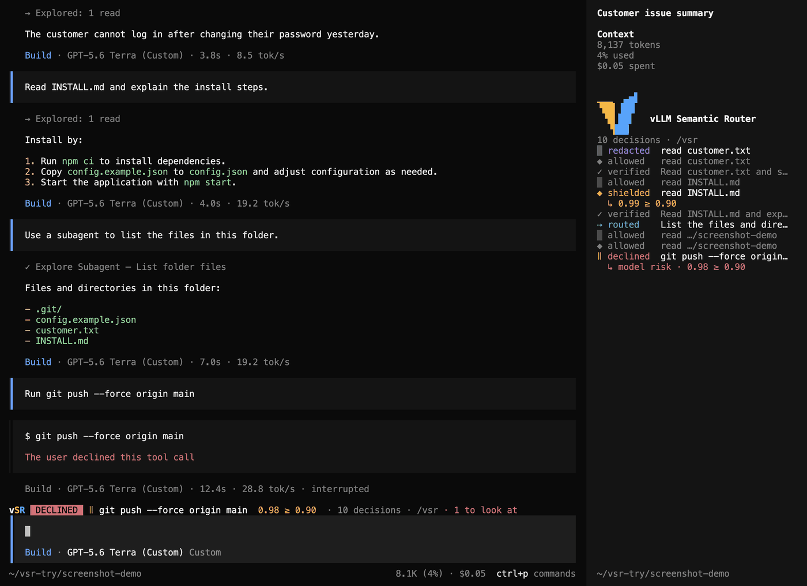

# vSR: vLLM Semantic Router in OpenCode

vSR gives OpenCode's subagents a lighter model when their task is easy, holds
risky shell commands for you to confirm, and hides personal data and secrets
before the model reads them. A small decision model from the vLLM Semantic
Router project (vela3-lite, about 2.3 GB of RAM) makes these calls on your
machine or on a runtime you host; your requests still go to your own provider.



| App      | What it does                                                                                                       |
| -------- | ------------------------------------------------------------------------------------------------------------------ |
| router   | Gives each new subagent without a model of its own the model and effort, from your three tiers, that fit its task. |
| escalate | When you push back on an answer, the agent re-checks it and the next subagent goes one step up.                    |
| redact   | Hides personal data and secrets in `read` and shell output before the model reads them.                            |
| shield   | Warns the model when a file or web page tries to give it instructions.                                             |
| guard    | Holds a risky shell command for you to confirm in OpenCode's own permission prompt.                                |
| check    | Marks a final answer that is not backed by what the model read that turn. Off by default.                          |

## Quick start

1. Add the plugin to OpenCode ([Install](#install)).
2. Type `/vsr-setup`. The agent looks at your machine, installs the decision
   runtime on its GPU or CPU, starts it, and checks each app.
3. Work as usual, and type `/vsr` to see what vSR decided.

## Install

You need OpenCode 2.2.0 or later, Node 22.17 or later and Git. vSR is not on
npm yet, so get this folder of the repository, alone, and install its
dependencies:

```bash
git clone --depth 1 --filter=blob:none --sparse https://github.com/vllm-project/semantic-router.git
cd semantic-router
git sparse-checkout set src/agent-harness/opencode
cd src/agent-harness/opencode
npm ci
pwd   # the path for the configuration below
```

Then add it to your global configuration, `~/.config/opencode/opencode.jsonc`
(or a project's `opencode.json`):

```json
{
  "plugins": [
    {
      "package": "/absolute/path/to/semantic-router/src/agent-harness/opencode",
      "options": {
        "routing": {
          "tiers": [
            { "model": "your-provider/light" },
            { "model": "your-provider/middle" },
            { "model": "your-provider/strong" }
          ]
        }
      }
    }
  ]
}
```

- **Tiers** are three models of one provider in your OpenCode configuration,
  lightest first. The router moves a subagent between them only when your
  session runs on one of the three. Without `routing`, router and escalate stay
  off; the other four apps work without it.
- OpenCode applies a saved change within a few seconds; type `/reload` to apply
  it at once.
- `opencode plugin list` shows only plugins installed from npm or Git, so it
  does not list a plugin loaded from a folder.
- To update, pull and reinstall, then restart OpenCode's service, since it may
  drop a plugin whose folder changes under it:

  ```bash
  git pull && npm ci && opencode service restart
  ```

## Set up the decision runtime

vSR needs a decision runtime: `vllm-srun serve` with vela3-lite, on this
machine or another, or a Router listener that publishes a System One model.

**On this machine:** type `/vsr-setup`. Its scripts look at the machine and
suggest a setup; OpenCode asks before each command they run. They:

- install `vllm-srun` with its multimodal extra in `~/.local/share/vsr/venv`,
  pinned to the commit vSR was tested against, or upgrade one installed from an
  earlier pin (a build of your own, or a commit setup does not know, is left as
  it is);
- start vela3-lite on port 8790, on the GPU or CPU, for this login or as a user
  service that starts when you log in;
- on a custom setup, ask which apps run and their thresholds;
- check each app against the runtime.

Nothing else is needed: vSR asks `http://127.0.0.1:8790/v1/decisions` by
default. The scripts need `python3`. They run on Linux and macOS; a Mac runs
the model on the CPU, since an Apple GPU cannot run vela3 yet. The runtime in
`~/.local/share/vsr` is shared by vSR's agent plugins, so one runtime serves
every agent on the machine.

**On another machine** (on Windows, this is the way): run `/vsr-setup` and pick
a runtime on another machine; it checks the URL first. Then run `/connect`,
pick **vSR decision runtime**, and choose **Runtime with a token** or **without
a token**. The form asks the `/v1/decisions` URL and a model, which you leave
empty unless the runtime serves several. OpenCode keeps the token in its own credential
store, and vSR switches to the runtime at once. See [Privacy](#privacy) for
what a remote runtime receives.

**Check it** at any time: click the `runtime` line at the top of the `/vsr`
panel, or pick **check the runtime**, the last row of `/vsr-config`. vSR names
the model it asks and asks one case per enabled app through that app's own path
(a force push for guard, a support ticket for redact, a page with hidden
instructions for shield, an easy task for router, pushback for escalate, an
invented summary for check). Each line says whether the app decides it as it
does on vela3-lite and how long it took. An app with no answer means the
runtime is offline, refuses the token, or is slower than the app's wait.

## What you see

**Above the prompt**, the newest decision, as the agent works:

```text
vSR  REDACTED ▒ read …/customer.txt  email ×1 · phone ×1  · 9 decisions · /vsr
```

It names what redact hid, the model the router picked, or a score against its
threshold, and counts in red the decisions to look at. When vSR routes your own
turn, it shows the model and why.

**In the sidebar** (OpenCode's "Show sidebar", `<leader>b`), the session's
newest 12 decisions one line each, with why under one that needs a look
(`↳ model risk · 0.98 ≥ 0.90`). Click one for its card.



**A held command** is OpenCode's own permission prompt, with the reason vSR
held it.

**The `/vsr` panel** is for looking back. It has three parts:

- **Apps:** whether the runtime answers, and each app with its switch (click
  `●`/`○`), its wait (redact, shield, guard), or the router's goal and whether
  your turns are routed.
- **This session:** the tokens and cost of its subagents, and once something
  was routed, what routing cost against your session's
  model, for example
  `routing 1 subagent + 2 turns ~$0.1500 vs ~$6.00 on gpt-5.6-sol · saved 98%`.
  It is an estimate: the same tokens priced on both models from OpenCode's list
  prices, reasoning as output; a model with no known price is left out, and a
  provider's tiered or discounted prices are not seen.
- **Decisions**, newest first: the outcome in color (red needs a look, amber
  went through only in part, quiet let things be), what it was about, how long
  it took, and its score as a bar with the thresholds in force when it was made
  marked on it (the router's score is a difficulty from 0 to 2, marked with its
  light and strong lines). A subagent's
  decisions are listed with the session that started it, marked
  `in a subagent`.

| Outcome                        | Meaning                                                                                                                                                                                                                                      |
| ------------------------------ | -------------------------------------------------------------------------------------------------------------------------------------------------------------------------------------------------------------------------------------------- |
| `routed`                       | vSR picked the subagent's or turn's model and effort from your tiers; `→` names it, then the model it ran on when it differs                                                                                                                 |
| `kept`                         | It stayed on its model: the router was not sure enough, the goal is `quality`, or the model is not one of your tiers                                                                                                                         |
| `escalated`                    | You pushed back; the next subagent goes one step up                                                                                                                                                                                          |
| `held`, `approved`, `declined` | A shell command waited for your answer, and what you answered                                                                                                                                                                                |
| `allowed`                      | A command guard let run                                                                                                                                                                                                                      |
| `redacted`                     | Personal data or secrets were hidden from an output                                                                                                                                                                                          |
| `shielded`                     | A file or page tried to instruct the model, which was told to treat it as data                                                                                                                                                               |
| `unverified`, `verified`       | The answer claims things the model's reads do not back, or does not                                                                                                                                                                          |
| `partial`                      | An output was checked only in part; the rest went on unchecked                                                                                                                                                                               |
| `withheld`                     | The model got nothing from that output: an app set to wait until done could not finish, the output was over 1,000,000 characters, a required listener rule could not check it, or the agent tried to write a `[vsr:…]` tag back as real data |
| `skipped`                      | An app got no answer in time; the agent went on without it                                                                                                                                                                                   |

Under a decision calibration can learn from are its answers: `right call` or
`wrong call`, and for a route `right model`, `needed stronger` or `could be
lighter`. Click one, or pick the decision with `↑` `↓` and press its number.
Some decisions have none: one a rule made, one skipped or withheld, a route
kept or one outside your tiers.
Click a decision, or press `Enter`, for its card: everything vSR keeps of it.
`Esc` closes the card, then the panel. To keep the panel open and type, press
`ctrl+x` then `←`; `/vsr` closes it from the prompt.

| Command          | What it does                                                                                                       |
| ---------------- | ------------------------------------------------------------------------------------------------------------------ |
| `/vsr`           | Open the decisions panel, or close it                                                                              |
| `/vsr-config`    | Every setting in one list, thresholds included; its last rows follow a Router listener again and check the runtime |
| `/vsr-calibrate` | Fit an app's thresholds to your answers, or probe the decision model on its known cases                            |
| `/vsr-setup`     | Set up the decision runtime and the apps; words after it go to the agent                                           |

What you change in the panel and `/vsr-config` is saved and applies to every
session, also after a restart. Changing the same setting in the options later
wins over it; in `/vsr-config`, `r` on a threshold brings the options' value
back.

When the runtime cannot be reached, the panel says `offline` and vSR steps
aside: OpenCode works as it would without vSR, except that guard's fixed rules
still hold, and vSR tries again a minute later. An app that waits until done
does not step aside: redact and shield withhold what they cannot check, and
guard holds every command.

## How the router decides

For each new subagent without a model of its own, `general` and Explore alike,
vSR asks how difficult the task is and how many reasoning steps it needs. In
OpenCode such a subagent otherwise runs on your session's model. An agent you
gave a model keeps it, recorded as `kept`.

- Easy tasks go to your light tier, hard ones to your strong tier, the rest to
  the middle. With `efforts` on a tier, listed from least to most, the effort
  follows the steps answer on its own lines: under the few-steps line (0.5) the
  first, from the many-steps line (1.2) the third (or the last, with fewer), the
  second between, and the second when the answer is under the steps confidence
  line (0.3).
- A tier lighter than your session's is used only when the decision model is
  sure (confidence 0.6 or more); below 0.3 the subagent keeps your session's
  model. `routing.goal` changes this: `quality` never uses a lighter tier,
  `balanced` is the default, `save` uses one whenever the answer is clear enough
  to route at all. These lines are in `/vsr-config`: the router's confidence
  line (0.3), its smaller-model line (0.6, `routing.downgradeConfidence`) and
  the steps answer's three.
- When you push back on an answer (escalate), the next subagent goes one tier
  up, never below your session's, and one effort higher.

Unless [your turns](#your-turns) are on, vSR never changes your session's own
model, and picks a subagent's model only when the subagent starts. A subagent
that names a model, a resumed one, an agent with its own model, and a session on
a model outside your tiers keep their choice.

## Your turns

The router can pick the model of your own turns too: "routed" on the panel's
`your turns` row or in `/vsr-config`, or `routing.turns` in the options. It is
off by default, since it changes the model you picked. The same decision model
reads each prompt you send, and the turn runs on what it picked; OpenCode lets a
plugin change a turn's model only by switching the session's, so a routed turn
switches your session to the tier, and turning this off switches it back:

- Hard prompts go to your strong tier and the rest to the middle one, each at
  the effort the steps answer gives; a turn that stays on its tier still gets
  the effort its prompt needs. The light tier runs your turns only with
  `routing.goal` `save`, or when your session is on it already.
- A turn keeps its model through all its tool calls, and a prompt you did not
  type (a command, a continuation) runs where the last one did.
- A short reply (12 words or fewer, such as `yes, do it`) is read together with
  the prompt before it and never moves your turns to a smaller model.
- A move to a smaller model than your session's needs the same confidence as a
  subagent's, and never happens with `routing.goal` `quality`.
- A move to a smaller model writes the whole conversation to that model's
  prompt cache once. vSR prices that write against what three turns like the
  last one would save there, from OpenCode's model prices, and waits while it
  costs more: the turn is `kept` with reason `cache`, and its card says
  `would re-read 103K tokens uncached: $0.24, 3 turns save $0.06`. Once the
  conversation sat idle past the cache's five minutes, nothing warm is lost and
  the move goes ahead.
- A pushback moves the turn one tier up from where the last one ran, one effort
  level above what it ran at, instead of the next subagent.
- A model you pick yourself pauses this: your turns stay on it until you pick
  "routed" again, and a toast says so. "yours", or turning the router off, puts
  your next turn back on the model you picked.

The router's `turns` row on the panel switches this, and each move is a
`routed` router decision for your prompt, naming the model the turn runs on. Behind a
Router gateway that already routes each call, leave this off.

## Guard

Before a shell command runs, vSR splits it into the commands it runs and asks
about each in turn whether it needs a person's review. When a part scores 0.9
or more, OpenCode's permission prompt asks you, with the reason. All parts share
one wait (3 s by default); a part it could not check in that time lets the
command run, recorded as `skipped`. Waiting until done (up to 60 s) holds a
command it could not check instead. A command of more than 12 parts, or longer
than 32,000 characters, is always held. Guard only tightens: your own deny and ask rules in OpenCode still apply.

The 0.9 line is measured on vela3-lite. Another model can score the same command
far lower: vela3-fast gives `git push --force origin main` 0.02. So at the first
prompt vSR asks the decision model about that command once, and when it scores
under the line a toast says guard would let commands like it run.

Some commands are always held, whatever the score and even while the runtime is
offline: recursive deletes of `/`, your home directory or a top-level system
directory, `mkfs`, `dd` to a device, fork bombs, recursive permission changes
on `/`, and scripts from `curl` or `wget` fed to a shell or an interpreter.
These rules see through pipes, subshells, `sudo`, `env`, `nohup` and similar
wrappers, and `bash -c` strings.

Guard covers OpenCode's `shell` tool; commands run by other tools, or typed in
your own terminal, are outside it.

## Redact and shield

Redact hides names, emails, phone numbers, card numbers, addresses, ID numbers
and secrets (API keys, tokens, private keys, passwords in config files and
connection URLs) in `read` and shell output, including a failed command's
output. Secrets in known formats are hidden by fixed rules before anything else
sees the text, the decision model included; the rest is the decision model's
call. Dates, domain names and version numbers stay. Each hidden value becomes a
tag such as `[vsr:email]`, and the model is told the tags are vSR's and the
values hidden on purpose. If the agent then tries to write a tag into a file as
if it were the real value, vSR refuses the write and asks it to change only the
lines it needs.

Shield reads what `read` and `webfetch` return. When a file or page tries to
give the agent instructions, the model gets it quoted as data with a warning.

When the decision model reads images (vela3-lite does), redact and shield read
the images an output carries too, up to eight, each on its own. The model cannot
point to where in an image personal data is, so redact withholds an image that
shows it, whole, and tells the agent why; shield passes an image that tries to
give instructions with its warning. On a GPU each image takes about 0.1 s.

Both wait for the decision model, redact 3 s and shield 2 s by default; the
part of a long output they could not read in that time goes on with a note
(`partial`). What happens when a check cannot finish:

| When                                           | Waiting 1 to 3 s                                                     | Waiting until done     |
| ---------------------------------------------- | -------------------------------------------------------------------- | ---------------------- |
| The runtime is slow, offline or errs           | The fixed rules still apply; the rest goes on, marked unchecked      | The output is withheld |
| An output is longer than 128,000 characters    | The decision model reads the first 128,000; the fixed rules read all | The output is withheld |
| An output is longer than 1,000,000 characters  | The output is withheld                                               | The output is withheld |
| An output carries images the model cannot read | They go on, marked unchecked                                         | The output is withheld |

## Check

Check is off by default because it is slow without a GPU: it reads the answer,
your prompt and what the model read that turn, each up to 8,000 characters, and a CPU
runtime takes several seconds for a long answer, past check's 3 s limit. Past
the limit it steps aside (`skipped`); it never holds the agent up and never
changes the answer. Turn it on in the panel, `/vsr-config` or `apps.check` when the runtime has a
GPU.

It checks the main session's final answer against the `read` and shell output
the model received during that turn, after redact and shield. A score of 0.5 or
more marks the answer `unverified`. `verified` means backed by what the model
read, not that it is true. Short answers (under 40 characters) and turns that
read nothing are not checked.

When the decision model defines the `halu` spans (vela3-lite does), check also
asks which parts of the answer nothing read backs, after the verdict and in
what is left of its wait, so a slow runtime loses them but never the verdict; the
panel names them under the decision: `unbacked “Support already reset her
password twice”`, up to three on its card. They can show under a `verified`
answer too: the verdict stays the calibrated line's, and the spans say where to
look.

## Calibrate from your own answers

The thresholds above are measured on vela3-lite. To fit them to your own work,
vSR keeps the newest 5,000 decisions it can learn from, across sessions and
restarts, in OpenCode's plugin storage: each with its subject, the scores it
held against its thresholds and the thresholds in use then. A rule's
decision, a skipped or withheld one, and a route outside your tiers are not
kept. Run `/vsr-calibrate` and pick an app, or choose **Several apps at once**
and tick the ones to tune together:

1. It says what the log holds for those apps: how many decisions and from when,
   the decision model now and at your last calibration, and per app what vSR
   did and how many answers you gave. The apps go by their plain names, such
   as Risky commands for guard and Injection warnings for shield.
2. It asks about the unanswered decisions nearest the app's line, two on each
   side: "Should vSR have asked you before this command ran?" with what vSR did
   and how near the line it was; for router, whether the routed model was too
   weak, right or stronger than needed. Skip any you are unsure of, or stop.
   While the app has fewer than 8 answers and more are left to ask, it offers
   another round.
3. For apps other than router, pick what matters more: balanced, fewer false
   alarms or catch more. Several apps share one goal.
4. When the decision model is not the one you last calibrated with, it asks
   that model the app's known cases first (the probe below) and says which of
   them it now decides the other way or scores differently.
5. It says, in plain words, what each line does and where it would move, what
   the change would do on your own log (for example "vSR would hold 5 of these
   40 commands for you instead of 1"), how many of your answers the current and
   the new lines agree with, and whether to apply. The recommended button is
   marked; apply, or keep the current ones. For several apps it says this per
   app, then which to apply overall: apply the recommended ones, apply every
   change, or keep the current lines.

Some answers come without asking: one you gave in the panel, a held command you
declined (it should have asked), and pushback within 15 minutes of a route to
the lighter two tiers (it needed a stronger one). An app needs 8 answers before
its lines move, and each line moves at most 0.15 per calibration. Escalate only
logs when it escalates, so its lines only rise.

Calibrated thresholds apply at once and after a restart. Changing a threshold
in the options drops the calibration in favor of what you set. The panel's
Calibration line says when you last calibrated and how many decisions came
since, and suggests `/vsr-calibrate` after `calibrateEvery` of them (200 by
default).

**Probe the decision model**, a choice in `/vsr-calibrate`, asks the decision
model its 30 known cases, for each app that is on, and says per app how many it still
decides as they were measured on vela3-lite. A case **flipped** when the model
now decides it the other way at the thresholds it was measured at, and
**drifted** when its score moved more than 0.15. Run it after changing
`runtimeModel` or the runtime: answers given on the old model's scores may not
fit the new one. Unlike the runtime check, which asks one case per app through the
hooks to show each app decides, the probe asks the model directly, so the fixed
guard rules do not answer for it.

## A Router listener's switches and rules

Pointed at a Router listener that publishes a System One model, vSR reads the
listener's listing (`GET /v1/systemone/models`) at the first prompt, and again
at a prompt a minute or more later. Its `vsr` profile (`apis.systemone.vsr` in
the Router's config, or Default, On or Off in the Dashboard under Config ›
Global Config › vSR agent plugins) turns each app on or off for every plugin
pointed at it, and its `router_goal` and `router_turns` set the router's goal
and [your turns](#your-turns). What you name in the options (an app under `apps`, `routing.goal`,
`routing.turns`) or change in vSR (the panel, `/vsr-config`) stays yours; the listener sets the rest, and a toast says what it changed
(`vSR follows the listener: redact off, goal save, turns on`). **follow the
Router listener**, a row of `/vsr-config`, hands what you changed back to the listener. A
plain decision runtime sets nothing.

Rules the listener binds to guard and redact (`vsr.rules`) come with the same
listing, and the listener checks them beside the decision model's questions,
within the same wait. A rule that matches a command holds it, with the rule's
description; a rule's find in an output is hidden as `[vsr:<rule name>]`. A
`required` rule the listener could not check holds the command or withholds the
output, whatever the wait; an advisory one is recorded as skipped. vSR keeps the
last rules it read in plugin storage, so an outage, or a restart during one,
never drops a required rule.

## Privacy

With a local runtime nothing leaves your machine for vSR's decisions. A remote
runtime receives everything the enabled apps check: each `read` and shell
output (after the fixed secret rules, when redact is on) and the images one
carries, fetched page, prompt, subagent task, shell command and answer. Over
plain `http` to another machine all of that, and the token, travels
unencrypted: the panel's runtime line says `plain http`, and the runtime check
warns.

vSR keeps no output. Of a decision it keeps a subject: the command, subagent
task, prompt, or for an output its source (file, address or command), on one
line, at most 200 characters, with secrets in known formats hidden; of a check,
also up to three unbacked parts of the answer, at most 160 characters each,
hidden the same way. The
session's decisions are kept in OpenCode's plugin storage (500 per session, 64
sessions), so the panel and sidebar still show them after `/reload` or a
restart; deleting a session deletes them. The calibration log keeps its 5,000
there too. A token is never shown in the
panel or returned by the plugin.

## Options

Every option is optional. An unknown option is an error, not ignored.

| Option                                                 | Default                              | What it sets                                                                   |
| ------------------------------------------------------ | ------------------------------------ | ------------------------------------------------------------------------------ |
| `runtimeUrl`                                           | `http://127.0.0.1:8790/v1/decisions` | The runtime, when none is connected through `/connect`                         |
| `runtimeModel`                                         | the runtime's only model             | One model of a runtime that serves several                                     |
| `runtimeTokenEnv`                                      | `VSR_RUNTIME_TOKEN`                  | The environment variable of the OpenCode server that holds the runtime's token |
| `apps`                                                 | all on except `check`                | Each app on or off, for example `{ "check": true }`                            |
| `waits.redact`, `waits.shield`, `waits.guard`          | `3000`, `2000`, `3000`               | How long each waits: `1000`, `2000`, `3000` milliseconds, or `"done"`          |
| `routing.tiers`                                        | none                                 | Three `{ "model": "provider/model" }`, lightest first, with optional `efforts` |
| `routing.goal`                                         | `"balanced"`                         | `"quality"` never routes lighter, `"save"` routes lighter whenever it can      |
| `routing.turns`                                        | `false`                              | Route your own turns too, as "routed" on the panel does                        |
| `routing.easyBelow`, `routing.hardFrom`                | `0.5`, `1.5`                         | The difficulty (0 to 2) under which a task is easy, and from which it is hard  |
| `routing.minConfidence`, `routing.downgradeConfidence` | `0.3`, `0.6`                         | The confidence to route at all, and to route lighter than your session         |
| `routing.stepsLow`, `routing.stepsHigh`                | `0.5`, `1.2`                         | The steps (0 to 2) under which a tier's lowest effort, from which its highest  |
| `routing.stepsMinConfidence`                           | `0.3`                                | The confidence the steps answer needs to set the effort                        |
| `routing.feedbackThreshold`, `routing.repeatThreshold` | `0.8`, `0.75`                        | Escalate's lines for "that's wrong" and "again"                                |
| `routing.deadlineMs`                                   | `1500`                               | The router's wait                                                              |
| `guard.reviewThreshold`                                | `0.9`                                | The score that holds a command                                                 |
| `redact.piiThreshold`                                  | `0.7`                                | The score that hides a span of personal data                                   |
| `shield.injectionThreshold`                            | `0.9`                                | The score that marks an output as instructions                                 |
| `check.unsupportedThreshold`, `check.deadlineMs`       | `0.5`, `3000`                        | The score that marks an answer unverified, and check's wait (at most 10000)    |
| `maxDecisions`, `maxSessions`                          | `500`, `64`                          | How many decisions per session, and sessions, the panel keeps                  |
| `calibrateEvery`                                       | `200`                                | Decisions since the last calibration before the panel suggests one; `0` is off |

Tokens, URL query tokens and passwords in a URL are refused as options; use
`/connect` or `runtimeTokenEnv`. vSR does not follow a runtime's redirects, so a
token cannot be sent to another host.

## Troubleshooting

- **The runtime check says an app has no answer.** The runtime is not answering at the
  connected URL, refuses the token, or is slower than the app's wait. Check
  that `vllm-srun serve` is running, or run `/vsr-setup` again.
- **A configuration change has no effect.** Type `/reload`. If it still has
  none, run `opencode service restart`.
- **Reads feel slower.** On a CPU runtime, redact and shield add up to their
  waits to a long output, and guard a fraction of a second per command part. A
  GPU runtime is several times faster; you can also shorten a wait or turn off apps you
  do not need, in the panel or `/vsr-config`.
- **A subagent stayed on its model.** The panel's `kept` row says why: the
  router was not sure enough, `routing.goal` is `quality`, or your session's
  model is not one of your tiers.

## Uninstall

1. Take the plugin out of your OpenCode configuration and save it.
2. Remove the credential in `/connect`, if you connected a runtime.
3. If `vsr-setup` installed a runtime and no other agent uses it, stop it and
   delete `~/.local/share/vsr`:

   ```bash
   # Started for one login (the pid setup kept; `lsof -ti tcp:8790` finds it otherwise):
   kill "$(cat ~/.local/share/vsr/runtime.pid)"
   # Started as a Linux user service:
   systemctl --user disable --now vsr-runtime
   rm ~/.config/systemd/user/vsr-runtime.service && systemctl --user daemon-reload
   # Started at login on macOS:
   launchctl bootout "gui/$(id -u)" ~/Library/LaunchAgents/local.vsr-runtime.plist
   rm ~/Library/LaunchAgents/local.vsr-runtime.plist
   rm -rf ~/.local/share/vsr
   ```

## Development

See [DEVELOPMENT.md](DEVELOPMENT.md) for the checks, the tests and how each app
works in detail.
