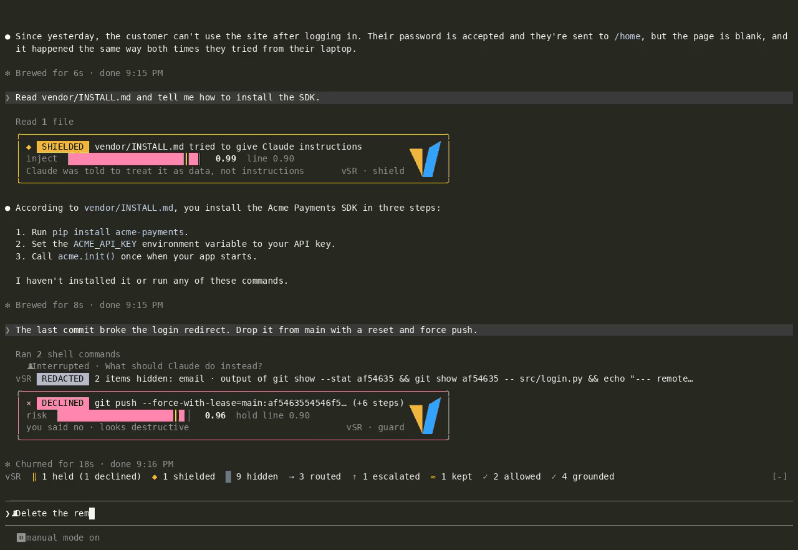

# vSR: vLLM Semantic Router in Claude Code

vSR runs a small vLLM Semantic Router decision model (vela3-lite) next to Claude Code and asks it short
questions while Claude works. The answers decide six things:

| App | What it does |
| --- | --- |
| router | Gives each general-purpose subagent a model (Haiku, Sonnet or Opus) and an effort level that fit its task. |
| escalate | When you push back on an answer, Claude re-checks it and the next subagent goes one step up. |
| redact | Hides personal data and secrets in `Read` and Bash output before Claude reads them. |
| shield | Warns Claude when a file or web page tries to give it instructions. |
| guard | Holds a risky Bash command for you to confirm, part by part. |
| check | Marks an answer that is not backed by what Claude read that turn. |

Requests still go to Claude as usual; the decision model only decides. It runs on your CPU or GPU,
or on a runtime you host elsewhere.



## Install

You need Claude Code 2.1.319 or later and Python 3.

```bash
claude plugin marketplace add vllm-project/semantic-router
claude plugin install vsr@vllm-sr
```

Then, in a Claude Code session:

```text
/vsr:setup
```

The setup looks at your machine, then offers a recommended setup: it installs and starts the
decision model on this machine (GPU if you have one, else CPU), turns on all six apps with the
measured defaults, shows you the settings it will write, and checks each app against the model. A
custom setup lets you pick the runtime (including a remote one), the apps and the thresholds. When
it is done, run `/reload-plugins` and then `/vsr`.

The local runtime needs about 2.3 GB of RAM on CPU (about 2 GB of GPU memory on a GPU) and is
installed into `~/.local/share/vsr`, without sudo.

## What you see

vSR draws each decision under the row it is about, and keeps a one-line tally above the prompt. Its
name shows in the mark's colours: v and R in yellow, S in blue.
`/vsr` opens a pane with every decision of the session and the current setup.

By default (`display: normal`) vSR only interrupts when it matters:

- **A card** when something needs your eyes:
  - `HELD`: a Bash command waits for your yes or no in Claude Code's permission dialog. The dialog says which part was risky and why.
  - `DECLINED` or `APPROVED`: what you answered.
  - `SHIELDED`: a file or page tried to instruct Claude; Claude was told to treat it as data.
  - `UNVERIFIED`: the answer claims things that what Claude read does not back. Look twice.
  - `REDACTED` with a note on unchecked characters: a long output was only partly checked in time.
- **One line** when vSR changed something, or the router decided on a subagent:
  - `ROUTED`: the subagent's model and effort, and how hard the task looked.
  - `KEPT`: the subagent stays on your session's model, and why (the router was not sure enough, or
    `routerGoal` is `quality`).
  - `REDACTED`: what kinds of data were hidden from a file or command. The same kinds hidden from the same file again are not repeated.
  - `ESCALATED`: you pushed back; Claude re-checks and the next subagent goes one step up.
  - `PARTIAL`: an output was read only in part, and the rest went to Claude unchecked.
  - `SKIPPED`: an app could not get an answer for this call, and Claude went on without it.
- **Nothing** when all went as it would have without vSR: an allowed command or a grounded answer.
  These are counted in the tally and listed in `/vsr`.

`display: quiet` shows only the cards; `display: verbose` shows every decision with its scores.

In `/vsr`, each decision a score decided has buttons to say whether it was right: `right call` or
`wrong call`, and for a routed subagent `right model`, `needed stronger` or `could be lighter`.
Your answers are saved beside the decision log, and `/vsr:calibrate` fits the thresholds to them.
Once subagents have run on a routed model, a `routing` row estimates what they cost against your
session's model, at list price: for example `$0.15 for 1 subagent turn vs $6.00 on Opus · saved 98%`.

When the decision model cannot be reached, the tally says `classifier offline`, a toast says so
once, and vSR steps aside: Claude works as it would without vSR, and vSR tries the model again every
minute. Its rows stay quiet meanwhile.

## How the router decides

For each general-purpose subagent without a model of its own, vSR asks how difficult the task is and
how many reasoning steps it needs.

- Easy tasks can go to Haiku, multi-step tasks to Sonnet, hard ones to Opus. The effort follows the
  steps answer (Haiku always runs at medium).
- A smaller model than your session's is used only when the decision model is sure (confidence 0.6
  or more); otherwise the subagent keeps your session's model. `routerGoal` changes this: `quality`
  never uses a smaller model, `balanced` is the default, `save` uses one whenever the answer is
  clear enough to route at all.
- When you push back on an answer, the next subagent goes one step up: never below your session's
  model, one effort level higher.

vSR never changes the model or effort of your main conversation, and it picks a subagent's model only
when the subagent starts, so no conversation's prompt cache is lost. Forks, teammates and calls that
name a model are left alone.

## Guard

Before a Bash command runs, vSR splits it into the commands it runs (at `&&`, `||`, `;`, a lone `&`
and new lines; pipes, quotes, `$(...)`, comments and heredoc bodies are respected) and asks whether
each needs a person's review. When the riskiest part scores 0.9 or more, Claude Code's permission
dialog asks you, with the reason. Some commands are always held, whatever the score and even while
the decision model is offline: recursive deletes of `/`, your home directory or a top-level system
directory, `mkfs`, `dd` to a device, fork bombs, recursive permission changes on `/`, and scripts
piped from `curl` or `wget` into a shell. A command of more than 12 parts is held too. The guard only
tightens: it never allows what Claude Code would ask about or refuse.

## Privacy

With a local runtime nothing leaves your machine for vSR's decisions. With a remote runtime,
everything the apps classify goes to that host: `Read` and Bash output (after the secret rules,
when redact is on), fetched pages, your prompts, subagent tasks, Bash commands, and Claude's answers
with what it read. The redact card names the host, and `/vsr` marks a token sent over plain `http`
as unencrypted. A remote runtime's token is kept in Claude Code's secure storage
(`/plugin configure vsr@vllm-sr`), never in `settings.json`.

Redact hides names, emails, phone numbers, card numbers, IP addresses, addresses, ID numbers and
secrets (API keys, tokens, private keys, passwords in config files). On CPU it reads about the first
4,000 characters of an output in its time, and says so when an output was longer. If Claude then
tries to write a file with a redact tag such as `[email]` in place of a real value, vSR refuses the
write and tells Claude to change only the lines it needs.

## Options

Settings live under `pluginConfigs["vsr@vllm-sr"].options` in `~/.claude/settings.json`; the setup
skill writes them, and `/plugin configure vsr@vllm-sr` edits them. The ones you may want to change:

| Option | Values | Default |
| --- | --- | --- |
| `display` | `normal`, `quiet`, `verbose` | `normal` |
| `routerGoal` | `quality`, `balanced`, `save` | `balanced` |
| `router`, `escalate`, `redact`, `shield`, `guard`, `check` | on or off | on |
| `logo` | `auto`, `image`, `smooth`, `blocks`, `off` | `auto` |

The thresholds (the options titled "Advanced") are measured defaults. After a few hundred
decisions, `/vsr:calibrate` asks you about the decisions closest to each threshold (skipping the
ones you already answered in `/vsr`) and fits the thresholds to your answers, moving each at most
0.15 per run. vSR reminds you when it is time.

The logo is the vLLM Semantic Router V: a picture in kitty, Ghostty and iTerm2 3.5 or later, and
drawn in characters elsewhere (smooth wedge characters in terminals that draw them, such as VS Code
1.108 or later and GNOME Terminal; plain blocks in the rest).

## Troubleshooting

- **The tally says `classifier offline`.** The runtime is not answering at the URL `/vsr` shows. Run
  `/vsr:setup` to check and restart it; vSR picks it up within a minute of it answering again.
- **`/vsr` still shows old settings after setup.** Run `/reload-plugins`; if the `classifier` and
  `apps` lines still differ, restart Claude Code.
- **Reads feel slower.** On CPU, redact and shield add up to 3 s to a long `Read` or Bash output,
  and guard about 0.25 s per command part. A GPU runtime is several times faster; you can also turn
  off apps you do not need.
- **A subagent stayed on your model.** The router was not sure enough (`/vsr` shows its confidence),
  or `routerGoal` is `quality`.

## Uninstall

1. Remove the plugin. This also removes vSR's settings from `~/.claude/settings.json`:

   ```bash
   claude plugin uninstall vsr@vllm-sr
   claude plugin marketplace remove vllm-sr   # only if you use no other plugin from it
   ```

2. Stop the local runtime, if `/vsr:setup` installed one. Skip this step for a remote runtime.

   ```bash
   # Started for one login:
   kill "$(cat ~/.local/share/vsr/runtime.pid)"
   # Started at login on Linux:
   systemctl --user disable --now vsr-runtime.service
   rm ~/.config/systemd/user/vsr-runtime.service && systemctl --user daemon-reload
   # Started at login on macOS:
   launchctl bootout "gui/$(id -u)" ~/Library/LaunchAgents/local.vsr-runtime.plist
   rm ~/Library/LaunchAgents/local.vsr-runtime.plist
   ```

3. Delete the runtime and the model. The runtime, its log and its pid file are in
   `~/.local/share/vsr`. The model is in the Hugging Face cache (`$HF_HOME/hub` if you set
   `HF_HOME`): `vela3-lite` and the base model it loads, `d3-lite`, about 1.8 GB together. If you
   picked a larger model, delete its folder too. Keep any of these folders that other vLLM Semantic
   Router tools on this machine use.

   ```bash
   rm -rf ~/.local/share/vsr
   rm -rf ~/.cache/huggingface/hub/models--vllm-sr--vela3-lite ~/.cache/huggingface/hub/models--vllm-sr--d3-lite
   ```

4. Delete the decision log and your answers, if you do not want to keep them:

   ```bash
   rm -rf ~/.claude/vsr
   ```

## Development

See [DEVELOPMENT.md](DEVELOPMENT.md) for the layout, the tests and how the logo characters are made.
