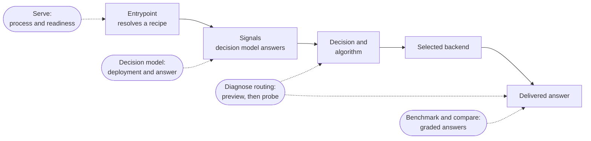

We sent a coding question through a local vLLM Semantic Router. It came back
HTTP 200 with the right route headers: the `code-route` decision and an
`upstream` response path. It contained no answer. A 128-token cap had ended the
backend's reply while it was still reasoning. Every check that looked only at
the status code or the route passed; the user still got nothing.

That is the gap these skills address. A request reaches the Router through a
public entrypoint. The Router evaluates signals, chooses a decision and
algorithm, selects a backend, and applies recipe-scoped plugins. A useful
assistant must know where in that chain an observation came from. A healthy
process does not prove a request took the intended route, a correct route does
not prove an answer arrived, and an improved benchmark score does not prove two
runs were comparable.

We have started publishing focused [agent skills](/docs/installation/agent-skills)
for those jobs. They give a coding assistant a short workflow, point to the
current commands and contracts, and say which evidence to preserve. This work
was inspired by [llm-d's skills article](https://llm-d.ai/blog/skills-for-accelerated-llm-d-development-evaluation-and-configuration).
Here, the unit of work follows the Semantic Router's entrypoint, recipe,
decision model, and measured request. That scope matters: starting a process,
selecting a route, delivering an answer, and measuring a workload are four
different results.

To try one, give a coding agent with terminal access a one-line prompt:

```text
Read https://vllm-sr.ai/install/agent/vllm-sr-serve/SKILL.md
and start a local CPU stack.
```

Swap in any skill from the table below. For the full install-to-tuning
lifecycle, use the prompt in the [agent installation guide](/docs/installation/agent).

<!-- truncate -->

## Choose the question first

The [operations skill](https://vllm-sr.ai/install/agent/vllm-sr/SKILL.md)
remains the broad guide for installation, upgrades, rollback, backup, and
teardown. The new skills answer narrower questions:

| Question | Skill | Result to review |
| --- | --- | --- |
| How do I start the local Router or decision model? | [Serve](https://vllm-sr.ai/install/agent/vllm-sr-serve/SKILL.md) | Runtime status, readiness, and a bounded probe |
| Which model answers a routing signal? | [Decision model](https://vllm-sr.ai/install/agent/vllm-sr-decision-model/SKILL.md) | Question-to-deployment map and traced answer |
| How should this workload enter a recipe? | [Configure recipe](https://vllm-sr.ai/install/agent/vllm-sr-configure-recipe/SKILL.md) | Baseline, candidate diff, validation, and plan |
| Where did this request go wrong? | [Diagnose routing](https://vllm-sr.ai/install/agent/vllm-sr-diagnose-routing/SKILL.md) | Preview, routed probe, and first failing boundary |
| What happened on a frozen workload? | [Benchmark](https://vllm-sr.ai/install/agent/vllm-sr-benchmark/SKILL.md) | Manifest, run ID, coverage, and report |
| Is candidate B better than A? | [Compare configurations](https://vllm-sr.ai/install/agent/vllm-sr-compare-configurations/SKILL.md) | Compatible paired runs, uncertainty, and cost basis |
| What should a recipe maintainer change next? | [Tune recipe](https://vllm-sr.ai/install/agent/vllm-sr-tune-recipe/SKILL.md) | Diagnostic case, guard floors, candidate, and handoff |

These skills compose in a natural order, but an agent can start with the one
question the user has. A diagnosis may end at an unavailable decision-model
deployment; it should not invent a routing fix. A comparison may end with
insufficient paired coverage; it should not convert two illustrative answers
into a quality claim.

## Two model jobs inside one request

The decision model answers a question *for the Router*. For example, a
model-backed `code` signal might judge whether a request is about programming.
The answer-model backend handles the user's prompt after a route is selected.
These models can be deployed separately, have different readiness states, and
fail at different points. A direct System One answer shows that a decision
model answered a question; it does not show that the Router selected the
intended recipe or that an answer backend responded.

The public entrypoint resolves to a recipe. That recipe determines which
signals to evaluate and which decisions, algorithms, and plugins apply. A
signal can also be a request fact, such as input modality, rather than a model
question. The decision-model skill maps each model-backed question to its
deployment and checks the answer and trace. The diagnosis skill then follows
the evaluated signal through the decision and algorithm to the selected
backend. This gives a contributor a concrete place to look when the final
model name is surprising: the question may be unknown, a predicate may not
match, a higher-priority decision may win, or execution may still be needed to
select the final model.

The figure shows one request's path and where each skill looks.



That separation also changes what a health check means. A Router process can
be healthy while a used decision deployment is loading. A decision deployment
can be ready while a particular question returns no usable answer. And a
correct route can still lead to an upstream timeout, a guard response, or an
answer cut short by its token budget. The skills ask for the observation at
each boundary instead of inferring the entire path from a single HTTP status.

## From workload to a routed request

The configure-recipe skill starts from the live config and a workload brief.
Its [two-backend fixture](https://github.com/vllm-project/semantic-router/tree/main/tools/agent/skills/vllm-sr-configure-recipe/fixtures)
shows a small, reviewable edit: keep the listener and providers, add a `code`
recipe, and expose it as `example/code` while retaining `vllm-sr/auto` as the
default. The assistant validates both documents, inspects the diff, and plans
the replacement against a running management endpoint before suggesting an
apply. Placeholder backends in that fixture are deliberately not treated as
reachable services.

When a deployed request behaves unexpectedly, the diagnosis skill freezes the
request and active config identity. It uses route preview to inspect signal
evaluation and the selected decision, then sends a bounded probe through the
public listener to inspect actual delivery. Its [three-case walkthrough](https://vllm-sr.ai/install/agent/vllm-sr-diagnose-routing/SKILL.md#three-case-diagnostic-walkthrough)
separates an expected route, an unknown or fallback route, and an upstream
delivery failure. That distinction matters because each case points to a
different repair.

The decision-model skill answers a related but distinct question: which
deployment serves a model-backed signal, what model card and readiness should
be checked, and what answer appeared in the trace? The serve skill uses the
existing `vllm-sr serve` local-image flow for a local stack and records both
process readiness and a routed or System One probe.

There is a useful review boundary here. Validating a candidate configuration
checks its structure; planning it against a running stack shows the proposed
replacement and the active version it targets. Neither step activates it.
Only after an approved change is applied can a preview describe the new active
route. A public-listener probe is another step: it checks that the selected
path actually returned a usable response. Keeping these receipts separate
makes it possible to say precisely whether a problem is in the proposal,
activation, selection, or delivery.

## From a run to a defensible comparison

The benchmark skill prepares a workload manifest and freezes its case IDs,
profile, grader, target, and source digest before dispatch. Its
[two-case smoke fixture](https://vllm-sr.ai/install/agent/vllm-sr-benchmark/references/two-case-smoke.md)
is synthetic and public. Preparing it checks the data path without making a
model call. A real result still needs reachable Router and model backends,
reviewed call and cost bounds, and saved run IDs.

The comparison skill starts with a direct single-model reference and checks
that each Router run used compatible cases, request profiles, graders, and
price assumptions. It reports paired, failed, and missing denominators
alongside uncertainty for each Router run against that reference. Its
[worked example](https://vllm-sr.ai/install/agent/vllm-sr-compare-configurations/references/paired-evidence.md)
is illustrative: with only two cases, even a valid paired calculation cannot
support a broad quality or savings claim. The tune-recipe skill uses that
evidence to propose a bounded recipe change and hands the candidate back for
validation and a fresh before/after run.

The run identity matters as much as the score. If two reports use different
case sets or graders, their headline percentages are not a paired comparison.
If a Router run lacks its active config hash, it is unclear which policy was
measured. If a failed call disappears from the denominator, the apparent gain
can be misleading. The benchmark and comparison skills therefore preserve
the dataset and plan digests, target and configuration identities, completed
and failed counts, and the assumptions behind any cost estimate. A comparison
can be valid yet inconclusive; that is still a useful result because it tells
the maintainer what evidence to collect next.

## What we have verified

The [workflow guide](/docs/installation/agent-skills) records offline fixture
digests and a [local live smoke receipt](https://github.com/vllm-project/semantic-router/blob/main/tools/agent/skills/vllm-sr-benchmark/fixtures/local-ollama-smoke-receipt.json).
On a CPU Colima VM, a v0.5 Router loaded Vela 2.0 0.3B for a model-backed
signal and routed to a local Ollama `qwen3:8b` backend. A public listener probe
returned a complete answer with the expected `code-route` decision and
`upstream` response path.

That probe is the one from the opening. The first attempt returned HTTP 200
and the right route headers, but its 128-token cap ended the answer in
reasoning with no final text. The same request passed the delivery assertion
with a reviewed 512-token cap. The [receipt](https://github.com/vllm-project/semantic-router/blob/main/tools/agent/skills/vllm-sr-benchmark/fixtures/local-ollama-smoke-receipt.json)
records both outcomes without publishing the reasoning text.

We then ran two synthetic development cases through a direct single-model
reference and two Router configs. All three runs completed and graded 2/2.
The Router configs differed only in the code-signal threshold; one selected
`code-route` twice, the other `default-route` twice. sr-bench accepted both
as comparable to the direct reference. Each two-case comparison found zero
observed quality difference but a conservative 95% interval of `[-1, 1]`.
That is the widest interval a difference of accuracies can have, so two cases
tell us nothing yet about which config is better.
Prices were not supplied, so there is no cost-savings result. The service
does not provide a direct A-versus-B interval from these comparisons.

This smoke proves that the workflow can preserve route and run identities,
execute bounded calls, grade the frozen cases, and reject unsupported
conclusions. A larger independent workload, priced usage, and a prespecified
direct comparison are still needed before making quality, latency, or savings
claims. The skill catalog, public mirrors, links, and command references also
have repository checks.

Each public `SKILL.md` is generated from a repository-authored source. That
keeps an installable copy available to an agent without a checkout while the
source, examples, and checks evolve with the Router. The
[skill catalog](https://github.com/vllm-project/semantic-router/blob/main/tools/agent/skills/README.md)
is the entrypoint for contributors who want to improve a workflow or add a
case we missed.
