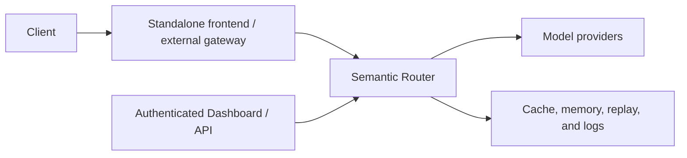

# Security Hardening

Semantic Router sits on the request path between clients and model providers.
Treat it as part of the application's trust boundary: it can inspect prompts,
choose providers, mutate requests, and optionally retain routing data.

This guide highlights the controls that need an explicit production decision.
It does not replace the identity, network, secret-management, and data-governance
controls of the surrounding platform.

## Map the trust boundaries



Review each boundary separately:

- who can call inference endpoints;
- which identity claims the Router trusts;
- which models and tools each role may use;
- where provider credentials are stored;
- which requests may leave the local environment;
- what prompts, responses, and route metadata are retained; and
- who can change configuration or inspect stored data.

## Protect the public listener

The standalone frontend strips untrusted identity and proxy-control headers.
Configure listener API keys, Chat model allowlists, and native model grants
separately; see [Gateway Modes](gateway-modes). Do not treat a Dashboard login
as a public inference credential.

The maintained Envoy configuration also removes internal control headers. Keep
that boundary when supplying a custom Envoy or gateway configuration. Internal
examples include:

```yaml
request_headers_to_remove:
  - x-authz-user-id
  - x-authz-user-groups
  - x-vsr-delegated-credential
```

Do not expose Router management, metrics, ExtProc, or backing-store ports as
public inference endpoints. Terminate client authentication at a trusted
boundary and allow only that component to supply identity headers and the
delegated credential described below.

Relevant Dashboard permissions include:

| Permission | Purpose | Default roles |
| --- | --- | --- |
| `feedback.submit` | Submit routing feedback. Read-role feedback is recorded on the replay without updating model experience. | admin, write, read |
| `replay.read` | List replay records. | admin, write, read |
| `logs.read` | Read bounded local-stack service logs. | admin, write |

The Router management API distinguishes replay metadata from replay detail.
The Dashboard service can retrieve complete records, then removes captured
bodies and tool payloads for users who do not have configuration-write access.
It does not receive permission to reveal stored secret values.

See the [management API reference](../api/apiserver) for endpoints and response
contracts.

## Keep credentials out of configuration

Use environment references in canonical YAML:

```yaml
api_key: ${MODEL_API_KEY}
```

Do not commit literal API keys, passwords, authorization headers, credential
query parameters, or URLs containing user information.

For `vllm-sr serve --target kubernetes`, the CLI places sensitive environment
values in an immutable Secret revision, scoped to the namespace and Helm
release:

- **By name only.** Helm values and the Deployment reference the Secret by
  name; they don't contain the credential value.
- **Safe upgrades.** A failed upgrade keeps the previous workload and Secret
  active.
- **Cleanup.** Release-owned old revisions are removed only once nothing
  references them.

Existing chart-native Secret references, such as a Dashboard JWT Secret, remain
external objects and are not copied into the CLI-managed Secret. Use the same
namespace and release ownership discipline for every manually managed Secret.

### Delegate the user's credential to an upstream

Some upstreams authorize each user themselves: a LiteLLM, one-api or similar
relay issuing per-user virtual keys, or a decision-model API metered per user.
When the Router sits behind an authenticating deployment layer, let the
authenticator hand the Router the credential it issued that user, and mark the
upstream's auth `credential: delegated`.

The credential that authenticates the client to the deployment and the
credential meant for the upstream are separate trust objects: the Router never
forwards the client's raw `Authorization` header.

```yaml
global:
  services:
    authz:
      delegated_credential:
        enabled: true
        header: x-vsr-delegated-credential   # default; set by the authenticator
  model_catalog:
    deployments:
      team-decisions:
        provider: systemone
        endpoint: https://decisions.example.com/v1/systemone
        model: vllm-sr/d3-ultra
        auth:
          credential: delegated              # a decision-model deployment
providers:
  models:
    - name: gpt-4o
      provider_model_id: gpt-4o
      api_format: openai
      backend_refs:
        - name: litellm
          endpoint: https://litellm.internal/v1
          provider: openai-compatible
          auth:
            credential: delegated            # a provider backend
```

Every upstream the Router calls takes one `auth` block of the same shape: a
provider backend, a decision-model or remote embedding deployment, the judge
model of an `escalate` stage and an `api_format: systemone` target alike. It
has one of three modes:

| Mode | Set with | Calls carry |
| --- | --- | --- |
| Static key | `auth.api_key_env` or `auth.api_key_file`, or a backend's `api_key` | the Router's own key |
| Delegated | `credential: delegated` | the requesting user's credential |
| None | neither | no credential |

The delegated contract is disabled by default. Once it's enabled, the rules
below apply.

#### Where the credential comes from

The delegated credential is an authentication output, like the identity
headers:

- **The shipped Envoy configurations** (`vllm-sr serve --gateway extproc` and
  `deploy/local/envoy.yaml`) remove a client-supplied copy in a filter ahead
  of ext_proc. The `vllm-sr` template removes a custom `header` too;
  `deploy/local/envoy.yaml` names only the default.
- **Your authenticator goes after that filter.** Neither configuration runs an
  authenticator, so a deployment that issues the credential places its
  authenticator after that filter and before ext_proc, as the
  `delegated-credential` E2E profile does.
- **A custom gateway** must do the same: `request_headers_to_remove` runs only
  after ext_proc.
- **A standalone listener** drops the header, from Chat and System One
  requests alike, unless `identity.trust_headers` is set.
- **The user must be known.** The Router keeps the value only when the request
  also carries the authenticated user
  (`global.services.authz.identity.user_id_header`).
- **A dedicated header.** Configuration rejects a `header` that carries a
  client credential (`Authorization`, `api-key`, `x-api-key` and similar) or
  an identity header.

#### Where it goes

- **Removed from every other request.** The Router removes the header from
  every upstream request, on every branch, and redacts it from logs.
- **An internal secret.** It's the one `x-vsr-*` request header the Router
  reads from the authenticator instead of dropping, and the header registry
  records it as an internal secret: no response, `x-vsr-trace` member, Router
  Replay record or cache key carries it.
- **Only delegated upstreams receive it,** under that upstream's auth header
  with its prefix (`Authorization: Bearer <credential>` for an
  OpenAI-compatible backend or a System One API), replacing whatever the
  client sent there.
- **No other client credential.** The client's other credential headers are
  removed, so a backend that authenticates on `x-api-key` doesn't also receive
  the client's `Authorization`.

#### Which calls carry it

The principal is a property of the call:

- **Calls made for a client request** carry that request's credential: primary
  dispatch, fallback attempts, Looper hops, System One decision-model calls,
  `escalate` judges, `api_format: systemone` targets, response checks and
  recall embeddings. When the request carries none, the Router answers `401`
  before the call, and a fallback chain or Looper run that reaches such a call
  ends with that `401` instead of another model's answer. A guard that keeps
  true streaming makes its check only after the client received the answer, so
  a refused check does not refuse that answer, but no response cache, memory or
  stored Responses object keeps it.
- **Calls the Router makes on its own behalf** never carry it, and a delegated
  upstream refuses them: probes, model listings, `router_replay.shadow`
  copies, automatic-output render, store building and management diagnostics.

#### What configuration rejects

- a delegated upstream that also names a static key, so a shared key can never
  stand in silently;
- a delegated upstream without the contract enabled;
- a delegated upstream that only the Router's own calls reach, or that a
  Router-own call must reach: vector store ingestion, memory storage, a
  `model_runtime` endpoint's health checks and preparation,
  `router_replay.shadow`, automatic output;
- a delegated `openai_embeddings` deployment without
  `capabilities.dimensions`;
- a delegated and a static backend in one cluster.

#### Answers stay with their user

- **No sharing across users.** An answer obtained with one user's credential is
  served back only to that user. While any upstream is delegated, every
  `response_cache` keeps its default `scope: user`, and the Router keeps no
  decision-model answer or embedding of a delegated deployment for another
  request.
- **One request per call.** The Router never puts two client requests in one
  upstream call, so a batched System One call carries one request's questions
  and that request's credential.
- **Policy stays upstream.** Caller attribution and any tenant, quota, budget
  or spend policy stay with the upstream.

### Isolate sr-bench credentials

The Dashboard proxies a server-owned sr-bench origin and forwards
authenticated user ownership:

- **The service token.** `SR_BENCH_TOKEN_ENV` names its environment variable
  (default `SR_BENCH_TOKEN`). Keep it separate from model API credentials and
  Router management credentials.
- **Fixed targets.** Browser manifests can't change registered target
  endpoints, prices, credential references or execution harness options.

The managed core worker receives only the registered model credential references
and its service token through inherited environment variables, not command-line
values. Its private store and adjacent token file live outside the common Router
and Dashboard mounts; the worker has no Docker socket or GPU passthrough.
Dashboard receives the service token but not model credential values.

For code and agent evaluation, use an independently prepared worker host, and
set `SR_BENCH_URL` to an authenticated origin the Dashboard can reach. The
standalone service binds loopback by default and needs a service token to bind
anything else; keep its source, sandbox and model credentials on that host.
See [sr-bench 1.0](../benchmarking/sr-bench) for setup and limits.

## Secure the local stack's storage credentials

`vllm-sr serve` provisions Redis and Postgres for the local stack, so it also
owns their credentials. Each stack generates its own on first start. No value
ships in this repository, and nothing falls back to a shared default.

Where the material lives:

| Artifact | Path under `<state-root>/.vllm-sr/storage-secrets/` | Mode |
| --- | --- | --- |
| Credential state | `secrets[.<stack>].json` | `0600` |
| Postgres password | `postgres-password[.<stack>]` | `0600` |
| Redis config | `redis[.<stack>].conf` | `0644` |

The directory itself is `0700` and owner-verified, so every file in it is
unreachable by other users. The Redis config is `0644` on purpose: the Redis
image drops to an unprivileged user before reading it, and the bind mount
resolves inside the container without traversing the host's private parent.

The values reach their consumers without entering any shared surface:

| Consumer | Gets the value from |
| --- | --- |
| Postgres | The mounted password file, via `POSTGRES_PASSWORD_FILE` |
| Redis | `requirepass` in its mounted config |
| Router | Inherited environment names; the generated runtime config carries only `${VLLM_SR_STACK_POSTGRES_PASSWORD}` and `${VLLM_SR_STACK_REDIS_PASSWORD}` |
| Dashboard | Never gets them |

They never appear in a `docker` command line, a generated config file, a log
record or a report artifact.

These credentials authenticate network peers. They do not constrain a caller
that can reach the container runtime directly: the Postgres image trusts local
socket connections, so anyone able to `docker exec` bypasses the password. Keep
[container-runtime access](#limit-container-runtime-access) restricted
accordingly.

### Network layering

The local stack runs on two bridge networks.

| Container | `vllm-sr-network` | `vllm-sr-data-network` |
| --- | --- | --- |
| Redis, Postgres, Milvus | no | yes |
| Router | yes | yes |
| Envoy, Dashboard | yes | no |
| Jaeger, Prometheus, Grafana | yes | no |

- **Router is the only container on both.** Requests reach it over the
  application network, and it reaches the stores over the data network.
- **Per stack.** A named stack prefixes both network names, so two stacks
  share neither.
- **Milvus** joins the data network, even though it has no credentials of its
  own yet.

This closes east-west reachability. A container on the application network,
such as a sidecar, cannot
open a connection to `vllm-sr-redis:6379` or `vllm-sr-postgres:5432` at all. The
storage ports remain published on `127.0.0.1` only, which closes the same
exposure from the host side.

It does not constrain a caller that can reach the container runtime. Such a
caller can attach a container to any network, so the split is a boundary for
workloads, not for the runtime socket.

A stack created before the split has its stores on the application network. The
next `vllm-sr serve` attaches each running store to the data network and
detaches it from the application network. If that detach fails, `serve` stops
rather than continuing: a stack that reports the isolation without having it is
worse than one that refuses to start.

### Rotate

```bash
vllm-sr storage rotate
```

The command is scoped to one stack and follows `VLLM_SR_STACK_NAME`, like
`serve` and `stop`. Rotate each stack separately; there is deliberately no
cross-stack mode, because a partial failure would leave some stacks revoked and
others not.

Rotation has a short degradation window, so plan it for a moment when a brief
Router restart is acceptable:

- **Postgres** changes its role password in place: existing connections
  continue, but new ones fail until the Router restarts.
- **Redis** is rebuilt against its named volume.

### Recover

**The credential state is missing or malformed.** The CLI fails closed rather
than regenerating silently, because a regenerated credential would leave the
CLI believing it has access it no longer has. Delete the state file and rerun
`vllm-sr serve`. The stack is taken over in place: Postgres is re-keyed over
its trusted local socket, Redis is rebuilt against the same named volume, and
no data is lost.

**Data from an older stack is not picked up.** Storage data now lives in named
volumes, and an existing container's volume is adopted by name when the stack
is taken over. A container removed by an older CLI leaves its volume behind
with no record of which container it belonged to, so it cannot be adopted
automatically. Recover it manually:

```bash
docker system df -v --format '{{json .Volumes}}'
```

Look for volumes with `Links: 0`. Identify each candidate by its contents — a
Postgres data directory contains `PG_VERSION`, a Redis one contains
`dump.rdb`:

```bash
docker run --rm -v <volume>:/v:ro alpine ls /v
```

Then start a container against the identified volume, or copy its contents into
the stack's named volume (`vllm-sr-postgres-data` / `vllm-sr-redis-data`, with
the stack prefix for a named stack). The CLI does not guess which orphaned
volume is yours.

**An older CLI is used against a rotated stack.** It will fail to authenticate.
That is the intended outcome. Either upgrade the CLI, or reset the passwords by
hand through the container runtime.

## Secure the local stack's management credential

The Dashboard calls the Router management API with one service credential, the
`dashboard_control_plane` role. When a Recipe turns on bearer authentication,
the Router accepts the Dashboard only with that credential. `vllm-sr serve`
creates both containers, so it owns the value:

- It uses `VLLM_SR_DASHBOARD_RECIPE_TOKEN` from its own environment when you
  set it (64 lowercase hexadecimal characters, such as the output of
  `openssl rand -hex 32`), and never writes that value down.
- Otherwise the stack generates one on its first start and keeps it in
  `<state-root>/.vllm-sr/management-credential/dashboard[.<stack>].json`, mode
  `0600`, in an owner-verified `0700` directory.
- The Dashboard always receives it, and the Router whenever its runtime config
  binds it, as an inherited environment name. It never appears in a `docker`
  command line, a generated config file, the Recipe store or a log record, and
  the Dashboard keeps no copy on disk. A Recipe cannot bind the name as one of
  its environment inputs.

Who can read it: the user who runs `vllm-sr serve`, the Router and Dashboard
processes, and anyone who can inspect the containers through the container
runtime. To rotate it, delete the state file and run `vllm-sr serve`: it
generates a new value and recreates the Router and the Dashboard with it.

### Recipe store permissions

`vllm-sr serve` reads the Dashboard's Recipe store before it starts the stack
and finishes interrupted activations, as the user who runs it. The store,
`<state-root>/.vllm-sr/recipe-store/<stack>`, is therefore shared with that
user's group: its files are group-readable and its directories group-writable.
`.vllm-sr` around it stays open to its owner and the Dashboard only, so other
host users cannot reach the store, and the store holds package and config
documents only, no credential.

A store written by an earlier Dashboard is private to the Dashboard's account.
If `vllm-sr serve` reports that it cannot read it, share it once with the
command it prints (`chgrp -R` to your group and `chmod -R g+rwX`); the Dashboard
keeps it shared from then on. Rootless Docker and Podman map container users to
other host IDs, so this sharing does not reach the host user there.

## Review stored request data

Replay, response cache, memory, response history, service logs, and provider
logs can all retain data derived from a request. Their settings are independent
from the model's placement. A route to a local model can still write a prompt
or response to a shared store.

For every enabled store:

- identify which routes write to it;
- inspect whether request or response bodies are captured;
- set a retention and deletion policy;
- restrict read and backup access;
- use encryption and transport security appropriate to the data; and
- test behavior when the store is unavailable.

Recipe Model Cards describe the checked-in replay and cache behavior for each
maintained recipe. See [Data and Storage](storage-overview) for deployment
guides.

## Review what the decision model reads

Every routing judgment is a question to the decision model, so the model a
question resolves to sees the parts of the request the question reads:

- **Local by default.** With nothing configured, every question asks the
  local `primary` deployment, and personal-data rules run there. A binding or
  a rule's `deployment` moves a question elsewhere; bind `pii` and
  `hallucination` explicitly when the decision model is remote.
- **Remote models receive what they judge.** A `systemone` deployment receives
  the state parts its questions read: the request, the earlier turns, the
  tool results, the model's answer, a candidate, and the images of image
  questions. [What leaves the host](../system-one/deploy/deployments#what-leaves-the-host)
  lists them per signal. A remote embedding provider receives the text it
  embeds.
- **Guards can fail open or closed.** A `jailbreak` or `pii` rule whose model
  gives no answer does not match unless it sets `on_unknown: match`; text the
  model could not read counts as an attack or as personal data.
- **Masking covers the final request.** The `masking` plugin replaces personal
  data in every text position of the provider-bound request, including
  retrieved documents and tool results, and fails closed when it cannot get
  spans.
- **Router-owned headers are protected.** `header_mutation` cannot write
  Router-owned headers or the route key, internal headers a client sends are
  dropped, and debug detail reaches only the callers
  `global.router.headers.debug` allows.
- **Authorization is a signal.** `role_bindings` conditions decide who may
  reach which route and tools, from identity the gateway asserts; client-sent
  identity headers are trusted only with `identity.trust_headers: true`.

## Limit container-runtime access

`vllm-sr serve` is the only part of the local stack that uses the container
runtime. It creates, recreates and stops the stack's containers, and applies
every change saved in the Dashboard that needs them created anew.

- **No socket in the stack.** No stack container mounts the runtime socket,
  and the Dashboard image contains no container CLI.
- **The Dashboard runs as a non-root user.** It reads service status from the
  Router's and Envoy's HTTP probes and the files the CLI keeps beside the
  runtime config, and service logs from the bounded log spool.

Treat access to the runtime as administrator access to the stack. A caller who
can reach it can read container environments, including the management
credential, and bypass the storage passwords. Keep the socket to the runtime's
administrators, and do not mount it into a stack container.

## Production checklist

| Check | How | Details |
| --- | --- | --- |
| Authenticate the public inference listener and the management surface | Listener API keys; bearer authentication on the management API | [Protect the public listener](#protect-the-public-listener) |
| Strip internal control and identity headers at the trusted proxy | `request_headers_to_remove`; remove the delegated credential ahead of ext_proc | [Delegate the user's credential](#delegate-the-users-credential-to-an-upstream) |
| Bind Router management, ExtProc, metrics and store ports to private interfaces | Expose only the inference listener | [Protect the public listener](#protect-the-public-listener) |
| Restrict model access and rate limits by role or tenant | Chat model allowlists, native model grants, `role_bindings` | [Gateway Modes](gateway-modes) |
| Keep provider and store credentials in a secret manager or Kubernetes Secret | `${ENV}` references in YAML | [Keep credentials out of configuration](#keep-credentials-out-of-configuration) |
| Review every route's provider locality, tools and data retention | Where each question's decision model runs; which stores each route writes | [Review what the decision model reads](#review-what-the-decision-model-reads), [Review stored request data](#review-stored-request-data) |
| Grant replay detail, logs and configuration writes only to trusted operators | `replay.read`, `logs.read`, configuration-write access | [Protect the public listener](#protect-the-public-listener) |
| Set strict failure behavior where bypassing a policy is unacceptable | `on_unknown: match` on `jailbreak` and `pii` rules | [Review what the decision model reads](#review-what-the-decision-model-reads) |
| Rotate the local stack's storage credentials with every other credential | `vllm-sr storage rotate` | [Rotate](#rotate) |
| Test backup, restore, credential rotation, upgrade and rollback | A rehearsal before each production change | [Upgrade and Rollback](upgrade-rollback) |
| Keep the container-runtime socket out of every stack container | Only `vllm-sr serve` uses the runtime | [Limit container-runtime access](#limit-container-runtime-access) |
