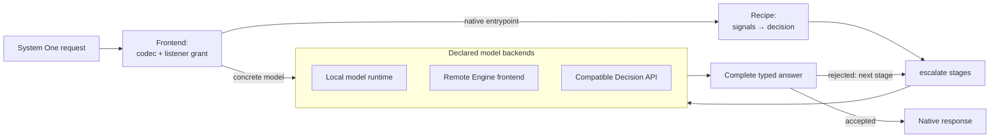

import Tabs from '@theme/Tabs'
import TabItem from '@theme/TabItem'

# Component Architecture

vLLM-SR combines a request frontend, a decision engine and a model runtime.
Run them together to route model calls, or serve a decision model on its own
without any chat backend.

- **Frontend:** listeners, access control and protocol adapters.
- **Decision engine:** entrypoints, recipes, signals, decisions and
  algorithms, in Router mode.
- **Model runtime:** the Router's decision and embedding models, as managed or
  attached workers.
- **Chat backends:** your vLLM, Ollama or hosted models.

:::note
These diagrams show the native HTTP frontend's logical components, not a
container layout. [Gateway Modes](../installation/gateway-modes) covers the
Envoy and ExtProc topology. Click a diagram to open its full-size SVG.
:::

## Compose the serving path

[](/img/architecture/system-one/01-component-composition.svg)

| Component | Responsibility |
| --- | --- |
| **Frontend** | Accept requests, enforce listener access, and adapt API protocols. |
| **Decision Engine** | Resolve an entrypoint to its recipe, evaluate signals and decisions, and call chat or native decision-model backends. |
| **Serving Engine / model runtime** | Serve the decision and embedding models through managed or attached workers. |
| **Chat backends** | Generate responses with your vLLM, Ollama or provider services. |

### Router mode and Engine mode

<Tabs groupId="startup-mode">
<TabItem value="router" label="Router mode" default>

```bash
# MODEL overrides the default decision model; chat backends stay in the YAML.
vllm-sr serve vllm-sr/vela3-fast --config config.yaml
```

- Recipe routing and chat backends are active.
- The System One API is also served, for the models a listener publishes.

</TabItem>
<TabItem value="engine" label="Engine mode">

```bash
# No chat backend or routing YAML is needed.
vllm-sr serve vllm-sr/d3-edge -e
```

- The frontend serves the decision model through the System One API.
- Saved routing configuration is kept, but inactive.

</TabItem>
</Tabs>

Every `vllm-sr serve` without `--engine` (`-e`) starts Router mode; passing a
MODEL alone does not select Engine mode. The Dashboard reports the mode and
manages deployments, but does not switch the mode.

### Models start on demand

- **Only what is used starts.** A deployment gets workers when a native model
  grant, a routing signal or an enabled model-backed feature uses it.
- **Rule-only routers need none.** A chat router whose rules ask no model runs
  without model workers.
- **Recall starts the embedding model.** The response cache, memory and RAG
  start it when they recall with it.

"On demand" means configured demand: a used model is ready before its first
request, not loaded by it.

## Separate protocol handling from routing policy

[](/img/architecture/system-one/02-frontend-and-decision-engine.svg)

A routed request takes five steps:

1. Resolve the public model name to an entrypoint and recipe.
2. Evaluate the required **signals** and derive **projections**.
3. Match a **decision** and its candidate set.
4. Run its **algorithm** to select one backend or a bounded multi-model plan.
5. Dispatch, and return the response through the matching protocol adapter.

Plugins run at their request, execution or response hooks, not as one final
step. A model-backed signal resolves its own deployment, independently of the
chat backend it helps select. The [Routing Pipeline](signal-driven-decisions)
covers policy authoring.

| Request | Handled by | Routing |
| --- | --- | --- |
| Chat Completions, Responses, Messages | Protocol codecs | The entrypoint's recipe |
| Images API | The images codec | Only decisions whose output is an image |
| System One, concrete model ID | The typed System One handler | None |
| System One, published native entrypoint | The typed System One handler | Its System One recipe |
| Concrete chat backend ID | Protocol codecs | None: skips signals, decisions and plugins |

Native recipes support fewer signals and algorithms than chat recipes; see
[Escalate on System One](../tutorials/algorithm/looper/escalate.md#on-system-one).

### Keep public and worker APIs distinct

| Surface | Endpoints | Access and purpose |
| --- | --- | --- |
| Public Chat APIs | `/v1/chat/completions`, `/v1/responses`, `/v1/messages`; discovery at `/v1/models` | Router mode. Listener access and the API's own requirements apply. |
| Public System One API | `/v1/systemone`, alias `/v1/decisions`; discovery at `/v1/systemone/models` | Either mode. Needs explicit publication in `listeners[].systemone.models`, and the listener's API keys when set. |
| Worker API | Classify, embeddings, rerank, decisions and bundle APIs, as the loaded model supports | An independently operated `vllm-srun` endpoint or a private managed socket. The frontend never publishes it. |

- Dashboard sessions do not replace listener credentials.
- Native model grants are separate from the listener's chat `models`
  allowlist.

The [System One quickstart](../model-runtime/get-started/quickstart.md) walks through a
complete request.

## Scale a deployment through replicas

[](/img/architecture/system-one/03-serving-engine-and-workers.svg)

Two separate choices happen for every model call:

| Question | Answered by |
| --- | --- |
| Which model should handle this task? | Model selection: the recipe's decision and algorithm |
| Which ready worker of that deployment runs it? | Replica dispatch, inside the deployment |

- **Managed replicas** are processes vLLM-SR starts and supervises.
- **Attached replicas** point to independently operated runtimes.
- **One pool, one model.** Workers in a pool share model identity, revision,
  engine arguments and capabilities. The diagram shows GPUs, but CPU workers
  work too.

Dispatch picks the ready worker with the fewest outstanding request bytes,
and breaks ties by the least recently assigned. Each worker admits at most 32
in-flight requests; a full pool reports overload instead of queueing.

:::note
Outstanding bytes are a local estimate. They are not token counts or
GPU-forward concurrency.
:::

Inside a worker, the model family defines inputs and typed outputs, and the
batch planner forms forwards from the deployment's engine arguments. The
execution engine and accelerator run them. Several questions can share one
forward, but one API call can still need several.

```bash title="Two replicas on two GPUs"
vllm-sr serve vllm-sr/d3-edge -e --platform rocm -dp 2 --device-ids 0,1
```

:::warning Data parallel is not sharding
`-dp` places a full copy of the model on each device; it does not split
weights with tensor or pipeline parallelism. Measure throughput and tail
latency for your input lengths before adding replicas, especially when
workers share one GPU.
:::

See [Frontend and runtime deployments](../model-runtime/deploy/connect-the-router.md) and
[Engine arguments](../model-runtime/deploy/engine-args.md).

## Route System One across decision models



- **A native recipe.** An `api: systemone` entrypoint selects an isolated
  System One recipe.
- **Escalation stages.** Its decision runs `escalate`: the fast stage answers
  first, and a later stage runs only when the answer fails acceptance.
- **Any backend.** A stage can call a local deployment, a separate vLLM-SR
  Engine, or a compatible external System One API.
- **One budget.** The signals and every stage share one request deadline and
  call limit; the decision's own budget can tighten both.
- **An optional judge.** An LLM judge can pick an earlier complete answer, or
  abstain; it never invents native probabilities.

The recipe chooses between models; each deployment still chooses among its
own replicas.

`/v1/systemone/models` lists concrete models with `routing: false` and native
recipes with `routing: true`; both need a listener grant. The chat default
`vllm-sr/auto` does not enable native auto, and Engine mode serves only
concrete models.

## Next

- [System Overview](semantic-router-overview): configuration and deployment
  context.
- [Quickstart](../installation/installation.md): send a routed chat request.
- [Model runtime quickstart](../model-runtime/get-started/quickstart.md): ask typed
  questions directly.
- [Frontend and runtime deployments](../model-runtime/deploy/connect-the-router.md): bindings,
  placement and readiness.
