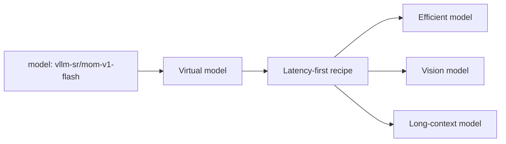

# Mixture of Models

A **Mixture of Models (MoM)** presents independently deployed models as one
virtual model. A recipe selects a model, cascade, panel, or bounded workflow for
each request. Your harness uses a stable name and retains its task loop and tools.



## MoM is not Mixture of Experts

Mixture of Experts (MoE) is a model architecture: a gating mechanism activates
parts of one checkpoint during inference. Mixture of Models is a serving-system
architecture: independently trained and independently served models are chosen
or coordinated at request time.

MoM can combine dense models, MoE models, hosted APIs, and local models. Their
internal architecture does not change the routing abstraction.

## Three kinds of model in the system

| Kind | Example | Role |
| --- | --- | --- |
| **Provider model** | A vLLM, Ollama, or hosted model endpoint | Generates the inference response. |
| **Virtual model** | `vllm-sr/mom-v1-flash` | Gives clients a stable objective and selects a recipe. |
| **Router system model** | An embedding or classifier asset | Helps detect intent, risk, similarity, or another routing signal. |

Router system models support the decision process. A decision deployment can
also be published directly through System One. Routing System One across
several decision models uses an explicit [native recipe](component-architecture#route-system-one-across-decision-models),
separate from the current Chat Mixture of Models.

## Execution patterns

### Select one model

Most requests should take a direct path. Policy narrows the eligible set and an
algorithm selects one backend by semantic fit, latency, relative cost, feedback,
or a fixed order.

### Cascade

Start with an efficient model, inspect a bounded confidence or verification
signal, and escalate only when needed. Cascades trade extra worst-case latency
for lower average cost.

### Orchestrate several models

Parallel comparison, multi-round reasoning, and workflows can use several
models before producing one response. These paths are valuable for selected
high-accuracy tasks, not as a default for all traffic.

## Virtual models and recipes

An entrypoint maps one or more public model names to an isolated recipe:

```yaml
entrypoints:
  - model_names: ["acme/assistant-fast"]
    recipe: fast

recipes:
  - name: fast
    routing:
      strategy: priority
      decisions:
        - name: default-fast-route
          description: Route eligible requests through the fast model pool.
          priority: 10
          rules:
            operator: AND
            conditions: []
          modelRefs:
            - model: local/small
              use_reasoning: false
            - model: local/vision
              use_reasoning: false
          algorithm:
            type: static
```

Signals and decisions identify the task. Candidate requirements then check the
capabilities and context capacity of the assigned models. Deployment placement
and data handling remain operator responsibilities. The public model name
resolves to the selected provider model before backend dispatch.

See [Virtual Models](../tutorials/global/entrypoints-and-recipes)
for the full schema and isolation rules.

## MoM V1

MoM V1 offers five built-in recipes. Connect your own backends and choose the
policy that fits your harness's model calls:

| Public model | Recipe | Decisions |
| --- | --- | --- |
| `vllm-sr/mom-v1-blend` | **Balance**: reasoning effort only where a request needs it | `simple`, `medium`, `reasoning` |
| `vllm-sr/mom-v1-lite` | **Cost**: economical serving with targeted escalation | `economy`, `tools`, `reasoning` |
| `vllm-sr/mom-v1-flash` | **Speed**: responsive conversation and streaming | `fast`, `tools`, `reasoning` |
| `vllm-sr/mom-v1-ultra` | **Accuracy**: strong answers and explicit orchestration | `simple`, `reasoning`, `review`, `agent` |
| `vllm-sr/mom-v1-vault` | **Vault**: processing within your private deployment | `private`, `sensitive`, `guard` |

Balance asks the router's decision model five routing questions in one call:
the kind of work, how much reasoning it needs, whether exact facts matter, what
a good answer needs, and whether the user is correcting an earlier answer. An
effort score from those answers selects `simple`, `medium` or `reasoning`;
corrections and tool work go to `reasoning`, and exact facts stay on `medium`.
Speed, Cost, Accuracy and Vault also route on named decision-model questions:
whether the user asks to call a tool, whether the request is a hard problem,
whether it reports a wrong answer, who should do the work (one assistant,
several workers or several independent experts), and whether it carries
confidential material, personal data, a risk of harm or a request for personal
advice. Accuracy normally selects one strong model; independent review and
workflows require an explicit request. The bundle declares Vela 2.0 0.8B as its
decision model; on a CPU its calls are slow, so serve it on a GPU for live
traffic. The Model Card lists every question and what it decides.

Vault disables client tools, memory, response caching, and new Responses object
writes on every path. Replay capture is configured separately and is enabled by
default; see [Router Replay](../tutorials/plugin/router-replay). Its
`guard` decision contains prompt attacks immediately. Personal identifiers,
confidential material, a risk of harm and requests for personal advice select
`sensitive`, where an approved model can provide responsible help, explain
risky material, or refuse harmful assistance.
Assign Vault's other decisions to backends that meet your privacy requirements;
the recipe cannot establish their physical location or provider retention.

Vault's prompt guard and PII judgments read the whole conversation up to the
decision model's scan budget, and its questions read the start of the latest
message. An unanswered judgment or an input past the budget fails closed:
Preview returns HTTP 503 with signal errors and no selected model. A larger
backend context window does not extend that budget.

Start or resume the stack:

```bash
vllm-sr serve
```

Open **Models** in the Dashboard to connect and verify inference endpoints.
Choose a **Recipe**, assign models to its backend decisions, and publish a
**Mixture-of-Model** entrypoint. Single-model decisions need at least one
qualified model; Accuracy's `review` and `agent` need two distinct workers.
Vault's `guard` needs no backend assignment.

Declare capabilities and input/output limits, and supply the relevant quality
index at the assigned reasoning effort. **Preview** shows the signals, decision,
and candidate-selection result. Send a real request to verify execution and
latency before rollout.

Policy version 4.0 keeps the decision names above; the decision model now selects every recipe's decisions, and Vault sends content risks to the sensitive pool. Validate new assignments before
publishing an upgrade; existing published versions remain unchanged. See the
[MoM V1 Model Card](https://github.com/vllm-project/semantic-router/blob/main/config/recipes/built-in/latest/mom-v1/README.md)
for the complete requirements and data-handling policy.

## When MoM is the wrong abstraction

Use a direct model endpoint when one backend satisfies the workload and policy
is unlikely to change. A multi-model system adds configuration, evaluation,
observability, and operational cost. Its value should come from a clear
capability boundary, objective, or measured routing improvement.

## Next

- [Models, Entrypoints, and Serving](../tutorials/global/models-entrypoints-serving)
  for the complete CLI and backend-binding workflow.
- [Use Cases](use-cases) for practical patterns.
- [Routing Pipeline](signal-driven-decisions) for policy composition.
- [Algorithms](../tutorials/algorithm/overview) for selection and orchestration
  choices.
