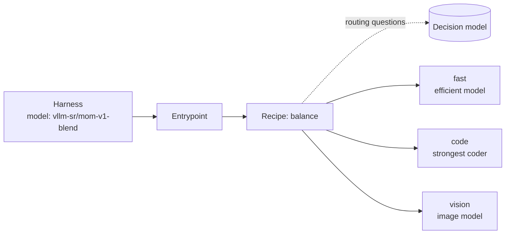

import Tabs from '@theme/Tabs'
import TabItem from '@theme/TabItem'

# Mixture of Models

A **Mixture of Models (MoM)** is one model name that stands for a pool of
independently served models. Your harness calls the stable name; a recipe
behind it picks the model, escalates, or coordinates several for each request.

- **One name, many models.** Clients call a virtual model such as
  `vllm-sr/mom-v1-blend` and never hard-code a backend.
- **Policy, not plumbing.** The recipe routes on the decision model's answers
  about each request, then checks each candidate's capabilities.
- **Ready-made recipes.** MoM V1 ships five, one per goal. You connect the
  models they route to.



## MoM is not Mixture of Experts

Mixture of Experts (MoE) happens inside one model. Mixture of Models happens
in the serving system, across whole models:

| | Mixture of Experts (MoE) | Mixture of Models (MoM) |
| --- | --- | --- |
| **What it is** | A model architecture | A serving-system architecture |
| **What it chooses** | Expert layers inside one checkpoint | Whole models, each served on its own |
| **When it chooses** | For each token, inside a forward pass | For each request, before any model runs |
| **What it combines** | Experts trained together | Dense, MoE, local and hosted models |

A MoM pool can include MoE models; their internal design does not change how
the Router routes to them.

## Three kinds of model

| Kind | Example | Role |
| --- | --- | --- |
| **Provider model** | A vLLM, Ollama or hosted endpoint | Generates the answer your users see. |
| **Virtual model** | `vllm-sr/mom-v1-blend` | Gives clients a stable name for a recipe. |
| **Router system model** | The decision model (vela3-fast by default) and the embedding model | Serve the Router itself: the decision model answers its routing questions, and the embedding model serves recall for caches and memory. |

The Router runs its system models on the built-in
[model runtime](../model-runtime/overview). [System One](../system-one/overview)
explains the decision model and the questions it answers.

## Execution patterns

A recipe's decisions choose one of three patterns:

| Pattern | What happens | Use it for | Algorithms |
| --- | --- | --- | --- |
| **Select one model** | A selector picks one candidate, then calls it once. | Most traffic | `static`, `random`, `multi_factor`, `systemone` |
| **Escalate** | Start with an efficient model, check the answer, and move up only when the check fails. | Lower average cost when answers can be checked | [`escalate`](../tutorials/algorithm/looper/escalate) |
| **Orchestrate** | Several models answer, compare or work in steps; one response comes back. | Selected high-accuracy tasks | `fusion`, `remom`, `ratings`, `workflows` |

:::tip Start simple
Escalation and orchestration add calls, latency and tokens. Keep them for the
requests where a measured gain justifies the cost, and select one model for
everything else. [Algorithms](../tutorials/algorithm/overview) compares them.
:::

## Publish a virtual model

An entrypoint maps public model names to a recipe. The recipe's decisions
name the provider models that serve each lane:

```yaml title="config.yaml"
entrypoints:
  - model_names: [vllm-sr/auto]
    recipe: default
    default: true
  - model_names: ["acme/assistant-fast"]
    recipe: fast
recipes:
  - name: default
  - name: fast
    strategy: priority
    decisions:
      - name: default-fast-route
        description: Route eligible requests through the fast model pool.
        priority: 10
        rules:
          operator: AND
          conditions: []
        modelRefs:
          - model: local/small
            use_reasoning: false
          - model: local/vision
            use_reasoning: false
        algorithm:
          type: static
```

For each request, the Router evaluates the recipe's signals, matches a
decision, and drops candidates that lack a needed capability or enough
context. The public name then resolves to the chosen provider model.

[Entrypoints and Recipes](../tutorials/global/entrypoints-and-recipes)
has the full schema and isolation rules.

## MoM V1

MoM V1 is the built-in family of five recipes, one per goal. You connect your
own backends and assign them to each recipe's decisions:

| Public model | Recipe | Goal | Decisions |
| --- | --- | --- | --- |
| `vllm-sr/mom-v1-blend` | **Balance** | Reasoning effort only where a request needs it | `long_context`, `vision`, `recovery`, `agentic`, `facts`, `frontier`, `code`, `hard`, `standard`, `fast` |
| `vllm-sr/mom-v1-lite` | **Cost** | Economical serving with targeted escalation | `economy`, `tools`, `reasoning` |
| `vllm-sr/mom-v1-flash` | **Speed** | Responsive conversation and streaming | `fast`, `tools`, `reasoning` |
| `vllm-sr/mom-v1-ultra` | **Accuracy** | Strong answers, with several models only on request | `simple`, `reasoning`, `review`, `agent` |
| `vllm-sr/mom-v1-vault` | **Vault** | Processing inside your private deployment | `private`, `sensitive`, `guard` |

### How MoM V1 routes

- **One call per request.** Each recipe asks the decision model a few named
  questions, all in one call.
- **Request facts.** Decisions also read what the request declares: tools,
  an active tool loop, or an earlier assistant answer.
- **No legacy signals.** No recipe uses keyword, embedding or classifier
  signals.
- **A declared decision model.** The bundle sets Vela 2.0 0.8B as its decision
  model, the model its probes were calibrated on.

:::warning Serve the decision model on a GPU for live traffic
On a CPU, the decision call is slow: with 4 CPUs, a short message takes about
4 seconds at the median, and a long input about 75 seconds. On one AMD
Instinct MI300X, the median is 0.25 seconds. Set `device: rocm` or
`device: cuda` on the decision model's deployment to require a GPU.
:::

### The five recipes

<Tabs groupId="mom-v1-recipe">
<TabItem value="balance" label="Balance" default>

**Balance** spends reasoning only where a request needs it. In one call, the
decision model answers six questions about the latest message:

- the kind of work, and how much reasoning it needs;
- whether a correct answer depends on facts most people would look up;
- what a good answer needs: deliberation, tools, verification, long output or
  creativity;
- whether the user says the previous answer was wrong;
- whether the user asks to call a tool now.

Then the lanes apply, highest priority first:

1. Long inputs and images take `long_context` and `vision` first.
2. Corrections go to `recovery`, tool work to `agentic`, and fact-heavy
   questions to `facts`.
3. An effort score from the answers picks `frontier`, `code`, `hard`,
   `standard` or `fast`.

In `frontier`, the decision model also picks which assigned model answers,
from their descriptions.

**Needs:** two distinct models for `frontier`. Balance asks a `score`
question, which vela3-fast cannot answer; keep the bundle's Vela 2.0 decision
model or another model that answers `score`.

</TabItem>
<TabItem value="speed" label="Speed">

**Speed** favors first-token latency for conversation and tool calls, and
per-token latency for reasoning.

- `tools`: the user asks to call a tool now, and the request declares tools.
- `reasoning`: a hard problem that needs careful multi-step work.
- `fast`: everything else.

An unanswered `depth` question also sends the request to `reasoning`, so an
outage never lowers quality.

</TabItem>
<TabItem value="cost" label="Cost">

**Cost** keeps each request on one model, and prefers the lowest estimated
request cost within each decision's quality band.

- It asks Speed's questions, plus two more: whether the user reports a wrong
  answer, and whether the message only quotes text to translate or explain.
- A reported wrong answer escalates to `reasoning`; one inside quoted text
  does not.
- `economy` serves everything that needs neither tools nor reasoning.

</TabItem>
<TabItem value="accuracy" label="Accuracy">

**Accuracy** normally answers with one strong model.

- `reasoning` takes hard problems, verification requests, high-stakes
  questions and corrections.
- `review` compares two independent answers and synthesizes them, only when
  the user asks several experts to answer.
- `agent` runs up to three steps with two workers in parallel, only when the
  user asks for several workers.
- `simple` takes everything else.

**Needs:** two distinct worker models for `review` and for `agent`. Neither
fans out during a client tool loop; those requests go to `reasoning`.

</TabItem>
<TabItem value="vault" label="Vault">

**Vault** keeps traffic inside the deployment you assign, with separate pools
for ordinary and sensitive requests.

- `guard` answers a prompt attack immediately, without calling a backend.
- `sensitive` takes personal identifiers, confidential material, a risk of
  harm, or a request for personal advice.
- `private` takes everything else.

Every Vault path disables client tools and tool history, memory, the response
cache, learning adaptation and new Responses object writes. Replay capture is
set separately and is on by default; see
[Router Replay](../tutorials/plugin/router-replay).

Vault fails closed. If a judgment goes unanswered, or the input runs past the
decision model's scan budget, the request gets HTTP 503 and no backend is
called.

:::warning
The recipe cannot place your models or change a provider's retention. Assign
Vault's decisions only to backends that meet your privacy requirements.
:::

</TabItem>
</Tabs>

### Try MoM V1

1. Start or resume the stack:

   ```bash
   vllm-sr serve
   ```

2. In the Dashboard, open **Models** and connect your inference endpoints.
3. Open **Build → Mixture-of-Models → Recipes**, and choose **Create model** on
   a built-in recipe.
4. Name its entrypoint, and assign models to each decision. Vault's `guard`
   needs none.
5. Use **Preview** to see the signals, the decision and the selected
   candidate. Then send a real request to check execution and latency.

Each model needs its capabilities, context window and output limit declared.
`multi_factor` decisions also compare the model's quality index at the
assigned reasoning effort.

:::note
The [MoM V1 Model Card](https://github.com/vllm-project/semantic-router/blob/main/config/recipes/built-in/latest/mom-v1/README.md)
lists every question, threshold and requirement, the data-handling policy,
and what changed in policy 4.0.
:::

## When MoM is the wrong abstraction

Call a model endpoint directly when:

- one backend serves the whole workload well;
- the policy is unlikely to change;
- you can't yet measure a routing gain.

A multi-model system adds configuration, evaluation and operating cost. Add
it for a clear capability boundary, objective or measured improvement.

## Next

- [Models, Entrypoints and Serving](../tutorials/global/models-entrypoints-serving):
  connect backends and publish entrypoints from the CLI.
- [Routing Pipeline](signal-driven-decisions): how signals, decisions and
  algorithms compose.
- [Use Cases](use-cases): patterns for cloud, data-center, edge and
  enterprise pools.
- [Algorithms](../tutorials/algorithm/overview): every selector and executor.
