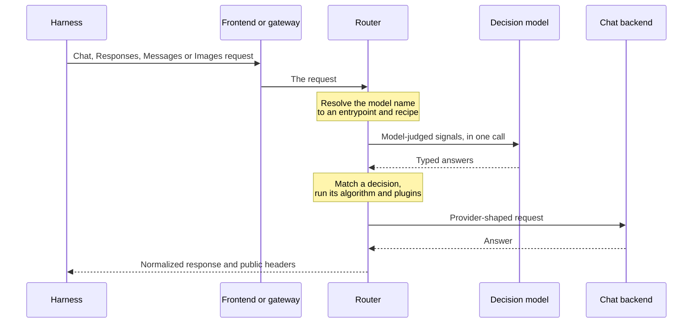

# System Overview

Semantic Router sits between agent harnesses and your models. It applies a
policy to every model call, selects one model or coordinates several, and
forwards the request to the chosen backend.

- **Data plane.** A frontend accepts the request, the Router decides, the
  model runtime answers the Router's own questions, and chat backends
  generate the answer.
- **Control plane.** One canonical YAML file, managed with the CLI, the
  Dashboard, Helm or the Operator.
- **Two ways in.** The Router serves its own listeners by default, or runs
  behind an Envoy-based gateway through ExtProc.

## Architecture


[Component Architecture](component-architecture) covers the protocol path,
the model runtime's replicas and Engine mode.

### Data plane

| Component | What it owns |
| --- | --- |
| **Agent harness** | The task loop, tool execution and task state. Each model call crosses the Router; the response returns to the harness for the next step. |
| **Frontend** | Listeners, access control and protocol adaptation. With `--gateway extproc`, an external gateway owns ingress and calls the Router through ExtProc. |
| **Semantic Router** | Signals, policy, route behavior, and the selection or coordination of models. |
| **Model runtime** | The Router's own models: the decision model, and the embedding model when a recall feature needs it. Workers can be managed or attached. |
| **Chat backends** | Generation. vLLM, Ollama or hosted providers own the weights and capacity. |

### Control plane

| Tool | Use it to |
| --- | --- |
| **Canonical YAML** | Describe routing behavior in one portable file. |
| **CLI and Dashboard** | Set up, validate, discover models, configure and operate. |
| **Helm and the Operator** | Deploy the Router into Kubernetes. |
| **Evaluation and observability** | See route outcomes, test policy and improve it. |

## Core objects

| Object | Purpose |
| --- | --- |
| **Entrypoint** | Maps one or more public model names to a recipe. |
| **Recipe** | A complete routing policy, with its own isolated runtime state. |
| **Signal** | A named fact about the request, identity, conversation or content. |
| **Projection** | A reusable score, partition or band derived from signals. |
| **Decision** | A rule that picks an eligible route and its candidate models. |
| **Algorithm** | How the decision selects or coordinates its candidates. |
| **Plugin** | Route-specific behavior, such as request controls, retrieval, memory or response handling. |
| **Provider model** | A physical inference endpoint that recipes can route to. |

These objects let you reuse detection across policies, change policy apart
from model selection, and evolve the pool behind a stable public name.

## Request lifecycle



1. A harness sends a request using OpenAI Chat Completions, OpenAI Responses,
   Anthropic Messages or the OpenAI Images API.
2. The standalone frontend, or an ExtProc gateway, presents it to the Router.
3. The requested model resolves to an entrypoint and its recipe.
4. The Router evaluates the recipe's signals and computes its projections.
   Heuristic signals run in code; model-judged signals go to the decision
   model in one call.
5. Decisions enforce constraints and choose an eligible candidate set.
6. The decision's algorithm selects one model, or runs a bounded multi-model
   strategy.
7. Plugins run at their request, execution or response hook.
8. The frontend's upstream client, or the external gateway, sends the
   provider-shaped request to the selected backend and returns the
   normalized response.

Two cases skip part of this path:

- **Direct selection.** An operator can expose physical model names for
  direct selection. Those requests skip recipe signals, decisions, plugins,
  cache, learning and session routing.
- **No match.** If no decision in the recipe matches, the request goes to the
  configured default provider model.

:::note The harness keeps its tools
The lifecycle covers one model call inside the harness's task loop. Plugins
can filter the tools a model sees, but the harness and its tool services
still execute and authorize tools.
:::

## Protocol and deployment boundaries {#protocol-and-deployment-boundaries}

The Router serves its own listeners by default, or integrates with an
external gateway through ExtProc; [Gateway Modes](../installation/gateway-modes)
compares the two. The same policy runs in Docker, Kubernetes and hybrid
environments.

The Router chooses a model; it does not replace a backend's scheduler. When an
AI gateway also fronts the stack, a request crosses three routing layers:

```text
agent harness
  -> AI Gateway (e.g. Agent Router / LiteLLM / agentgateway)
  -> Semantic Router ExtProc
  -> Inference Router / pool scheduler (e.g. llm-d / vLLM Router / AIBrix gateway)
  -> model replica
```

| Layer | What it owns | Examples |
| --- | --- | --- |
| **AI Gateway** | Client ingress, provider translation, credentials, rate limits and traffic policy. | [Agent Router (formerly Envoy AI Gateway)](../installation/k8s/ai-gateway), [LiteLLM](https://docs.litellm.ai/docs/simple_proxy), [agentgateway](../installation/k8s/agentgateway) |
| **Semantic Router** | The model or model pool for the request's intent and policy, chosen through recipes and decisions. The gateway routes on `x-vsr-route-model`. | vLLM Semantic Router |
| **Inference Router** | A healthy replica or endpoint inside the selected pool. | [llm-d](../installation/k8s/llm-d), [vLLM Router](https://github.com/vllm-project/router), [AIBrix gateway](../installation/k8s/aibrix) |

[Kubernetes Gateways](../installation/k8s/gateways) and
[Inference Platforms](../installation/k8s/inference-platforms) list the
integrations this project maintains.

:::tip Client and backend formats can differ
A client can call one API while the backend speaks another. See
[Protocol Compatibility](../installation/protocol-compatibility) for the
supported pairs.
:::

## Next

- [Component Architecture](component-architecture): the frontend, the model
  runtime and Engine mode.
- [Routing Pipeline](signal-driven-decisions): the policy layers.
- [Mixture of Models](mom-model-family): virtual models and multi-model
  execution.
- [Quickstart](../installation/installation.md): run the local stack.
