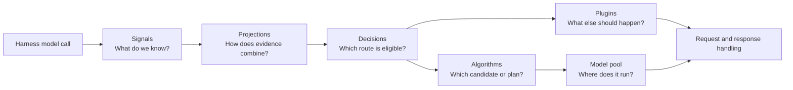

# Routing Pipeline

Every routed model call passes through the same stages: understand the
request, apply policy, then run the chosen model. The recipe that the
entrypoint selects defines each stage.

- **Signals** name facts about the request.
- **Projections** combine signals into scores, partitions and bands.
- **Decisions** apply policy and choose the candidate models.
- **Algorithms** pick one model or coordinate several.
- **Plugins** act on the route: rewrite, retrieve, cache or guard.

## Signals: name the facts

A signal gives a name to something true about the request, the conversation,
the caller or the content. Signals describe facts; they never choose a
backend, so one signal can serve many decisions.

| Layer | How it answers | Examples |
| --- | --- | --- |
| **The `systemone` primitive** | The decision model answers a question you write in plain language. | "Does this request need a tool call?" |
| **Application signals** | The decision model answers one of eleven built-in questions. | `domains`, `jailbreak`, `pii`, `complexity` |
| **Heuristic signals** | Deterministic code, with no model. | `keywords`, `language`, `context`, `role_bindings` |

:::tip One call per request
The Router sends a request's model-judged signals to the decision model
together, in one call per deployment. [System One](../system-one/overview)
explains the questions and the models that answer them.
:::

Embeddings serve recall only, for the response cache, memory and RAG; no
signal reads an embedding. See the [signal overview](../tutorials/signal/overview)
for every signal type.

## Projections: combine evidence

A projection turns several signal results into one reusable result:

- a **partition** picks one winner among overlapping matches;
- a **score** combines weighted inputs;
- a **mapping** turns a score into named bands.

For example, domain evidence can form one exclusive partition, while
complexity, context and verification evidence form a difficulty score.
Decisions then reference the result instead of repeating the logic. See
[Projections](../tutorials/projection/overview).

## Decisions: apply policy

A decision combines signal and projection results with `AND`, `OR` and `NOT`.
When several decisions match, their priority and the recipe's strategy pick
one. The winner supplies the candidate models, the algorithm, the plugins and
the output it must produce.

:::warning Keep hard requirements in decisions
Authorization, local-only processing, modality, context capacity and tool
compatibility should make a route eligible or ineligible before any optimizer
compares cost or latency.
:::

See [Decisions](../tutorials/decision/overview).

## Algorithms: select or coordinate models

After a decision matches, its algorithm handles the candidates:

| Kind | Types | What it does |
| --- | --- | --- |
| **Selectors** | `static`, `random`, `multi_factor`, `systemone` | Pick one candidate before calling it. |
| **Executors** | `escalate`, `fusion`, `remom`, `ratings`, `workflows` | Call several candidates and return one response. |

With one candidate, `static` is usually right. Keep executors for tasks where
their extra latency and compute have a measured payoff. See
[Algorithms](../tutorials/algorithm/overview).

## Plugins: act on the route

Plugins add behavior to the selected route. Depending on the type, a plugin
runs before the provider request, during execution or on the response.
Examples include request parameter limits, context retrieval and
compression, memory, replay, response caching and response guards.

:::note Detection is not enforcement
A `pii` signal only reports a match. The decision and its plugins decide
whether to block, reroute, mask or just observe it.
:::

See [Plugins](../tutorials/plugin/overview).

## Model pools: run the request

Providers bind model names to inference endpoints: local vLLM or Ollama
services, Kubernetes-hosted models or remote OpenAI-compatible providers. The
Router chooses the model; the model server or its scheduler runs it and
places replicas.

- **Capability first.** A fast backend is not eligible if it can't handle the
  request's modality, context, tools or locality.
- **Separate pools.** The decision model has its own
  [replica pool](component-architecture#scale-a-deployment-through-replicas),
  which never chooses the chat backend.

## Recipes keep policies isolated

An entrypoint selects one recipe. The recipe owns its signals, projections,
decisions, algorithms, plugins, cache namespace and routing state. Providers,
stores and the Router's own models can be shared without one recipe's policy
leaking into another.

- **Direct names pass through.** A concrete backend model name skips recipe
  signals, decisions, plugins, cache, learning and session routing.
- **No match falls back.** If no decision in the recipe matches, the Router
  uses the configured default provider model.

See [Entrypoints and Recipes](../tutorials/global/entrypoints-and-recipes)
for the configuration contract.

## Example: a coding call with tools

1. A harness sends a conversation, tool definitions and a virtual model name.
2. The entrypoint selects a recipe, and its signals recognize a coding request
   and the conversation's facts.
3. A decision establishes the route; capability and context checks narrow its
   candidates, and the algorithm selects a model.
4. Plugins apply tool policy or context compression, when configured.
5. The response returns to the harness, which executes any tools and takes
   the next step.

:::note Multi-turn routing
Configure session identity and protection deliberately. An active tool loop
or provider state that can't move can restrict model switches, but a model
that policy excludes is never restored just for continuity. See the
[agent harness guide](../installation/agent-harness).
:::

## Workload, Router and pool

A good routing decision joins three views:

| View | Examples |
| --- | --- |
| **Workload** | Intent, language, complexity, context, tools, modality, identity |
| **Router policy** | Eligibility, priority, objective, plugins, algorithm |
| **Model pool** | Capabilities, locality, health, latency, load, relative cost |

The workload says what is needed, policy says what is allowed and preferred,
and the pool says what is available now. Keeping them separate makes the
system easier to change and to evaluate.
