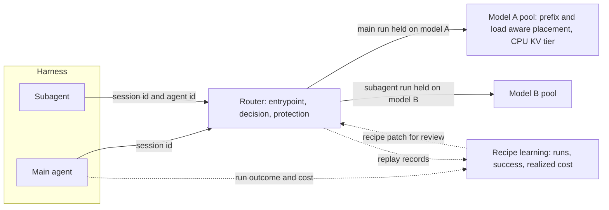

> **Status:** Proposal · **Created:** 2026-10-21 · **Epic:** [#5378](https://github.com/vllm-project/semantic-router/issues/5378)

## Problem

Coding agents such as Claude Code, Codex CLI, OpenCode and mini-SWE-agent send the longest sessions a Router sees. A run resends its whole conversation on every call, reuses almost all of its prompt, delegates parts of the task to subagents, and is judged by one outcome at the end: the tests pass or they do not. Teams that want these agents on a chosen set of models, often self-hosted, need one place to decide which models agents may use, to keep a run coherent and cached, and to choose models from their own outcomes.

Today a Claude Code session through the Router does not survive contact with an OpenAI-format backend. In ten Terminal-Bench 2.0 runs of Claude Code 2.1.304 through a Router built from main to vLLM Chat Completions backends, eight ended with "API Error: 400 translation would lose tool_result.is_error" at the first shell command that exited nonzero, and a backend serving Qwen3.5 or later refused the first answered call with "System message must be at the beginning." The client protocol fixes that already landed for Claude Code and Codex CLI (#4189, #4215, #4141, #4227, #4234) show the same pattern: each harness release finds a field the Router does not yet carry.

This proposal states what is worth building for coding agents, in which order, and how each step is evaluated. It keeps the boundary set by [Agent-Aware Router Contracts](./agent-based-routing): the Router selects a logical model and never orchestrates the agent.

## Position

For coding agents, switching models between the requests of one run is not where the Router helps first. On public agent benchmarks it captures a modest share of the theoretical headroom, it needs signals the Router does not see, and it throws away a cache that holds almost the whole prompt. Four things come first, in this order.

1. **Control.** One place to decide which models an organization's agents may use, to keep a run on one model, to accept what harnesses send, to resolve the model names a harness uses internally, and to scan and audit what agents send. This is why a team that cannot adopt hosted coding tools would deploy the Router, and it does not depend on any cost argument.
2. **Cache-aware placement.** Keep a session on the model and replica that hold its prefix, and give self-hosted backends a CPU tier for the KV they would otherwise evict.
3. **Outcome-driven model choice.** Choose the default model, and the model a subagent gets, from the organization's own run outcomes and realized cost, and choose again when models change.
4. **Escalation at the end of an attempt**, as an option only where the first model costs a small fraction of the strong one: judge the finished attempt and restart on a stronger model when the expected rescue is worth it.

## Ownership boundary

| Layer | Owns | Does not own |
| --- | --- | --- |
| **Harness** (Claude Code, Codex CLI, OpenCode, mini-SWE-agent) | The agent loop, tools, subagents and when to start them, the session and agent ids it sends, the run's outcome, and the restart on a stronger model when it uses the escalation wrapper | Which models agents may use, or which model a request gets |
| **Router** | The entrypoints and the models each may select, the model for each request, holding a run and each subagent run on one model, translation between the harness's and the backend's API format, scans, content-minimized records, and the offline model-choice report | Agent invocation, task state, starting subagents, the decision to restart a task |
| **Serving backend** (vLLM, llm-d) | Prefix cache, replica placement by prefix and load, the CPU KV tier | Model choice |

A run through the Router with the agent identity of #5348, which #5363 added:



The main agent's requests carry the session id and stay on the model chosen for the run's first request. A subagent's requests also carry its agent id, so the subagent stays on the model chosen for its own first request, which differs from the parent's only when its decision chose another. Outcomes come back per run and change the recipe only through a reviewed patch.

## Evidence

Sources, chosen for provenance. Production session traces: SemiAnalysis cc-traces-weka-with-subagents (Apache-2.0, 336 Claude Code sessions with token counts and 64-token KV block hashes, no text). Multi-model trajectories: Terminal-Bench 2.0 leaderboard trajectories (Apache-2.0), TwinRouterBench's static track (Apache-2.0), OpenHands trajectories from nebius/SWE-rebench-openhands-trajectories (CC-BY-4.0), SWE-Router's SWE-Smith and SWE-bench Verified trajectories (arXiv 2607.00053) and mini-SWE-agent runs from the public SWE-bench Verified submissions, both used for aggregate results only. Public leaderboard rows from Terminal-Bench 4.0. Router replay of recorded runs and live Claude Code runs, both ours. Every number is a single run unless stated, and the research issues #5357 (prefix reuse), #5358 (CPU KV tier and placement) and #5374 (escalation) carry the code and data behind them. The evaluation lanes below fetch only data whose license allows it and rerun the Terminal-Bench 2.0 numbers from it. The SWE-Router and SWE-bench trajectories are local inputs.

### Summary

| Finding | Measurement | Source | Issue |
| --- | --- | --- | --- |
| Claude Code breaks on OpenAI-format backends | 8 of 10 Terminal-Bench 2.0 runs ended in a Router 400 at the first failing command | Live runs, ours | #5350, #5360 |
| With the compatibility changes it runs clean | No refusal across 274 requests with mid-conversation system messages and 189 with a failed tool result | Live runs, ours | #5349 to #5353 |
| Text-protocol agents switch models mid-run | 62 switches in 30 mini-SWE-agent runs under conversation scope, none under session scope | Router replay | #5355, #5361 |
| A main agent's prompt is almost all cached | 98.0% of prompt tokens are a prefix of the same session's earlier calls | SemiAnalysis traces | #5357 |
| A subagent is the cheap place to change model | Its first call shares 9% of its prompt with the parent's session | SemiAnalysis traces | #5348, #5357 |
| A CPU KV tier carries more agent load | 2.2 times the input tokens of the GPU prefix cache alone, under the same time-to-first-token limit | kv-cache-tester replay, Qwen3-14B, one MI300X | #5358 |
| Session placement helps when sessions fit | Prefix hits from about 80% to 90%, median time to first token from 1.6 s to 1.0 s | Same replay, two replicas | #5358 |
| Cross-model KV handoff is not ready for agents | KL 0.14 to 0.18 on agent trajectories against 0.036 on chat | Qwen3-14B to Qwen3-32B mapper | #2976 |
| The best default model depends on the workload | deepseek-v3.2 beats gpt-5-mini on SWE-bench Verified and loses on SWE-Smith | SWE-Router trajectories | #5354 |
| List price misleads | Sonnet 5.5 costs $22.22 per trial against $14.30 for Opus 5.5 and solves less | Terminal-Bench 4.0 leaderboard | #5356 |
| Escalating from the task text does not work | AUROC 0.585 to 0.648, no better than ranking by predicted cost | SWE-Router, mini-SWE-agent | #5374 |
| Escalating a finished attempt pays in a narrow band | $0.10 and $0.16 of utility per task, with 95% intervals that include zero | Terminal-Bench 2.0, 87 tasks | #5374 |
| Cheaper subagents are untested | 0 of 30 live runs called the subagent tool | Live runs, ours | #5362 |

### What the Router does with agent traffic on main

| Area | What happens on main | Change |
| --- | --- | --- |
| Run stability | Tool-call agents are held on their first model for the whole run (343 of 388 replayed requests). Text-protocol agents that send command output as user messages are not recognized as tool loops: under `scope: conversation` the Router switched models mid-run 62 times in 30 replayed mini-SWE-agent runs when a signal on the latest output changed the decision, `min_turns_before_switch` did not stop it, and `scope: session` held every run on one model. Replaying 30 Terminal-Bench 2.0 runs the same way, 15 switched mid-run under conversation scope and none under session scope. | Recommend `scope: session` (#5355) |
| Subagents | Claude Code sends `x-claude-code-session-id` on every request, with the same value for the main agent and its subagents, and `x-claude-code-agent-id` only on subagent requests. Protection keyed on the session held both subagents of a run on the parent's model when their decision chose another, and protection keyed on `x-session-id`, which Claude Code never sends, held nothing. | Agent identity in protection (#5348) |
| First calls | Every Claude Code session starts with rejected calls (`thinking.display: updates` and `tools.defer_loading`), and the run then drops the display setting. | Accept `updates` (#5349) |
| Failed tool results | Toward OpenAI-format backends, a failed tool result is rejected (`tool_result.is_error`, strict by design since #4656). | Opt-in loss (#5350) |
| System messages | Claude Code's mid-conversation system messages reach the backend in a position many open-model chat templates reject. Rendered through 21 published chat templates, a system message after a user turn raises in Qwen3.5, Qwen3.6, Qwen3.8, Gemma 3 and Mistral 7B v0.3 and is silently dropped by gpt-oss, MiniMax-M2 and Nemotron Nano 9B v2. Claude Code sends these messages throughout a session: its environment section after the first user turn, and notices after the turn they describe ("changed on disk since you last read it", "[Truncated: PARTIAL view ...]", "# Environment update"). | User text in place (#5351) |
| Messages backends | A vLLM server cannot be declared as a Messages backend (`provider: vllm` refuses `api_format: anthropic`), and a decision that enables reasoning for an `enabled`-mode family fails its own request on a Messages backend because enabled thinking there needs a token budget. | #5352, #5353 |
| Learning | Router Learning adaptation learns from outcomes (500 of 500 reached the ledger) but prices models by list price with a penalty capped at 0.04. Offered gpt-5-mini, deepseek-v3.2 and gpt-5.2 on SWE-bench Verified it converged to gpt-5.2 (0.662 at $0.140 per task, where gpt-5.2 alone is 0.742 at $0.258). Its learned state lives in process memory and restarts cold. | Evidence for #3412 (#5356) |

With the compatibility changes listed under Delivery, the same ten tasks ran through Chat Completions backends to a stock Qwen3.5 template with no API error: 274 requests carried one to five mid-conversation system messages and 189 carried a failed tool result, and the backend refused none.

### Cache

In the SemiAnalysis sessions, 98.0% of a main agent's prompt tokens are a prefix of the same session's earlier calls. A subagent's first call shares 9% of its prompt with the parent's session and 63% with an earlier sibling, and subagents carry 10% of the tokens. Replaying those sessions against Qwen3-14B on one MI300X with WEKA's kv-cache-tester, vLLM with LMCache's CPU tier carried 2.2 times the input tokens of the GPU prefix cache alone (8.75M against 3.98M, and 2.1 times on a second run) under the same time-to-first-token limit, because the sessions' working set (1.03M tokens) exceeds the GPU KV pool (801,376 tokens). Across two replicas, keeping each session on one replica after a load-aware first placement raised prefix hits from about 80% to 90% and cut median time to first token from 1.6 s to 1.0 s when the sessions fit, while a plain hash of the session id did worse than round robin under load.

### Cross-model KV handoff

The published Qwen3-14B to Qwen3-32B mapper is at KL 0.036 to the target's own cache on chat and 0.14 to 0.18 on OpenHands trajectories at 8k to 32k tokens, four to five times further on agent traffic. It still beats keeping only the last 2,048 tokens of history.

### Model choice

The default model flips by workload: deepseek-v3.2 beats gpt-5-mini on SWE-bench Verified (0.624 at $0.045 against 0.556 at $0.033) and loses on SWE-Smith. List price misleads: on the Terminal-Bench 4.0 leaderboard, Claude Code with Sonnet 5.5 costs $22.22 per trial against $14.30 with Opus 5.5 and solves less (0.618 against 0.648). Online, two cheap models 0.07 apart did not separate reliably within 250 runs of Router Learning.

### Escalation

Deciding from the task text does not work: a judge reading the issue or the first one to four agent actions ranks tasks a stronger model would rescue at AUROC 0.585 to 0.648, no better than ranking by predicted cost. Judging the finished attempt works if the judge sees the final diff (d3 and d3-turbo predict the cheap agent's failure at AUROC 0.735 to 0.755 with it, 0.668 to 0.709 without). It pays in a narrow band if at all: on the 87 Terminal-Bench 2.0 tasks both models attempted, escalating deepseek-v3.2 to Claude Opus 4.6 gains $0.10 and $0.16 of utility per task over the best single model at $2 and $5 per resolved task, with a judge at AUROC 0.856, but the 95% intervals ([-0.03, +0.24] and [-0.03, +0.33]) include zero, and escalating from gpt-5-mini or to Gemini 3 Pro loses. A deployment only sees the strong model's outcome on tasks it escalated, so learning the threshold costs most of the gain ($0.004 to $0.027 per task at $2 per resolved task over a 500-task stream, negative elsewhere). Per-call tier routing is not the target either: zero-shot d3-turbo scores 56.83 on TwinRouterBench, level with the best rule-based router the TwinRouterBench paper reports (56.96) and below always choosing the low tier (63.68).

### Subagents

Whether a subagent on a cheaper model keeps a run's success is not in any public data. Our live attempt could not answer it: in 30 Claude Code runs on Terminal-Bench 2.0 with Qwen3.5-27B or Qwen3.8-27B as the main agent, none called the subagent tool.

## Design

### Control

- **One model per agent run, and per subagent run.** Recommend `scope: session` for coding-agent entrypoints, so text-protocol agents are held like tool-call agents. Add an optional agent identity header to protection (`x-claude-code-agent-id` for Claude Code), so each subagent run is held on the model chosen for its first request instead of on its parent's. Protection reads its headers as the client sends them, and the agent id joins the key behind the session id, so a forged agent id can at most move a request to another entry of the same session and never changes which models are eligible. It therefore needs no trusted gateway, unlike the delegated-role facts of #3379 that narrow candidates. Sticky tool and KV state, which need a trusted session, keep ignoring `x-claude-code-session-id` as they do now. A policy switch, such as a refusal fallback, stays visible in the run's records. When a switch inside a session pays is #4080's question, and until it shows one for coding agents the recommended configuration holds the run.
- **Accept what harnesses send.** Accept `thinking.display: updates` and pass it to Messages backends. Let operators accept the `tool_result.is_error` loss toward Chat and Responses backends by name, with a protocol warning, while every other loss keeps failing closed. Send mid-conversation system messages to Chat and Responses backends as user text in the same place, so no template refuses them and no notice moves away from the turn it describes. Let a vLLM server be declared as a Messages backend, and send a budgetless enabled reasoning mode to Messages backends as adaptive thinking at the selected effort. Keep rejecting `tools.defer_loading`, which needs the backend's tool search, and document that the harness retries without it.
- **Resolve the harness's model names.** Harnesses name models for subagents and fallbacks (`sonnet`, `haiku`, `opus`, versioned ids). The [agent harness guide](../installation/agent-harness) lists every name the harness can send in an entrypoint's `model_names`, or points the harness's model settings at an entrypoint, so a delegation does not fail on an unknown model.
- **Scan what agents send.** PII and jailbreak signals already cover prompts, and #3624 covers tool results. Add credential and private-key detection for prompts and tool results, evaluated on real leaked-secret corpora before it is claimed.
- **Audit without content.** Keep replay content-minimized, and record per run the model or models used, cost, scan results, and the outcome when the harness reports one.

### Recommended configuration

For Claude Code against OpenAI-format backends, with the fields that #5363 and #5365 added for #5348 and #5350:

```yaml
global:
  router:
    allow_lossy_translation: [tool_result.is_error] # since #5365
    learning:
      enabled: true
      adaptation:
        enabled: false
      protection:
        enabled: true
        scope: session
        identity:
          headers:
            session: x-claude-code-session-id
            agent: x-claude-code-agent-id # since #5363

entrypoints:
  - model_names: [team/coding-agents]
    recipe: coding-agents
```

Point every model setting of the harness at that entrypoint, so subagents and fallbacks follow the same policy:

```bash
export ANTHROPIC_BASE_URL=http://router:8899
export ANTHROPIC_MODEL=team/coding-agents
export ANTHROPIC_DEFAULT_OPUS_MODEL=team/coding-agents
export ANTHROPIC_DEFAULT_SONNET_MODEL=team/coding-agents
export ANTHROPIC_DEFAULT_HAIKU_MODEL=team/coding-agents
export CLAUDE_CODE_SUBAGENT_MODEL=team/coding-agents
```

Online adaptation stays off because on agent traffic it prices by list price and separates close models slowly, so model choice comes from the offline report until #3412 lands. Cache affinity needs no setting: without `x-session-id` the Router takes the session from the same header, and the hybrid selector favors the model that served the session's previous turn.

### Cache-aware placement

- **Sessions stay where their cache is.** Use the cache-affinity estimator (#4188) with session identity for coding-agent entrypoints, so a session's requests reach the same model. Behind a model, place replicas with a scheduler that weighs prefix cache and load, as llm-d's endpoint picker does, rather than with `lb_policy`. A session-sticky `lb_policy` is not proposed: a hash alone did worse than round robin under load, and a load-aware version would have to behave the same in the in-process balancer and the Envoy cluster.
- **A CPU tier for self-hosted backends.** Document LMCache's CPU tier for vLLM backends that serve agent sessions, sized from the session working set.
- **Cross-model KV handoff stays off for coding agents** until a mapper trained on agent transcripts closes the gap above. The coordinator's `max_transfer_turn` bound remains the guard where it is on.

### Outcome-driven model choice

- **Outcomes per run, not per request.** A harness reports one outcome per run (tests passed, a reviewer verdict) together with its realized cost, linked to the run's requests by session id, or the Router grades a finished task itself as #5064 proposes.
- **Offline first.** Recipe learning groups replay records into runs and reports, per decision and model, the success rate with an interval, the realized cost per run, and the expected value at a stated value per success. It proposes a default model as a recipe patch for review and keeps runs that used more than one model apart. Nothing changes on the request path.
- **Subagents by role, from lineage.** When #3379 carries a request's delegated role, a recipe can give a role its own model, and the same offline report scores it from run outcomes. It becomes a default only after a live run with a main agent that delegates shows that a cheaper subagent keeps the run's success.
- **Online through #3412.** Request-time selection by expected lifecycle cost under a success target is #3412's. Our replay and leaderboard measurements are evidence for it: list price is not the cost that matters for agents.

### Escalation at the end of an attempt (optional)

- **Contract.** When the cheap agent declares the task done, the harness sends the task, the final diff and the agent's actions with their outputs. The Router answers through the System One API with a fixed question set (will the patch resolve the task, would a much stronger model starting from scratch resolve it) and returns a verdict. It is the attempt-level counterpart of the per-request residual-failure classifier in #3282, and the verdict can feed Router Learning the way #5064 proposes for finished tasks.
- **Rule.** Escalate when the value of a resolved task times the calibrated probability of a rescue exceeds the predicted strong-model cost. Calibration needs both models' outcomes, so the loop escalates a small random share of tasks regardless of the verdict and fits only on that sample. Restart the task on the strong model rather than handing it the cheap transcript.
- **When to enable.** Only where the evaluation shows the band: a first model that costs a small fraction of the strong one, and a judge that is accurate on that model's attempts.

## Evaluation

Each lane is reproducible from the repository on licensed data.

| Lane | Input | What it answers | Tracking |
| --- | --- | --- | --- |
| 1. Counterfactual policy evaluation | Recorded multi-model trajectories, no inference | For any policy: resolve rate at fixed budgets against the static hull of single models, utility at stated values per resolved task, judge AUROC overall and within task, and the gain when thresholds are calibrated on the first outcomes of a stream | #5359, #5373 |
| 2. Recorded-run replay through the Router | Recorded runs, with a backend that answers from the recording, in both wire forms | What the Router holds, switches, records and learns, with a benchmark streamed through Router Learning and an outcome posted after each run | #5361, #5377 |
| 3. Live coding-agent runs | An unmodified harness, pinned by version, on Terminal-Bench tasks | The verifier's reward, API errors, subagents, and the Router's records joined by session. This lane found the compatibility failures above, and it answers what recordings cannot: subagents on a cheaper model, restart against continuation, end-to-end latency and cache effects | #5360, #5376 |
| 4. Cache and KV | Production session traces replayed against a vLLM backend, and agent trajectories for the KV mapper | Load carried with and without a CPU tier, and the KV handoff measured as KL to the target's own cache | #5358, #5372, #2976 |

## Delivery

| Step | Work | Changes | Issue | PR |
| --- | --- | --- | --- | --- |
| 1 | Agent identity in protection | `identity.headers.agent` through the config, loader, schema, CLI, Dashboard, reference config, docs and Replay diagnostics | #5348 | #5363 |
| 1 | `thinking.display: updates` | Messages validation and the Anthropic backend projection | #5349 | #5364 |
| 1 | Opt-in `tool_result.is_error` loss | `global.router.allow_lossy_translation` through the config, schema, Dashboard and codec, with an E2E case | #5350 | #5365 |
| 1 | Mid-conversation system messages | Anthropic backend projection for Chat and Responses targets | #5351 | #5366 |
| 1 | vLLM Messages backends | The vllm provider catalog entry | #5352 | #5367 |
| 1 | Budgetless reasoning on Messages backends | Reasoning request mutation and selection capabilities | #5353 | #5368 |
| 2 | Coding-agent sections in the [agent harness guide](../installation/agent-harness): session scope and the harness's session header, harness model ids in `model_names`, cache affinity on session identity, replica placement by prefix and load, CPU KV tier, cache-losing events | `website/docs/installation/agent-harness.md` | #5355 | #5369 |
| 3 | Run-level outcomes and the offline model-choice report in recipe learning | `vllm-sr optimize recipe-learning --value-per-success` and its docs | #5354 | #5370 |
| 4 | Evaluation lanes 1 to 3 | `src/training/model_selection/policy_eval`, `bench/agent_run_replay`, `bench/coding_agent_live` | #5359, #5361, #5360 | #5373, #5377, #5376 |
| 4 | Lane 4 for agent trajectories | `bench/agent_kv_tier` and the KV mapper evaluation | #5358, #2976 | #5372 |
| 5 | Live subagent experiment with a main agent that delegates | Lane 3 runs | #5362 | |
| 6 | Escalation contract and a reference harness wrapper, behind the evaluation gate | System One question set and the wrapper | Later | |
| 7 | Credential and private-key scanning, with its evaluation | Prompt and tool-result signals | Later | |
| 8 | Router Learning cost evidence for #3412 | Replay evidence | #5356 | |

The research behind the evidence is #5357 with #5371, #5358 with #5372, and #5374 with #5375.

## Scope and non-goals

This proposal does not:

- orchestrate, host or invoke agents, or add an agent catalog to Router configuration.
- switch models inside a run by default, or hand a cheap model's transcript to a strong model before that is measured.
- enable cross-model KV handoff for coding-agent entrypoints.
- claim a routing gain, scan accuracy or escalation benefit that the evaluation lanes have not shown on licensed data.

## Related work

- [Agent-Aware Router Contracts](./agent-based-routing), Epic #2994, and #3379 with #4849 for delegated-role and lineage facts.
- Epic #2973 for long-session state and model switching, #4080 for switch calibration, and #2984 for context optimization.
- Epic #2238 and #3412 for the offline-to-online recipe lifecycle and lifecycle-cost selection, #3503 for a Router Learning benchmark, and #5064 for task-level outcome verification.
- #3282 for a residual-failure escalation classifier.
- Epic #2976 and #4735 for cross-model KV reuse.
- Epic #4241, #4153, #4259 and #4964 for agent workflows and session replay in sr-bench, and #3410 for a real-client smoke check.

## Open questions

- Does a subagent on a cheaper model keep the run's success when the main agent delegates?
- Does continuing on the strong model with the cheap transcript beat restarting?
- Can a mapper trained on agent transcripts bring the KV handoff close to its chat numbers?
- Do standalone deployments without llm-d serve agents from several replicas often enough to justify a load-aware sticky `lb_policy`?
- How often does an organization's best default model change over time?
