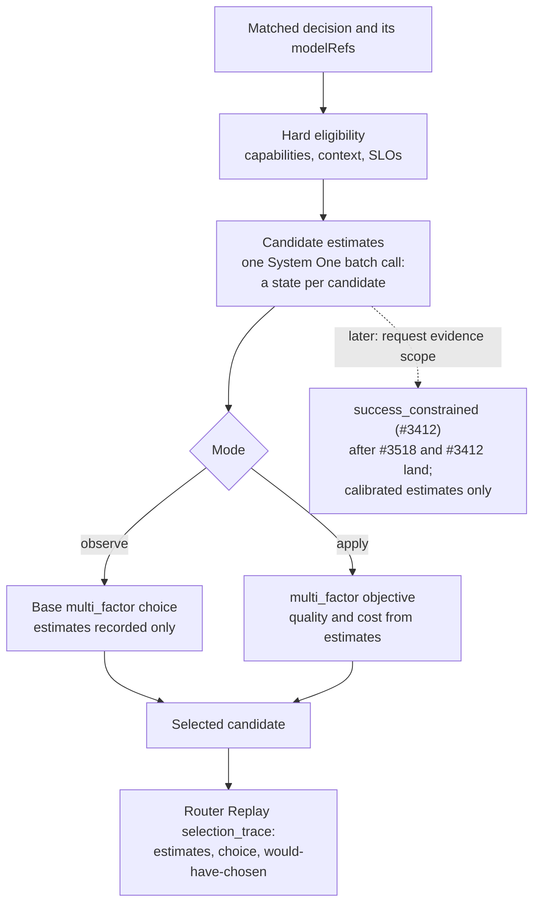

> **Status:** Proposal · **Created:** 2026-11-16 · **Issue:** [#6772](https://github.com/vllm-project/semantic-router/issues/6772) · **Related:** [#3412](https://github.com/vllm-project/semantic-router/issues/3412), [#3480](https://github.com/vllm-project/semantic-router/issues/3480), [#3518](https://github.com/vllm-project/semantic-router/pull/3518)

## Problem

A decision's `modelRefs` already describe more than models. Each reference can
carry `use_reasoning` and `reasoning_effort`, so a decision can offer the same
model with reasoning off and on, or two models at different efforts. Choosing
well between those candidates depends on the request: a short factual question
rarely needs a long reasoning trace, and a multi-step math problem often does.

No supported selector makes that choice per request with both accuracy and cost
in view:

| Selector | What it reads | Gap for this choice |
| --- | --- | --- |
| `static` | Configured order | Ignores the request |
| `random` | Nothing | Ignores the request |
| `multi_factor` | Catalog quality index per (model, effort), price, latency, load | Quality is the same for every request. Cost uses one configured `expected_output_tokens` for every candidate, and latency and load are read per model, so two efforts of one model differ only in catalog quality: the higher-scoring effort always wins. |
| `systemone` | The request and one description per candidate | One `choice` question over all candidates. Its probabilities say which candidate fits best, not how likely each is to succeed, and they carry no cost. It requires unique models, so it cannot choose between efforts of one model. Adding a candidate changes the question for every other candidate. |
| `routing_sampling` (Router Learning) | Online outcome evidence per model | Per model, not per request; the success-constrained work in [#3412](https://github.com/vllm-project/semantic-router/issues/3412) adds calibration but keeps that scope. |

Budgets have the same gap. `slo.max_cost_per_1m` caps a candidate's blended
price, not the expected cost of this request. Spend budgets
(`global.services.budgets`) refuse a call that would exceed a run or user limit.
Neither selects the most accurate candidate that fits a budget.

## Background: CONCUR

[CONCUR: A Framework for Continual Constrained and Unconstrained
Routing](https://arxiv.org/abs/2512.09386) (Chen, Li, Roth, Cafarella, Madden,
Andreas; ICLR 2026; [project page](https://peterbaile.github.io/concur/),
[code](https://github.com/peterbaile/concur)) routes each task to a
**computation strategy**: a pair of a model and a decoding method, such as
Qwen2.5-7B with chain-of-thought.

- **Modular predictors.** Each strategy has its own accuracy predictor (a
  binary classifier) and cost predictor (a regressor). Adding a strategy trains
  only that strategy's two predictors; existing predictors are unchanged.
- **Inputs.** The task text, and a text description of the strategy's model and
  decoding method. The reference implementation encodes both with a frozen
  sentence encoder and adds learned task-specific projections and strategy
  embeddings.
- **Unconstrained routing.** Choose the strategy that maximizes
  `w * accuracy - (1 - w) * cost`.
- **Constrained routing.** Maximize accuracy subject to a cost budget, either
  per task (local) or across a batch with a dynamic program (global).

The paper reports, on in-distribution tasks with five open models up to 8B and
two decoding methods, 75.2% average accuracy at lower cost than the best single
strategy (74.3%), and adding new strategies at 1.00x relative training time
against 7.66x for retraining the RTR baseline from scratch. Those results use FLOPs as
cost and a fixed task mix. This proposal does not assume they transfer; the
[evaluation](#evaluation) measures them on Router workloads.

## Proposal

Bring CONCUR's two ideas into the Router in the v0.5 shape:

1. **Per-request, per-candidate estimates.** For each candidate of a decision,
   estimate the probability that it answers this request correctly and the
   number of output tokens it will produce. Each candidate is estimated
   independently, so adding or removing a candidate never changes another
   candidate's estimate.
2. **Selection over those estimates.** `multi_factor` reads them as per-request
   quality and per-candidate cost, with an objective that matches CONCUR's
   unconstrained rule and a hard ceiling that gives its local constrained rule.

Later, once [#3518](https://github.com/vllm-project/semantic-router/pull/3518)
merges and the [#3412](https://github.com/vllm-project/semantic-router/issues/3412)
strategy is implemented, the same estimates can also become a request-scoped
evidence source for success-constrained selection. Nothing in steps 1 and 2
depends on that work; see [Relationship to success-constrained
selection](#relationship-to-success-constrained-selection).

Every new behavior is opt-in, starts in observe mode, and leaves existing recipes
unchanged when its fields are omitted.



## Fit with v0.5

v0.5 ([Decision Model as the First-Class Model](./decision-model-first-class))
makes the decision model answer every learned routing judgment, keeps
embeddings for recall only, and removed the trained selectors (`knn`, `kmeans`,
`svm`, `mlp`) together with their offline training pipeline. This proposal keeps
to those rules:

| CONCUR component | Reference implementation | In this proposal |
| --- | --- | --- |
| Strategy | (model, decoding method) | A `modelRef`: model plus `use_reasoning` / `reasoning_effort` |
| Strategy description | Embedded text | `providers.models[].description` plus the ref's `reasoning_description`, sent as the state's `candidate` part |
| Task representation | Frozen sentence encoder | The decision model reads the request; no embedding is computed |
| Accuracy predictor, one per strategy | MLP on embeddings | A `noul` question per candidate state: "will this candidate answer correctly?" |
| Cost predictor, one per strategy | MLP regressing FLOPs | A `choice` question per candidate state over output-length bands; cost is catalog price times tokens |
| Adding a strategy | Train its two predictors | Zero-shot: describe it. Trained form (later, optional): train its own binding only |

- **Zero-shot first.** Both questions are ordinary System One questions that any
  decision model answers zero-shot. A trained form, where one exists, is an
  optimization in the sense of the v0.5 principles, not a requirement.
- **No embedding path.** The estimate reads the request and the candidate
  description through the decision model. The CONCUR reference predictors
  (embedding plus MLP) appear only as an offline baseline in the evaluation.
- **No new selector type.** The estimates feed `multi_factor`, which already
  absorbed `automix`, `hybrid` and `latency_aware` as weights. The selector
  count stays at four.
- **Per-query scope.** The
  [routing-scope decision record](./batch-and-capacity-aware-routing) keeps
  joint batch assignment off the request path. CONCUR's global budget dynamic
  program stays offline; see [Budgets](#budgets).

## Candidate estimates

### The questions

Per request, the Router sends one System One call to the estimating deployment
(the decision model unless a `deployment` is named). The call is a batch with
one state per eligible candidate, following the existing call-merging rules:

```json
{"states": {
  "1": {"state": {"request": "If 3x + 7 = 22, what is x?",
                  "candidate": "qwen3-8b: fast general model. Reasoning off: answers directly."},
        "questions": {"preset:candidate_success": {"type": "noul", "instructions": "..."},
                      "preset:output_length": {"type": "choice", "instructions": "..."}}},
  "2": {"state": {"request": "If 3x + 7 = 22, what is x?",
                  "candidate": "qwen3-8b: fast general model. Reasoning high: works step by step before answering."},
        "questions": {"preset:candidate_success": {"type": "noul", "instructions": "..."},
                      "preset:output_length": {"type": "choice", "instructions": "..."}}}}}
```

| Preset | Type | Reads | Answer used |
| --- | --- | --- | --- |
| `candidate_success` | noul | `request`, `candidate` | P(yes): estimated probability of a correct answer |
| `output_length` | choice | `request`, `candidate` | Expected output tokens: the probability-weighted midpoint of bands such as under 256, 256 to 1k, 1k to 4k, over 4k |

`choice` is used for length because every decision model family answers it;
vela3-fast does not answer `score`. Band edges are part of the preset and open
for review.

### The typed estimate

Each eligible candidate receives one estimate, keyed by the full candidate
identity rather than the model name:

```yaml
candidate_estimate:
  candidate: {model: qwen3-8b, reasoning_effort: high}
  status: available               # available | unavailable | deadline_exceeded
  success_probability: 0.86       # the model's answer; not calibrated
  calibrated: false               # true only with an accepted calibration artifact
  calibration_version: ""
  expected_output_tokens: 1180
  estimated_cost: 0.00041         # catalog prices x (input tokens + expected output)
  currency: USD
  source: systemone               # systemone | trained (later)
  deployment: primary
```

- `success_probability` is never reported as calibrated without an accepted
  artifact, matching the conservative rules of #3480: a classifier or
  zero-shot probability alone is not `P(success)`.
- `estimated_cost` uses the same pricing fields and input-token demand that
  `multi_factor` uses today, with `expected_output_tokens` per candidate in place
  of the decision-wide forecast. It is still bounded by the candidate's
  executable output capacity.

### Failure and latency policy

- The estimate call has its own deadline, as the `systemone` selector has
  `timeout_ms`. A missing, failed or late answer marks
  that candidate's estimate `unavailable` or `deadline_exceeded`; it never
  fails the request.
- With any estimate missing in apply mode, `multi_factor` uses its existing
  `quality.on_missing` policy against the catalog index and the configured
  `expected_output_tokens`. It never mixes estimated and catalog quality within
  one candidate pool.
- Answers are reused through the existing System One result cache for identical
  request and candidate states.
- What leaves the host for a remote deployment is the request text and the
  candidate descriptions, the same parts the `systemone` selector sends today.

## Selection

### Unconstrained: a utility objective

CONCUR's rule is linear in raw accuracy and raw cost.
`multi_factor`'s weighted objective min-max normalizes each factor over the
candidate pool, so the trade-off shifts when a candidate is added. The
proposal adds one objective strategy, a utility over raw values:

```text
utility(candidate) = V * success_probability - estimated_cost
```

`V` is the operator's value of one correct answer in the pricing currency. It
is CONCUR's `w / (1 - w)` expressed in money, and it is the same
utility the counterfactual `policy_eval` tool already reports
(`V x resolved - cost`). The `weighted` and `lexicographic` strategies keep their
meaning and can also read estimated quality and cost.

### Constrained per request

A new SLO ceiling on estimated request cost removes candidates whose
`estimated_cost` exceeds it before the objective runs. With a lexicographic
objective whose first priority is quality, that is CONCUR's local constrained
rule: the most accurate candidate within the per-request budget. When no
candidate fits, the existing `on_no_candidates` policy applies (the default is
`cheapest`).

### Budgets

CONCUR's global mode spends one budget across a batch. The Router decides one
request at a time, so the proposal does not solve a batch on the request path.
Two per-request paths approximate it, and both are optional later phases:

- **Offline calibration of `V`.** On replayed estimates, choose the value
  whose per-request choices meet an average budget. This is the
  Lagrangian dual of the batch problem and runs entirely in evaluation tooling.
- **Pacing against a spend budget.** Adjust the value from a spend budget's
  remaining balance. This touches `global.services.budgets` and needs its own
  review; it is listed as an open question, not a commitment.

A dedicated bulk interface, which the decision record leaves open, could run the
exact dynamic program. That is out of scope here.

## Relationship to success-constrained selection

This part is gated and lands last. [#3518](https://github.com/vllm-project/semantic-router/pull/3518)
still conflicts with `main`, and [#3412](https://github.com/vllm-project/semantic-router/issues/3412)
is still a design. The candidate estimates, their use in `multi_factor`, the
per-request cost ceiling and the offline evaluation do not depend on either, so
they land first. Nothing in this section starts until #3518 merges and the
strategy from #3412 is implemented.

[#3412](https://github.com/vllm-project/semantic-router/issues/3412) selects the
cheapest candidate whose calibrated `P(success)` meets a target. CONCUR's
constrained mode is the dual: the most accurate candidate within a cost budget.
Both need the same input, a per-candidate success estimate, and differ in which
quantity is the constraint.

[#3518](https://github.com/vllm-project/semantic-router/pull/3518) (open) adds
typed success estimates over an immutable snapshot of Router Learning
experience, with scopes `cohort`, `decision`, `tier` and `global`. This
proposal builds on it rather than beside it:

| Item | Proposal |
| --- | --- |
| Evidence scope | Add `request`: the candidate estimate for this request, ahead of `cohort` in the lookup chain |
| Status | A request estimate is `unsupported` with reason `signal_not_calibrated_success` until a calibration artifact covers its candidate; then `calibrated` |
| Calibration artifact | Fitted offline per candidate (for example isotonic regression) on held-out sr-bench outcomes; owned by [#2341](https://github.com/vllm-project/semantic-router/issues/2341)'s calibration path |
| Candidate identity | Key estimates by model and reasoning effort; #3518 currently keys by model name |
| Dual objective | Add "maximize calibrated `P(success)` subject to expected cost within the per-request cost ceiling" beside "minimize cost subject to `P(success)` at least the target", both under `success_constrained` |
| Modes | Unchanged: observe first, apply only after #2240, #2341 and #2346, as #3412 states |

PR #3518 predates v0.5 and conflicts with `main`, so it needs a rebase onto the
v0.5 configuration contract before this work can extend it. Coordinate with its
author before changing the shared types.

## Configuration surface

All settings are decision-local, under the decision's `multi_factor` block.

- Estimates are opt-in. With them off, nothing is asked and `multi_factor`
  behaves exactly as today.
- In observe mode the Router computes and records the estimates and the
  candidate the estimate-based objective would have chosen, and keeps the base
  choice. This mirrors the `observe` contract of Router Learning adaptations.
- Estimated quality, the utility objective and the per-request cost ceiling
  are refused at load unless estimates are turned on. The first release accepts
  only observe mode; apply mode arrives in a later step with an experimental
  warning at load (see [Rollout](#rollout)).
- Candidates are ordinary `modelRefs`. Two efforts of one model are two refs,
  and a ref's existing `reasoning_description` describes its reasoning setting
  to the decision model.

## Diagnostics and replay

- **No new public headers or trace members.** `x-vsr-trace` has no selection
  member (see `pkg/headers/trace.go`), and this proposal does not add one.
- **Router Replay** carries the diagnostics in the record's existing
  `selection_trace` (`pkg/routerreplay/store/store.go`, typed in
  `pkg/selectiontrace`), which already holds `multi_factor`'s objective stages
  and per-candidate values. It adds, per request: each candidate's estimate
  (status, probability, calibration flag, expected tokens, estimated cost), the
  objective and its parameters, the base choice, the estimate-based choice, and
  the final choice. It stores no prompt text beyond what replay already stores.
- **Metrics:** estimate call latency and failures by deployment, and the rate
  at which the estimate-based choice differs from the base choice in observe
  mode.

## Rollout

Each step is a separate PR, gated on review of the one before. No step changes
routing for a configuration that does not opt in. PRs 1 to 4 do not depend
on #3412 or #3518; PR 5 is the only step that does, and it waits for both.

| PR | Scope | Gate | Routing change |
| --- | --- | --- | --- |
| **0** | This page, its row in the proposals index and its sidebar entry | Docs build | None |
| **1** | Offline evaluation: per-candidate prediction files, a predicted-utility policy and a budgeted policy (local and global dynamic program) in `policy_eval`; an sr-bench export recipe for the (model, effort) outcome matrix; the CONCUR reference predictors as an offline baseline script | Evaluation tooling only | None |
| **2** | `candidate_success` and `output_length` presets; the typed candidate estimate keyed by model and effort; the opt-in estimate setting, observe mode only; estimate fields in Router Replay's `selection_trace` | Opt-in, observe only | None |
| **3** | `multi_factor` reads estimates in apply mode: estimated quality, per-candidate expected tokens in cost, and the utility objective | Opt-in, experimental warning at load | Only for decisions that opt in |
| **4** | The per-request cost ceiling over estimated cost | Opt-in | Only for decisions that opt in |
| **5** | `request` evidence scope and dual objective in `success_constrained` | Starts only after #3518 merges and the #3412 strategy is implemented; then Router Learning observe and the #3412 apply gate | Per #3412 |
| **6** | Optional trained forms: per-candidate bindings trained from sr-bench outcomes, served by the model runtime | Separate acceptance by Router Models & Inference Runtime; only if PR 1 and PR 2 data show a zero-shot gap worth closing | None by itself |
| **7** | Tutorial and config reference; remove the experimental marker | Holdout results meet the graduation criteria | None by itself |

PRs 2 to 4 change the `router_config_contract` surface: the Go types,
`router-config-v0.5.schema.json` and the generated Dashboard contract, and the
Python CLI schema. They are additive, so `vllm-sr config migrate` has nothing to
rewrite.

## Code touchpoints

| Area | Location |
| --- | --- |
| Presets | `src/semantic-router/pkg/presets/` |
| System One calls | `src/semantic-router/pkg/modelservice/` (existing batch client) |
| Candidate estimate and selection | `src/semantic-router/pkg/selection/multi_factor.go`, `multi_factor_objective.go`, a new `candidate_estimate.go` |
| Config and validation | `src/semantic-router/pkg/config/selection_config.go` and its validator; `pkg/configschema/` regenerated |
| Success-constrained integration (PR 5 only) | `src/semantic-router/pkg/extproc/router_learning_success_*.go` (after #3518 merges) |
| Replay diagnostics | `src/semantic-router/pkg/routerreplay/store/` (`selection_trace`), `src/semantic-router/pkg/selectiontrace/` |
| Offline evaluation | `src/training/model_selection/policy_eval/`, `src/vllm-sr/cli/sr_bench/` export |
| Docs | `website/docs/tutorials/algorithm/selection/multi-factor.md` |

## Evaluation

The evaluation answers three questions, in order: do per-request estimates
choose better than today's selectors at the same cost; how far is the zero-shot
decision model from CONCUR's trained predictors; and what does the estimate
call cost on the request path.

### Data

- **Outcome matrix.** Run every candidate (each model at each reasoning setting)
  on the same frozen tasks with sr-bench, and export the per-task outcome,
  tokens and dollar cost (`vllm-sr benchmark export`).
- **Tasks.** sr-bench slices (`mmlu-pro`, `gpqa-diamond`, `livecodebench`,
  `simpleqa-verified`), plus the paper's sets for parity: MMLU, GSM8K and
  2WikiMultiHop in distribution; GPQA, HotpotQA and SVAMP out of distribution.
- **Splits.** Tune on sr-bench quick/dev, freeze, then evaluate the
  standard/holdout split once, as sr-bench prescribes. Trained baselines and
  calibration artifacts are fitted only on the training split.

### Policies compared

| Policy | Notes |
| --- | --- |
| Best single candidate | The strongest fixed (model, effort) pair |
| `static`, `random` | Existing selectors |
| `multi_factor` | Catalog quality index and configured forecast, weights swept over the same range |
| `systemone` | Run on a pool with unique models, since it cannot hold two efforts of one model; reported separately |
| `escalate` | Cheap to strong with `answer_check`, under the same budget |
| `routing_sampling` | Where the replay can reproduce its state |
| CONCUR, decision model | This proposal, zero-shot |
| CONCUR, reference | Embedding plus MLP predictors from the paper's code, offline only |
| Oracle | Knows every outcome; the upper bound |

### Metrics

- Accuracy and dollar cost per task, and the accuracy-cost frontier across
  values of `V`; area under that frontier.
- Accuracy at fixed per-request budgets (local) and at fixed average budgets
  (global dynamic program, offline), and how often a budget is exceeded.
- Calibration of `success_probability` per candidate: Brier score and expected
  calibration error, before and after the calibration artifact.
- Error of `expected_output_tokens` against actual output tokens.
- Request-path overhead: p50 and p99 latency of the estimate call, on
  vela3-fast on CPU and on a d3 deployment on GPU, by candidate count.
- Continual behavior: add a candidate to a frozen pool and report the change in
  accuracy and cost, the work needed (none for zero-shot, one binding for the
  trained form), and confirm other candidates' estimates are unchanged.

All comparisons are paired on the same tasks, with 95% intervals from resampling
tasks.

### Graduation criteria (proposed)

- On the holdout, the estimate-based `multi_factor` reaches higher accuracy
  than `multi_factor` with catalog quality at equal or lower cost, with the
  interval excluding zero.
- Observe mode on a live recipe shows no request failures attributable to the
  estimate call.

## Scope and non-goals

This proposal covers per-request candidate estimates, their use in
`multi_factor`, a per-request cost ceiling, offline evaluation, and replay
diagnostics. The request evidence scope for success-constrained selection is
a later step, gated on #3518 and #3412.

It does **not**:

- add an embedding-based decision path or restore a trained selector type;
- solve joint batch assignment on the request path;
- change the default selector, or the behavior of a recipe that does not opt in;
- train or ship a new decision model;
- replace `systemone`, `escalate` or Router Learning's `routing_sampling`;
- manage serving capacity, queues or replicas;
- treat an uncalibrated probability as a success guarantee.

## Open questions

- Is the zero-shot decision model a useful estimator of per-candidate success,
  or only of relative difficulty? PR 1 and PR 2 measure this before PR 3.
- Should trained forms live as per-candidate bindings in the model runtime, and
  how are their question IDs named, given that router-owned IDs contain a colon
  so they never turn on a trained adapter?
- Do estimates belong under `multi_factor`, or in a shared estimator block that
  `multi_factor` and Router Learning both read?
- Output-length bands: fixed in the preset, or configurable per decision?
- Cost unit: catalog currency by default; is a FLOPs mode worth keeping for
  parity with the paper?
- Budget pacing against `global.services.budgets`: in scope for a later phase,
  or left to a bulk interface?

## References

- Peter Baile Chen, Weiyue Li, Dan Roth, Michael Cafarella, Samuel Madden,
  Jacob Andreas. [CONCUR: A Framework for Continual Constrained and
  Unconstrained Routing](https://arxiv.org/abs/2512.09386). ICLR 2026.
  [Project page](https://peterbaile.github.io/concur/),
  [code](https://github.com/peterbaile/concur)
- [Feature #3412: Add calibrated success-constrained model selection](https://github.com/vllm-project/semantic-router/issues/3412)
- [Feature #3480: Define typed success estimates and immutable evidence snapshots](https://github.com/vllm-project/semantic-router/issues/3480)
- [PR #3518: Add typed success estimates and immutable evidence snapshots](https://github.com/vllm-project/semantic-router/pull/3518)
- [Feature #2341: Add adaptive thresholding and policy calibration](https://github.com/vllm-project/semantic-router/issues/2341)
- [Research #2346: Compare Router Learning algorithms under a shared benchmark protocol](https://github.com/vllm-project/semantic-router/issues/2346)
- [Decision Model as the First-Class Model](./decision-model-first-class)
- [Success-Constrained Model Selection](./success-constrained-selection)
- [Routing Scope: Per-Query and Capacity-Aware Routing](./batch-and-capacity-aware-routing)
- [Open Intelligence Index 1.0 and Unified Model Arena](./open-intelligence-index-and-model-arena)
- [Multi-factor selection tutorial](../tutorials/algorithm/selection/multi-factor)
- [sr-bench](../benchmarking/sr-bench/)
