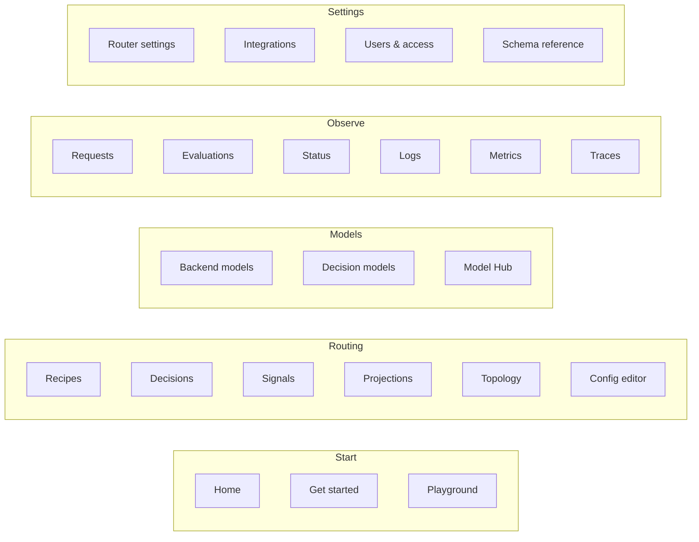

> **Status:** Proposal · **Created:** 2026-11-17

## Summary

The Dashboard has grown to 25 routes, 372 page and component files and 44,000
lines of hand-written CSS. Each feature arrived with its own header, width,
colors and table style, and navigation hides most pages two or three clicks
deep. Operators can configure a great deal but find it hard to answer basic
questions: is routing healthy, what did it cost, where do I change this, and
how does my application call the router?

This proposal replaces the presentation layer in one change:

- a sidebar information architecture in which every page is one click away,
  grouped by the operator's job, with a command menu for everything else;
- a design system built from semantic tokens with light and dark themes, the
  vLLM blue and gold brand, and one set of accessible primitives;
- shared page patterns: a compact page header, list pages with drawers,
  explicit empty and error states, and consistent charts;
- an operational **Home** page and a new **Get started** page that shows the
  endpoint, public model names and copyable client code;
- one schema source for every configuration form, the config editor and their
  validators, so every field of the canonical contract can be viewed and edited;
- redesigned complex editors (configuration editor, topology, rule builder,
  evaluation) on the same system.

Backend and Router changes are additive and limited to what the pages need
(see [API additions](#api-additions)). Every old route redirects to its new
location.

## Problem

An audit of the current Dashboard, run against the canonical
`config/config.yaml` with every page captured, found these issues.

| Area | Finding |
| --- | --- |
| Navigation | Two mega menus (**Build**, **System**) with three tabbed categories each. Most pages need two or three clicks. Insights and Evaluation sit under Build, Model Hub under System → Runtime, Global Config under System → Platform & Access while its page says "Runtime". |
| Naming | "Models" names four different things: backend models, public Mixture-of-Models names, the Model Hub catalog and System One decision models. "Brain" is the topology. Routing profile, routing scope, recipe and entrypoint are used interchangeably. |
| Page structure | At least five hero styles and three content widths. Titles repeat two or three times (a "Models" hero above a "Models · 11 items" card). Heroes take about a third of the first screen. |
| Visual system | 314 distinct hex colors, 483 distinct `rgba()` values, 145 font sizes and 58 border radii across 113 CSS modules, with two parallel variable vocabularies. The declared Inter font is not bundled, so text falls back to whatever the browser has. |
| Color meaning | AMD red is both the brand accent and the error color: primary buttons, failure states and benchmark bars share it. The navigation menu opens a cream panel on a black page. |
| Home | Opens with a slogan, then configuration counts that disagree with other pages (the home page counts every recipe; Signals and Decisions count the selected routing profile) without saying so. It does not show traffic, latency, cost or what needs attention. |
| Onboarding | Nothing shows how an application calls the router: no endpoint, model name or client example. |
| States | Raw `502 Bad Gateway` text, duplicated error banners, a full-page Evaluation error that removes navigation, and pages of "Not Reported" without a next step. |
| Tables | Every row carries bordered View, Edit and Delete buttons; filters are full-width native selects; one toolbar has five dropdowns. |
| Weight | A public marketing landing page and animated three.js backgrounds ship inside an authenticated control plane. |

The problems are structural. A new color palette over the same structure would
not fix navigation, naming, duplicated headers or missing workflows.

## Goals

- Every destination is reachable in one click; search reaches the rest.
- One visual language across every page in light and dark mode.
- Each page answers "what is this, is it healthy, what can I do" above the fold.
- New users can call the router from the Dashboard alone.
- Complex editors become approachable without losing expert workflows.
- Accessible by default: keyboard navigation, focus rings, contrast, reduced motion.

## Non-goals

- No breaking backend, API, Router or configuration contract changes. The few
  API additions the pages need are additive and listed under
  [API additions](#api-additions). The Router and model runtime changes the new
  pages surface landed separately: the Router names DeepSeek Harness requests
  (#6836), and the model runtime serves Vela 3.1-fast semantics (#6391), the
  Vela 3.1 picos (#6840) and a pinned vela3.1-fast (#6844).
- No new product capabilities beyond presentation, except the Get started page,
  which only presents existing information, and model health checks, which
  replace per-row refresh buttons.
- No internationalization in this change. Copy stays in English but is written
  so that strings can be extracted later.
- No React major-version upgrade. Primitives are written for React 18.

## Decisions

These choices were agreed before implementation.

| Topic | Decision |
| --- | --- |
| Stack | Tailwind CSS v4, Radix primitives through the `radix-ui` package, shadcn/ui conventions, `lucide-react` icons, `cmdk` and `sonner`. Existing `framer-motion`, `recharts`, `reactflow`, Monaco and `@lobehub/icons-static-svg` stay. |
| Themes | Light and dark, following the operating system by default, with a manual toggle. |
| Brand | vLLM blue `#30A2FF` drives interaction (primary actions, links, focus, selection). vLLM gold `#FDB515` marks brand moments such as savings and highlights. Neither encodes status. A gold accent preset is available as a user preference. |
| Navigation | Collapsible left sidebar grouped by job, a slim top bar and a ⌘K command menu. |
| Names | Pages and concepts may be renamed for clarity; documentation and translations change in the same pull request. |
| Scope | Every page, including the configuration editor, topology, rule builder and sr-bench evaluation, moves to the new system. |
| Public landing page | Removed. `/` opens Home after sign-in and the sign-in page otherwise. Marketing stays on vllm-sr.ai. |
| Internationalization | Out of scope for this change. |
| Model Hub | Model Hub stays a catalog. The Open Intelligence Index Arena and its rankings are removed from the Dashboard and from the website's `/models` page. The index data in the model catalog and its use by multi-factor selection are unchanged. |

## Information architecture

Settings collapses into one sidebar entry with its own sub-navigation, which
keeps the sidebar to 18 items. The account menu sits at the bottom of the
sidebar; documentation, GitHub and the Router API reference move to a help
menu in the top bar.

### Routes and names

| Before | After | Route |
| --- | --- | --- |
| Dashboard | Home | `/` (was `/dashboard`) |
| — | Get started | `/get-started` |
| Playground | Playground | `/playground` |
| Build → Mixture-of-Models | Routing → Recipes | `/routing/recipes` |
| Build → Decisions | Routing → Decisions | `/routing/decisions` |
| Build → Signals | Routing → Signals | `/routing/signals` |
| Build → Projections | Routing → Projections | `/routing/projections` |
| Build → Brain | Routing → Topology | `/routing/topology` |
| Build → Builder | Routing → Config editor | `/routing/editor` |
| Build → Models | Models → Backend models | `/models/backends` |
| Build → System One | Models → Decision models | `/models/decision` |
| System → Model Hub | Models → Model Hub | `/models/hub` (`/models` redirects here) |
| Build → Insights | Observe → Requests | `/observe/requests` |
| Build → Evaluation | Observe → Evaluations | `/observe/evaluations` |
| System → Status | Observe → Status | `/observe/status` |
| System → Logs | Observe → Logs | `/observe/logs` |
| System → Grafana | Observe → Metrics | `/observe/metrics` |
| System → Tracing | Observe → Traces | `/observe/traces` |
| System → Global Config | Settings → Router settings | `/settings/router` |
| System → MCP Servers | Settings → Integrations | `/settings/integrations` |
| System → Users | Settings → Users & access | `/settings/access` |
| System → Schema Reference | Settings → Schema reference | `/settings/schema` |

Every old path, including `/config/:section`, `/decision-model/*`,
`/insights/:id` and `/playground/fullscreen`, redirects with `replace` so
bookmarks, documentation links and alert URLs keep working.

Routing pages share one recipe scope selector instead of each page carrying its
own "routing profile" dropdown, and every count says which scope it covers.

## Design system

The system lives in `dashboard/frontend/src/ui` and is the only place that
defines colors, type, spacing, elevation and motion.

### Tokens

Tokens use shadcn/ui role names (`background`, `card`, `primary`, `muted`,
`border`, `ring`, `sidebar-*`) so stock primitives fit without edits, plus
`surface`, `surface-subtle`, `surface-sunken`, status roles with `-soft`
variants, and an eight-color categorical palette. Values are defined in OKLCH
for both themes; components never use raw color literals.

| Role | Purpose |
| --- | --- |
| Primary (vLLM blue) | Primary actions, links, focus rings, selection, active navigation |
| Brand gold | Logo, savings, highlights; never status |
| Success, warning, danger | Health and outcomes only |
| Neutrals | Canvas, surfaces, borders and text in three emphasis levels |
| Chart 1–8 | Data series and entity colors, tuned for both themes |

### Entities

Each concept keeps one color and icon on every surface, including tables,
drawers, charts, the topology and the command menu: recipe blue, decision
violet, signal gold, projection teal, backend model green with the provider's
logo, plugin rose, evaluation orange, system slate.

### Typography, shape and motion

- Geist and Geist Mono are bundled through Fontsource, so offline deployments
  render the same type. Mono is reserved for identifiers, code and copied
  values; metrics use tabular figures.
- A 4 px spacing grid, radii of 6, 8, 10 and 14 px, and five elevation levels.
- Motion is short and interruptible: content enters in 420 ms with a 6 px rise,
  overlays in 200–300 ms, indicators move with a shared-layout spring, and the
  theme switch uses a View Transitions reveal. `prefers-reduced-motion` disables
  all of it.

## Application shell

- **Sidebar.** The vLLM Semantic Router wordmark (black and white variants for
  the two themes, the vLLM mark when collapsed), kept at its own proportions,
  with a fixed-width pill beside it that shows the short release, as LiteLLM
  shows it; the pill opens the full version and the instance details. Below it, grouped navigation with an animated active indicator,
  attention badges (for example a running evaluation or a degraded service),
  Settings and the account menu. It collapses to an icon rail with ⌘B and
  becomes a drawer on small screens.
- **Top bar.** Breadcrumb, search that opens the command menu, a router status
  icon linking to Status, notifications for deploys, evaluations and
  health events, the theme toggle and the help menu.
- **Command menu.** ⌘K searches pages, recipes, decisions and backend models,
  and runs actions such as creating a decision or starting an evaluation.

## Page patterns

| Pattern | Rules |
| --- | --- |
| Page header | Icon, title, one sentence of purpose, primary actions on the right, optional tabs. No hero sections. |
| List page | Search and filter chips, a table with sortable headers, row click opens a detail drawer, row actions in an overflow menu, a floating bar for bulk actions. |
| Detail drawer | Header with identity and status, tabs (Overview, domain tabs, YAML), a scrolling body and a sticky footer that shows unsaved changes. Drawer state lives in the URL. |
| States | Skeletons while loading. Empty states explain what the page is for and offer the next action. Errors name the cause and the fix (for example "Restart required: run `vllm-sr serve`") and never remove navigation. |
| Forms | Labeled fields with hints and inline errors, inherited defaults shown as placeholders, changes reviewed as a YAML diff with hot reload or restart called out before saving. |
| Charts | Recharts with shared axes, grid and tooltip; missing samples are shown as unknown, never as zero. |

## Pages

- **Home** greets the operator and shows, from existing APIs: anything needing
  attention, requests, p95 latency, spend and savings with trends, traffic over
  time, routing mix by decision, models in use, public models, recent requests,
  service health and a setup checklist. Each card loads on its own, so a slow
  call never holds the page, and a range's last snapshot shows at once while it
  refreshes. The decision model card and the checklist read the model runtime,
  as Models does.
- **Get started** shows public model names, the base URL clients call (the
  address a deployment declares in `VLLM_SR_PUBLIC_BASE_URL`, else the
  listener's address labelled as derived) and copyable
  examples for cURL, Python and TypeScript, and connection steps for the coding
  agents the Router identifies (Claude Code, Codex, OpenCode and DeepSeek
  Harness), explains the `x-vsr-*` response headers, and waits for the first
  request.
- **Playground** fills the viewport, each pane scrolling on its own, with chats
  on the left, the conversation in the center and a routing trace on the right:
  signals with scores, the matched decision and why it won, candidate models,
  plugins, headers and the request.
- **Recipes** groups public model names, recipe packages and route probes, and
  previews activation changes, including whether a restart is required.
- **Decisions, Signals, Projections** use the list pattern, and every field of
  the canonical contract is viewable and editable: all 20 signal types, every
  decision field, all nine algorithms with their parameters, all eleven plugins
  in order, and partitions, scores and mappings. The rule builder replaces the
  free-form graph with nested All/Any/NOT groups that read like the DSL, with
  the graph available as a view. Signals can be tried against the router with
  a sample prompt, and projections show weights, bands and calibration with
  live meters. An edited rule keeps its position, and unset fields are not
  written with defaults.
- **Topology** draws entrypoint, signals, projections, decisions and models as
  lanes, groups signals by type so the default view is readable, and highlights
  the path a test prompt takes.
- **Config editor** is an editor workspace with an outline, Monaco with themes
  matching the design system, a problems panel with quick fixes, version
  history and a review step with a diff, checks and the reload or restart
  outcome before deploying.
- **Backend models** show health, latency, price, traffic share and the
  decisions that use each model, with health kept current by one cached batch
  check rather than per-row refresh buttons; the drawer covers endpoints, evaluation
  evidence and YAML. Connecting a model starts from a provider grid.
- **Decision models** separate saved configuration, activation and observed
  readiness, and keep deployment, playground and monitoring as tabs. The
  catalog lists every release whose family the Router's decision catalog
  serves, grouped by family: Vela 2.0, the Vela 3.0 sizes, Vela 3.1 (vela3.1-fast
  and the 150M and 380M picos) and Decision 1.0, 2.0 and 3.0 including d3-ultra
  and d3-turbo. The catalog generator projects them from the runtime registry, so
  a new pinned release appears without page changes. On a CPU-only instance the
  page recommends the first servable of vela3.1-fast, vela3.1-pico-150m and
  vela3.1-pico-380m, else vela3-fast.
- **Model Hub** is a catalog: search, filters by provider and capability, model
  details with specifications, pricing and published evidence, and an "add as
  backend" path. It no longer shows the Open Intelligence Index Arena or
  rankings, and neither does the website's Model Hub.
- **Requests** replaces Insights: a filterable live table of the last 24 hours
  (other ranges on demand) paged on the server, agent runs loaded when their tab
  opens and bounded by the range, reviews, and a request page with the full
  routing trace. Every request shows the
  coding-agent harness that sent it (Claude Code, Codex, OpenCode or DeepSeek
  Harness, with its logo) and, when the harness names them, the session and its
  title, whether the main agent or a subagent made the call, the turn, the tools
  used and the session routing action. Housekeeping calls such as session titles
  can be hidden, and a session opens its run: a one-line title with the full
  task one click away, key figures, a timeline with one lane per agent that
  shows 100 calls at a time and folds idle stretches, and paged calls, agents
  and outcomes. One harness registry serves every page. Lists stay
  live and pause while hidden or under the pointer, a request that failed after
  its status line went out reads as failed, and spend leads with the currency
  that carries it.
- **Evaluations** is redesigned around sr-bench's own objects rather than
  restyled. The header keeps one action, New evaluation; Runs and Datasets are
  the only tabs, experiments become a filter and grouping of runs, and
  comparing is a selection action. A run row shows its benchmarks, targets,
  live progress, the best score with its target and the cost; the run sheet
  holds results per target and benchmark, call evidence, activity and the
  frozen protocol. New evaluation is a stepped sheet (what to measure, what to
  compare, limits, then a review with estimated questions, cost and time) with
  dataset preparation inline and routing preview as a dry run.
- **Status, Logs, Metrics, Traces** follow the same patterns. Status shows the
  Router, the deployment and the decision model in cards of equal height. Logs
  reads the bounded log spool or, in Kubernetes without one, the Router and
  Dashboard pod logs through the API with the Dashboard's service account, each
  line naming its pod. Metrics charts the Router's Prometheus series natively
  through the Dashboard's Prometheus proxy, and Traces lists summaries the
  Dashboard builds from Jaeger, then opens one trace at a time in a span
  waterfall; Grafana stays one link away when it is configured.
- **Settings** groups router settings, integrations, users and access, and the
  schema reference behind one sub-navigation. Router settings render every
  global field from the generated contract in cards with an on-this-page index:
  inherited values show as placeholders, edits carry a marker with undo, and a
  sticky Review & save shows the YAML diff and whether the change hot-reloads
  or needs a restart. A Form and YAML toggle replaces the old editor, and a save
  sends only the edited keys. Users & access sorts and filters through the
  backend list stores and keeps an audit timeline.
- **Sign-in and setup** use a calm full-screen layout without three.js; the
  first-run wizard connects models, chooses a recipe and a decision model,
  reviews the configuration and activates it with visible progress.

## Implementation

- **Structure.** `src/ui` holds tokens and primitives, `src/shell` the
  application frame and navigation model, and pages keep owning their data
  fetching and state as `dashboard/frontend/src/AGENTS.md` requires.
- **One schema source.** The configuration pages and the config editor share
  one set of modules in `src/lib`: the decision and projection schemas, one
  required-field validator and the YAML renderer in schema order. Parity tests
  hold both callers to the generated contract and fail when the Router's
  inventories add a signal type, algorithm or plugin the Dashboard does not
  edit. The duplicate schemas, page-level field lists and their validator are
  removed.
- **Coexistence during the change.** Tailwind is loaded with its reset and
  explicit `@source` paths. Legacy CSS variables map to the new tokens first,
  so every remaining page adopts the palette immediately; page-level CSS
  modules are then replaced as each page is rebuilt, and deleted when unused.
- **Removals.** The landing page, three.js backgrounds, the auth transition
  scene, the mega menu, the duplicated page heroes, and the Model Hub Arena in
  both the Dashboard and the website (`ModelHubArena` components, their styles
  and support code). The catalog's index data, the Router and the index
  methodology page stay.
- **Repository detail.** The root `.gitignore` ignores every `models` path
  segment and every `build/` directory, so new source directories must not use
  either name; Git would not track them and Tailwind would not scan them.
- **Bundle.** Fonts and Radix add weight; three.js and the landing assets are
  removed. Route-level code splitting stays, and the pull request reports the
  production bundle size before and after.

## API additions

Each change is additive except one: spool log lines name their component in a
field rather than a `[component]` prefix.

| Surface | Addition | Used by |
| --- | --- | --- |
| Dashboard `GET /api/models/health` | Health of the configured backend models in one call. Each backend gets a cheap read, never inference: its `reliability.health_check_path`, else the provider's model list, else its base URL. Results are shared between viewers for 20 seconds; `?model=` narrows the check and `?refresh=1` checks again. | Backend models, Home |
| Dashboard sr-bench run list | Finished runs carry a compact summary (best score and recorded cost), read once per report and cached, with bounded reads per list. | Evaluations |
| Dashboard users and audit lists | Comma-separated multi-value filters, sorting by column, and the most frequent actors and actions as filter facets. | Users & access |
| Dashboard global configuration YAML view | Shows the written `global` block when another part of `config.yaml` does not parse, instead of failing. | Router settings |
| Router Replay `aggregate` | An optional `interval` with `since` returns `traffic`: the records in contiguous intervals from `since` to now. | Home |
| Dashboard setup state | `publicBaseUrl` and `publicRequiresKey`, from `VLLM_SR_PUBLIC_BASE_URL` and `VLLM_SR_PUBLIC_REQUIRES_KEY`. | Get started |
| Dashboard logs | Without a spool, a Dashboard in Kubernetes reads pod logs through the API (pods `list`, pods/log `get`); responses add `components`, `namespace`, `pods` and each line's `pod` and `timestamp`. | Logs |
| Dashboard `GET /api/observability/traces/summaries` | Searches Jaeger from the Dashboard and returns one small summary per trace (root operation and service, services, spans, errors, start and duration), bounded to 100 traces, 20 seconds and 256 MiB of answer. | Traces |

## Compatibility

- Authentication, CSRF, permissions and read-only behavior are unchanged;
  pages hide or disable actions with the same permission checks, and existing
  endpoints keep their responses.
- All old routes redirect. Deep links that carry state, such as
  `/topology?scope=…`, map to the new parameters.
- Documentation that names menu paths (installation, tutorials, benchmarking,
  API pages and `dashboard/README.md`) is updated with the new names, and the
  zh-Hans translations are updated or marked stale by the translation audit.
- The website's `/models` page keeps its catalog and provider sections; links
  to its former `#arena` anchor fall back to the catalog. The Open Intelligence
  Index proposal records that the Arena display was retired while the index
  continues to inform multi-factor selection.

## Validation

- `make dashboard-check`: lint, type check, frontend unit tests and backend tests.
- The graphite theme contract test is replaced by a design-token contract that
  rejects raw color literals outside `src/ui` and checks both themes define
  every role.
- Playwright specs that assert navigation and layout move to the new routes
  and roles; `make dashboard-test-e2e-evaluation` stays green.
- Each page is reviewed in light and dark mode at desktop and mobile widths.
- A live deployment is signed in to and every page opened in both themes, and
  requests from Claude Code, Codex, OpenCode and DeepSeek Harness are checked
  on the Requests page with their harness, session and agent.
- Screenshots of the redesigned pages accompany the pull request.

## Rollout

The proposal and implementation land in one pull request, organized as a
series of commits that can be reviewed in order: design system, shell and
navigation, redirects, then pages grouped by area, then documentation. A local
preview with fixture data was used to agree on the design before the
implementation began; it is not part of this change.

## Risks

| Risk | Mitigation |
| --- | --- |
| A large diff is hard to review | Ordered commits, unchanged backend, screenshots per page, and redirects that keep old behavior reachable. |
| Regressions in rarely used workflows | Pages keep their data hooks and controllers; only presentation changes, and existing unit tests stay. |
| Documentation drift | Menu-path references are updated in the same change and checked by search. |
| Styling conflicts during migration | Legacy variables aliased to tokens, and CSS modules deleted only after their page moves. |

## Follow-ups

These are gaps the pages work around today:

- Claude Code names a subagent only when it sends the agent hint headers, so
  without them a subagent's calls cannot be told apart from the main agent's.
- Router Replay records neither a request class (an agent turn or a
  housekeeping call such as a session title) nor Claude Code's agent type, so
  the page infers housekeeping calls from their shape.
- A run summary carries no turn count; the page counts turns from the records
  it loaded.
- Router Replay builds the aggregate's filter options with a full scan on each
  cache miss, `/runs` has no `until`, list summaries carry no session name, and
  a run comes back with every call at once, so the run page pages in the
  browser.
- The Helm chart's pod labels and Role do not match the Kubernetes log source
  yet, and the setup wizard still derives the base URL from the listener.
