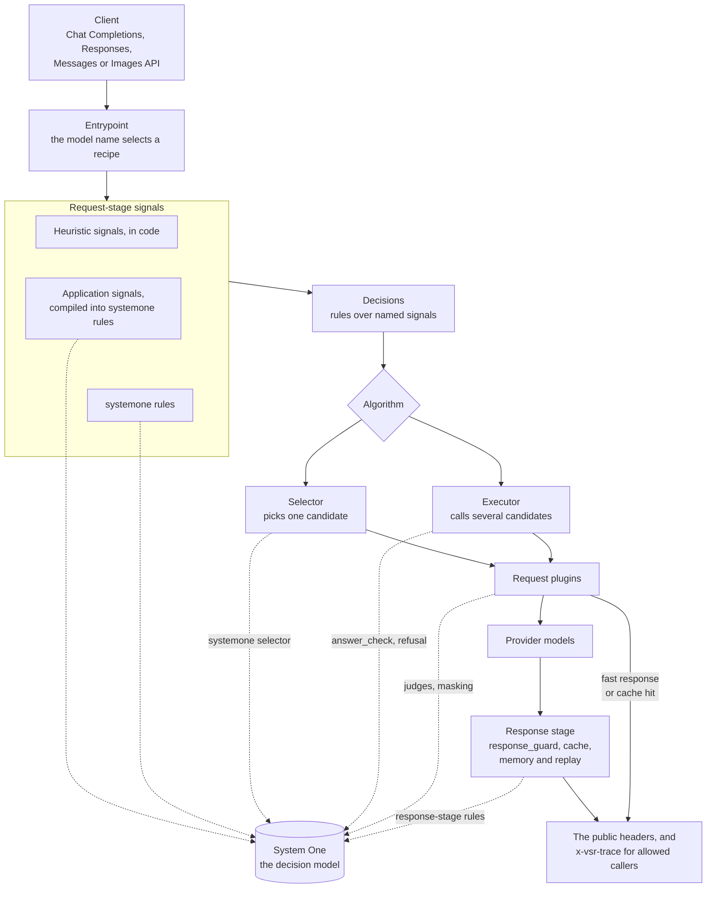
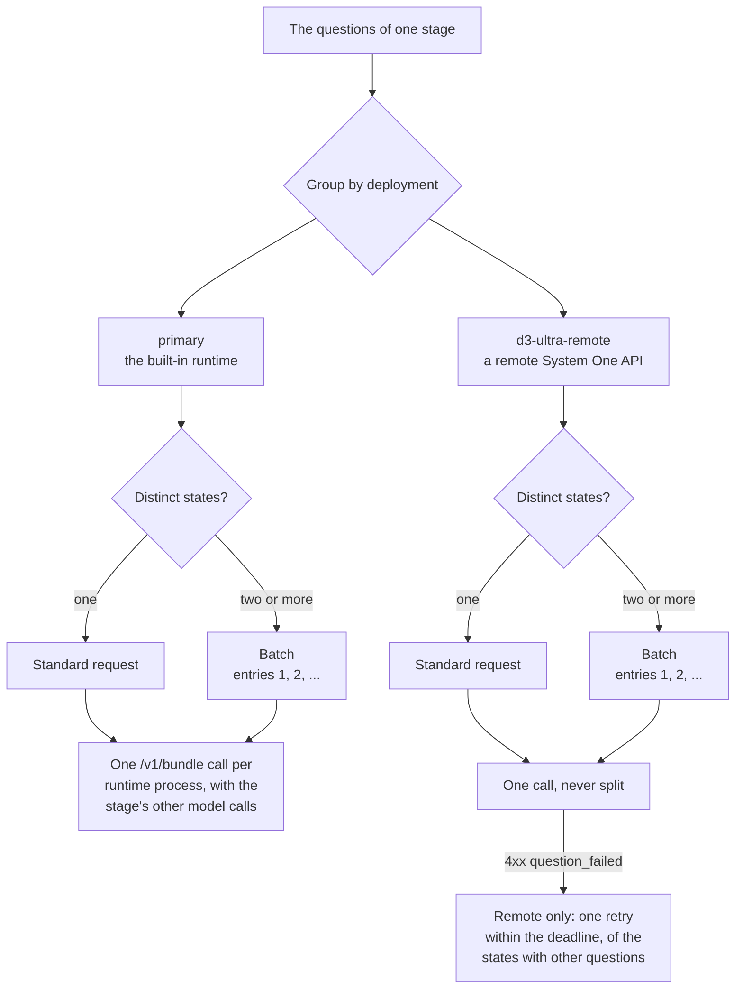
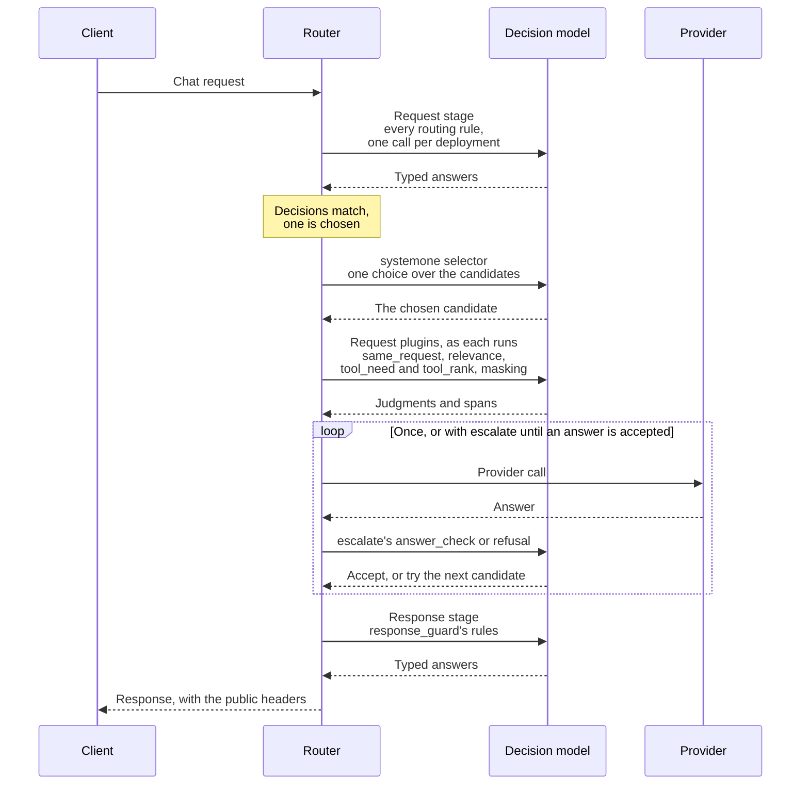
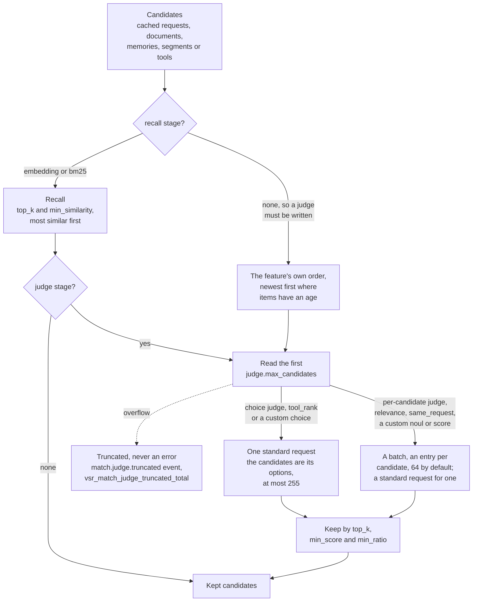
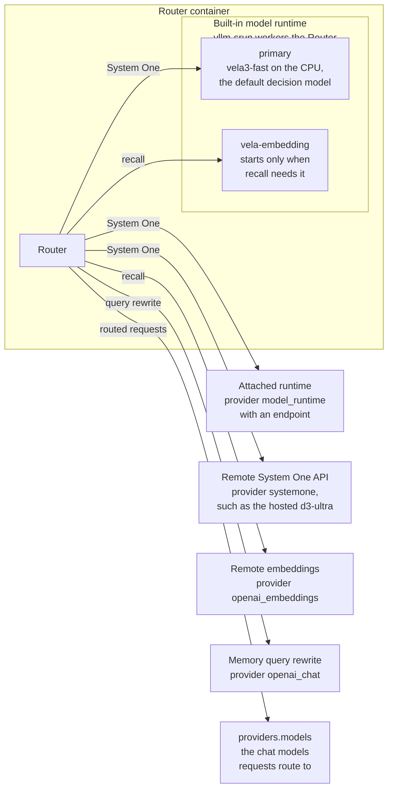
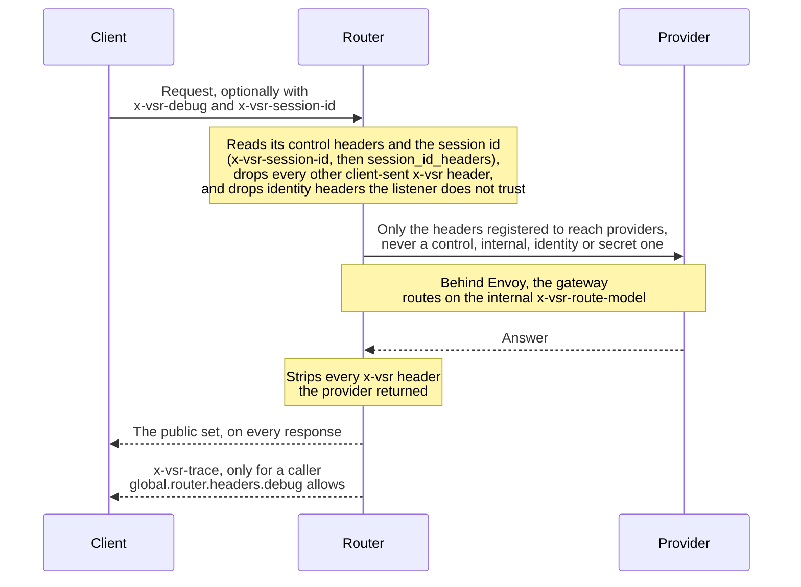
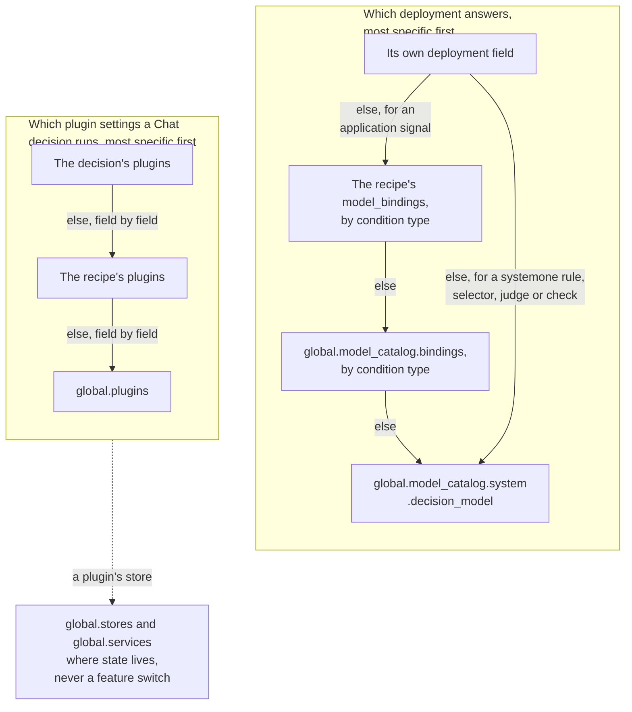
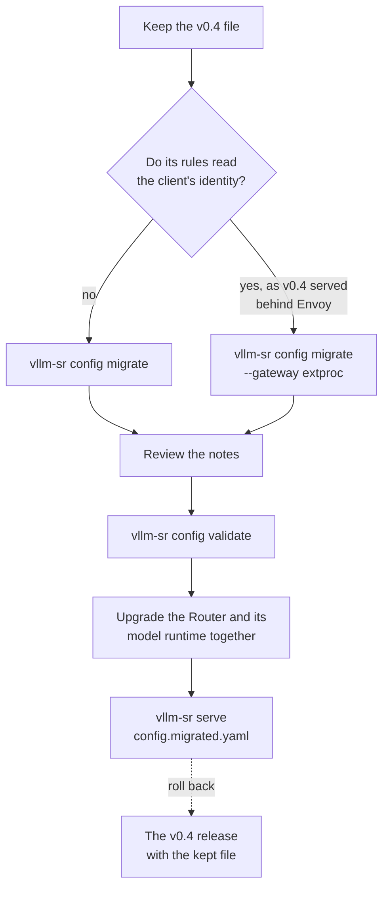

> **Status:** Implemented in [#5886](https://github.com/vllm-project/semantic-router/pull/5886) · **Created:** 2026-11-05 · **Builds on:** [#5853](https://github.com/vllm-project/semantic-router/pull/5853)

This proposal records why v0.5 makes the decision model the first-class model
of the Router, and how the parts of that design fit together. The user
documentation says how to use it, and this page links to it rather than
repeating it:

- [System One](../system-one/overview) explains the decision model, its API,
  its deployments and how the Router asks it.
- [Migrate to v0.5](../installation/migrate-to-v0-5) lists every removed form,
  the error it loads with and what `vllm-sr config migrate` writes instead.
- [The v0.5 release note](../release-notes/decision-model-first-class) lists
  the breaking changes, the behavior to expect and the header mapping.

## Summary

The Router already answered most routing questions with one family of models,
the System One decision models: Vela 3.0, Decision 3.0 (d3), and the earlier
Decision and Vela 2.0 releases. They answer typed questions (choice, yes/no,
score, set and span) zero-shot. The configuration, the plugins and the
algorithms still described an older system, in which each signal had its own
small specialist model or an embedding-similarity trick.

v0.5 makes the decision model the first-class model for intelligent routing:

- **One model answers every judgment.** The signals, the `systemone` selector,
  `response_guard`, `masking`, the `match` judges, the `tools` selection and
  `escalate` all ask System One questions, through one client and one API.
- **Signals have three layers:** the `systemone` primitive for questions an
  operator writes (renamed from `decision`); eleven **application signals**,
  each compiled into one `systemone` rule over a canonical preset; and seven
  deterministic **heuristic signals**.
- **Zero-shot first.** Every decision model answers every preset zero-shot.
  Trained bindings and calibrated thresholds are per-family optimizations,
  never requirements. Models differ in the question types they answer
  (Decision 1.0–3.0 return no spans, vela3-fast answers no score question): a
  question must resolve to a deployment that answers its type, or the
  configuration fails to load.
- **Similarity has one `match` block**, with an optional `recall` stage
  (embedding or BM25) and an optional System One `judge` stage. Every judge
  has a hard cap, `judge.max_candidates`, and overflow is truncated, never an
  error.
- **Embeddings serve recall only, and start lazily.** No decision path reads
  an embedding. The pre-declared `vela-embedding` deployment starts only when
  the response cache, memory, a vector store or a RAG source recalls with it.
  The Router's embeddings API and `embeddings.multimodal` are removed.
- **One way to call System One:** a standard request (one state and its
  questions) or a batch of named standard requests, never mixed. The Router
  merges each stage's calls by deployment and by state, and the model runtime
  contract is 4.0.0.
- **Multimodal output is a decision contract**, `output: {kind, action}`,
  checked at load. Image generation, and text with an image from one model,
  ship in v0.5, together with an Images API entry.
- **Algorithms are selectors or executors.** `escalate` replaces the Looper
  `confidence` algorithm and the native `cascade`.
- **Plugins only act**, on the signals they name. There are eleven plugin types.
  A response guard that can block or change an answer holds a streamed answer
  until it has read all of it, and the response cache stores only what the
  guard released.
- **The configuration has one structure** at schema `v0.5`: defaults in
  `global`, routing in flat `recipes`, model facts on `providers.models[]`,
  no top-level `routing` and no `global.model_catalog.modules`. Prompt
  compression is the `signals` part of the context plugin's `compress` block.
- **The response headers are a public set**, with one debug header,
  `x-vsr-trace`, for the callers the operator allows.
- **Canonical forms only.** Every removed form fails at load with a one-line
  hint. `vllm-sr config migrate` rewrites a configuration of any earlier
  version to v0.5 in one run: it rewrites what maps, and drops what v0.5 cannot
  execute or no longer reads, with a note that says how to restore it. The
  only alias is `decision`, which loads as `systemone` with a warning.

## 1. Background

### 1.1 How the Router came to ask one model

The Router's learned judgments went through three generations of models.

1. **Specialist heads and embeddings (Vela 1.0).**
   - Each learned signal had its own fine-tuned encoder head: domain,
     jailbreak (the prompt guard), PII, fact-check need, hallucination, user
     feedback, output modality and hazard categories. An embedding model and a cross-encoder
     reranker served similarity.
   - Signals without a head were built on embedding similarity: example banks
     (`embeddings`, `kb`), difficulty margins (`complexity`), `preferences`,
     contrastive jailbreak detection, `reask`, and the `router_dc` selector.
   - Offline-trained selectors (KNN, KMeans, SVM and MLP) predicted a model
     from a query embedding.
2. **Decision models (Vela 2.0, Decision 1.0 and 2.0).** A model reads a state
   (the request) and a typed question, and returns probabilities. Vela 2.0
   answered the Router's built-in signals this way, with thresholds calibrated
   to keep the Vela 1.0 operating points.
3. **System One, Decision 3.0 and Vela 3.0.**
   - The System One protocol (`/v1/systemone`, `/v1/decisions`) became the
     common interface of every decision model.
   - Decision 3.0, the d3 family with the hosted d3-ultra, answers choice,
     yes/no and score questions zero-shot over text, images and video.
   - Vela 3.0 added `vela3-fast`, a CPU-friendly encoder that is the default
     decision model, and larger sizes (`vela3-lite`, `-mini`, `-flash` and
     `-turbo`) that run a pinned d3 base with adapters trained on the Router's
     built-in questions and span heads.

Two pieces of infrastructure came with them. The built-in
[model runtime](../model-runtime/overview) serves the decision model and the
embedding model next to the Router, in place of in-process model bindings.
[#5853](https://github.com/vllm-project/semantic-router/pull/5853) unified
where models are named: deployments are declared once in
`global.model_catalog.deployments`, connection blocks are shared, every
reference is resolved and checked at load, and `vllm-sr config migrate`
rewrites the older forms. It merged after the v0.4.0 release, so v0.5 is the
first release that carries it, together with this design.

By then the built-in signals were already System One questions, answered by
vela3-fast through the shared `primary` deployment. The configuration, the
plugins and the algorithms had not followed.

### 1.2 System One in brief

A System One model reads a **state**, the text a question is about, made of
named parts: `request` (the current user turn), `history`, `previous_turns`,
`previous_answer` (the assistant answer the current turn replies to),
`tool_results`, `candidate`, `answer`, `context`, and the current turn's
images and videos. It answers **typed questions** about the state with
probabilities:

| Type | Asks | The answer a rule reads |
| --- | --- | --- |
| `choice` | Which of 2 to 255 described options fits? | P(option) |
| `noul` | Is this true? (System One's yes/no type) | P(yes) |
| `score` | How much, on 2 to 10 ordered levels? | The expected level |
| `set` | Which of 1 to 255 labels apply? | P(label) |
| `span` | Where in the text is each label? | The most probable span of a label |

A question is written in plain language, with a description for each option,
so a model answers it without training. [System One concepts](../system-one/get-started/concepts)
covers the state, the stages and the limits.

## 2. Motivation

Through v0.4, the Router carried the older system next to the model that had
replaced it, and the cost showed in ten places.

1. **Several ways to ask one question.**
   - A `classifiers` rule without a model, a `complexity` rule without example
     banks and a `preferences` rule were each a System One question in another
     shape. `preferences` even chose one of three methods from the shape of its
     data.
   - Typed signals carried fields that meant something only to an old
     implementation: `jailbreak.method: contrastive`, `safety.labels` and
     `unsafe_labels`, `domains.mmlu_categories`, the modality keyword fallback,
     and the cosine `reask.threshold`.
2. **Old models in new paths.**
   - The `hazard` part of a `safety` rule ran a Vela 1.0 head against a single
     threshold.
   - RAG reranking used the Vela 1.0 cross-encoder.
   - Embedding similarity was the final classifier in several signals and
     plugins.
   - Model keywords such as `mmbert` selected embedding models and created
     implicit deployments.
3. **Trained capability left unused.**
   - The Router asked every built-in question under its own `<consumer>:<key>`
     ID. The Vela 3.0 d3 sizes turn a trained adapter on by exact question ID,
     so they answered the built-in signals with every adapter off.
   - vela3-fast has a trained 34-label hazard question that the Router never
     asked.
4. **Silent calibration fallback.** A model without calibrated thresholds
   silently inherited the Vela 1.0 specialists' thresholds.
5. **Plugins that hid detection and conditions.**
   - `masking` ran its own PII classifier.
   - `hallucination_action: block` was accepted, and nothing blocked.
   - RAG's `min_confidence_threshold` retrieved only when a fact-check rule
     matched: a routing condition hidden inside a plugin.
   - `system_prompt` `mode: append` replaced the caller's prompt.
   - `header_mutation` could write headers the Router owns, its route key
     among them.
6. **Duplicated algorithms.**
   - `prompt` and `router_dc` chose a model from descriptions, which one
     decision-model question does.
   - `automix`, `hybrid` and `latency_aware` weighed factors that
     `multi_factor` scores.
   - The trained selectors needed their own offline training pipeline.
   - The Looper `confidence` algorithm and the native `cascade` were one
     escalation mechanism under two names and two configuration shapes.
   - Algorithm types the Router refused at load were still compiled.
7. **Heuristic overlap.** `events` was an "any of these words" keyword rule,
   `structure` was regex counting, `actions` was an English regex intent
   classifier, `conversation.image_content` duplicated `input_modality`, and
   `topic_continuity` was an English lexicon package for what one question
   about the conversation answers.
8. **Configuration structure.**
   - The top-level `routing` block was an implicit default recipe, recipes
     nested their own `routing` block, and model cards (`routing.modelCards`)
     lived apart from the provider entry of the same model.
   - `global.stores` and `global.services` held feature switches (the response
     cache's `enabled` and similarity threshold, memory's `enabled`, the replay
     capture settings), while decisions turned the same features on through
     plugins.
   - Tool selection was spread over `global.integrations.tools` and two
     plugins, and RAG, memory and context compression were three plugins acting
     on the same context. Prompt compression, which shortens the text the
     signals read, sat apart from all of them in `global.model_catalog.modules`.
9. **Multimodal output.** The `modality` names `AR`, `DIFFUSION` and `BOTH`
   mixed the output medium with a backend architecture. Nothing checked at
   load that a selected model could produce the output, or that the client's
   API could carry it, and `BOTH` suggested a two-model fan-out that did not
   exist.
10. **Headers.** When the header registry first recorded them, the Router read
    or wrote about 150 headers, 55 of them on the debug surface, with duplicate
    pairs such as `x-vsr-protocol-warnings` and `x-vsr-response-warnings`, and a
    route key outside its own namespace (`x-selected-model`).

## 3. Goals and non-goals

**Goals**

1. The decision model answers every learned signal, selector and plugin
   judgment, through one execution path.
2. Any System One model answers any question it supports zero-shot. Trained
   bindings and calibrated thresholds are used where they exist.
3. Clear layering: signals observe, decisions route and gate, plugins act, and
   the global blocks say where stores and services are.
4. No classifier heads, rerankers or embedding-similarity classifiers from
   older model generations. Embeddings serve recall only, and the embedding
   model runs only when a recall feature needs it.
5. One canonical configuration form per concept. Every removed form fails at
   load with a hint, and `vllm-sr config migrate` rewrites any earlier
   configuration in one run.
6. Multimodal output declared once per decision, and validated at load.
7. A governed header surface: a small public set, one gated debug header, and
   a registry that tests enforce.

**Non-goals**

- Training new models or adapters.
- Changing the semantics of `fusion`, `remom`, `ratings` or `workflows` beyond
  their configuration shape.
- Redesigning the #5853 model catalog.
- The codecs of multimodal phases 2 and 3: image edits, speech, audio and
  video output.
- Rewriting cluster resources. `vllm-sr config migrate` rewrites configuration
  files, not `IntelligentRoute` resources.
- Gating the release on quality measurements. They are listed under
  [Follow-ups](#11-follow-ups).

## 4. Overall design

### 4.1 Principles

1. **Zero-shot first.** Every System One model answers every preset and every
   custom question it supports, zero-shot. Trained bindings (question IDs,
   wording, option sets) and calibrated thresholds are optimizations bound per
   model family. The hard requirements are that the model answers the question
   type, reads the medium of its input, and fits the input in its context.
2. **Three signal layers.** `systemone` is the primitive. Application signals
   compile into `systemone` rules. Heuristics are deterministic code.
3. **Layering.**
   - Signals observe the request, the session or the answer. Only signals hold
     detectors and thresholds.
   - Decisions combine signals into conditions, and choose the models, the
     algorithm, the plugins and the output contract. They also carry
     per-decision attributes (`retention`, `output`).
   - Plugins act, and reference signals by name.
   - `global.stores` and `global.services` say where stores and services are.
     They never turn a feature on.
4. **One `match` block for similarity.** `recall` narrows a candidate set by
   embedding or BM25 similarity, and `judge` decides with a System One
   question. Each feature uses the stages it needs. A judge's input is capped,
   and overflow is truncated rather than failing the request.
5. **Canonical forms only.** Removed forms fail at load with a one-line hint,
   and migrate rewrites them. The only alias is `decision`, which loads as
   `systemone` with a warning.
6. **Cleanup over preservation.** Overlapping, low-value and
   old-implementation-only signals, fields and plugins are merged or removed.

### 4.2 Architecture

The diagram follows one request through the Router. Solid arrows are the
request path; dotted arrows are the System One questions each step asks. The
path is the same in both [gateway modes](../installation/gateway-modes):
**standalone**, where clients reach the Router's own listener, and **behind
Envoy** (`--gateway extproc`), where the Router is Envoy's external processor.



1. The entrypoint maps the request's model name to a recipe. A configuration
   with one recipe needs no entrypoint.
2. The request stage evaluates the rules that decisions, projections and
   request plugins read. Heuristics run in code. Application and `systemone`
   rules are System One questions, sent in one call per deployment. When a context plugin in `global.plugins`
   or the recipe sets `compress.signals`, the signals read a compressed copy of
   the text, and the provider still receives the original.
3. Decisions match their rules over named signals, and the recipe's strategy
   picks one.
4. The decision's algorithm chooses the model. A selector (`static`, `random`,
   `multi_factor`, `systemone`) picks one candidate; the `systemone` selector
   asks the decision model. An executor (`escalate`, `fusion`, `remom`,
   `ratings`, `workflows`) calls several candidates; `escalate` can judge each
   answer with `answer_check` or `refusal`.
5. Request plugins act. `fast_response` and `response_cache` can answer
   without a model. `context` retrieves and compresses with the `relevance`
   judge, `tools` selects with `tool_need` and `tool_rank`, and `masking` asks
   its `pii` rule about the final provider-bound request.
6. After the provider answers, response-stage rules ask about the answer when a
   plugin reads them. `response_guard` blocks or annotates. A decision whose
   guard can block or change the answer holds a streamed answer until the
   guard has read all of it. The cache stores only what the guard released,
   and memory and replay record what they need.
7. Every response carries the public header set. Everything else the Router
   reports rides in `x-vsr-trace`, and only for a caller the operator allows.

### 4.3 Where System One is asked

| Feature | Question | Stage | What the state holds |
| --- | --- | --- | --- |
| Application signals | The rule's preset | Request, or response for `refusal`, `hallucination` and response-stage `jailbreak` and `safety` rules | The parts the preset reads |
| `systemone` rules | The rule's own question | Request or response | The parts its `input` names |
| `systemone` selector | One choice over the decision's candidates | After a decision matches | The request |
| `response_guard` | The response-stage rules its rules read | Response | The request and the answer |
| `masking` | The `pii` rule it names | Before dispatch | Every text position of the provider-bound request |
| `response_cache` | `same_request` | Request | The request and each recalled cached request |
| `context` | `relevance` | Request | The latest user message and each document or segment |
| `tools` | `tool_need` and `tool_rank` | Request | The request and the candidate tools |
| `escalate` | `answer_check`, or `refusal` | Response | The request and the answer |

A decision's rules cannot read a response-stage rule, because a decision
routes the request before an answer exists; a configuration that tries fails
to load. [How the Router uses System One](../system-one/use/router) shows the call
each feature makes.

## 5. Module design

### 5.1 Presets: canonical zero-shot questions

The preset catalog, `pkg/presets`, is the Router's list of canonical System
One questions. A preset is a zero-shot definition: its instructions, its
options with their descriptions, the options a rule matches when it names
none, the stage and parts it reads, whether it reads the whole input in
windows, and whether it needs span answers. Application signals, the `match`
judges, the `tools` plugin's `tool_need` gate and `escalate` ask presets. A
question an operator writes is a `systemone` rule. A configuration names a
preset only as a judge preset.

| Preset | Type | Options | Stage | Asked by |
| --- | --- | --- | --- | --- |
| `domain` | choice | 14 subject areas | request | `domains` |
| `fact_check` | choice | `FACT_CHECK_NEEDED`, `NO_FACT_CHECK_NEEDED` | request | `fact_check` |
| `feedback` | choice | `SAT`, `NEED_CLARIFICATION`, `WRONG_ANSWER`, `WANT_DIFFERENT`, `NO_FEEDBACK` | request | `user_feedbacks` |
| `jailbreak` | choice | `benign`, `jailbreak` | request or response | `jailbreak` |
| `harm` | choice | `safe`, `unsafe` | request or response | `safety` without `labels` |
| `harm_categories` | set | 34 harm categories | request or response | `safety` with `labels` |
| `pii` | span | 11 personal data labels | request | `pii`, and `masking` through it |
| `hallucination` | span | `unsupported` | response | `hallucination` |
| `refusal` | choice | `compliance`, `refusal` | response | `refusal`, `escalate` |
| `turn_relation` | choice | `continue`, `reask`, `shift`, `return` | request | `turn_relation` |
| `complexity` | choice | `easy`, `medium`, `hard` | request | `complexity` |
| `modality` | choice | `text`, `image`, `text_image`, `image_edit`, `speech`, `audio`, `video`, `video_edit` | request | `modality` |
| `relevance` | noul | | request | `context` sources and compression |
| `same_request` | noul | | request | `response_cache` |
| `tool_rank` | choice | The candidate tools | request | `tools` |
| `tool_need` | noul | | request | `tools` |
| `answer_check` | noul | | response | `escalate` |

The harm categories are the 34 labels of vela3's trained hazard question, used
as they are: the 21 AEGIS 2.0 categories and 13 MLCommons hazard codes. Keeping
the trained labels lets vela3-fast, and vela3-lite through its hazard adapter,
answer them trained, while every other model answers the same labels
zero-shot.

A preset reads only the parts of the state its question is about. The
request-stage presets read the current turn: `feedback` adds
`previous_answer`, the assistant answer the turn replies to; `turn_relation`
adds the last turns (`previous_turns`, four by default); and `jailbreak`,
`safety` and `pii` add the earlier user turns or the tool results a rule asks
for. The response-stage presets read the answer, and `hallucination` its
grounding context. The judges read the request and each candidate. These parts
are what a question to a remote deployment sends
([What leaves the host](../system-one/deploy/deployments#what-leaves-the-host)).

**Trained bindings.** Three model families have trained forms of some presets,
and the Router asks a family in its trained form when one exists:

- The Vela 3.0 d3 sizes (family `vela3_d3`: vela3-lite, -mini, -flash and
  -turbo) turn a trained adapter on by exact question ID: `domain`,
  `factcheck`, `feedback`, `attack` (jailbreak), `p_harm` and `r_harm` (harm),
  `r_refusal` and `modality`. At the request stage, harm categories go out as
  one `hazard:<label>` yes/no question per category, in vela3-lite's trained
  template: vela3-lite's hazard adapter answers them, and the larger sizes
  answer the same questions zero-shot. A
  question without a trained form asks for the opt-in decision adapter
  (`decision_adapter`), which a package without one ignores.
- vela3-fast (`vela3`) and Vela 2.0 (`vela2`) pick a trained form by its exact
  wording, which for every preset they were trained on is the canonical
  wording. vela3-fast asks its trained 34-label harm set natively.
- `pii` and `hallucination` use the span presets of the model's own package on
  the families that have them.

Answers in a trained form are mapped back to the canonical options. The trained
modality question answers `AR`, `DIFFUSION` and `BOTH`, which come back as
`text`, `image` and `text_image`. A trained form covers only the options it was
trained on, so rules that read another modality label share the canonical
question instead.

**Router-owned IDs.** A question without a trained form goes out under an ID
that contains a colon, such as `preset:complexity` or `systemone:needs_tools`.
Such an ID cannot collide with a trained one, so it never turns an adapter on
by accident.

**Calibrated thresholds.** For vela3-fast and the four Vela 2.0 sizes, a
request-stage preset's default threshold is the one measured on the router
signal suite to keep the Vela 1.0 specialists' operating point; for vela3-fast
these are jailbreak 0.88, domain 0.41, PII 0.18, fact check 0.9999, feedback
0.47, harm 0.52 and modality 0.63. Response-stage rules, and every other
model, use 0.5, and the configuration load reports `uncalibrated_preset`,
naming the rule. No model inherits another model's thresholds. The
[support matrix](../system-one/reference/support-matrix#support-matrix) shows, for each preset
and family, whether answers are trained and calibrated, trained, zero-shot or
impossible.

### 5.2 Signals in three layers

#### The `systemone` primitive

A `systemone` rule is a question in plain language, the fields that say which
answers match it, and where and how it is asked:

```yaml
recipes:
  - name: default
    signals:
      systemone:
        - name: needs_tools               # condition: {type: systemone, name: needs_tools}
          question:
            type: noul                    # choice, noul, score, set or span
            instructions: Does answering this request need a tool call?
          predicate: {gte: 0.7}           # noul: P(yes); score: the expected level; labelled types: P(label)
          stage: request                  # request (the default) or response
          input:
            history: false                # the earlier user turns
            previous_turns: 0             # the last N turns, user and assistant (0 to 32)
            tool_results: false
            image: false                  # the current turn's images
          coverage: truncate              # truncate (the default) or full, read in windows
          timeout_ms: 1000
```

- `labels` names the options a choice, set or span rule matches, and
  `ignore_labels` the set and span labels that never count. At the response
  stage, `input.answer` and `input.context` add the model's answer and its
  grounding context. With `coverage: full`, `on_unscanned` says what an answer
  that could not read the whole input means.
- A rule asks its question under the Router-owned ID `systemone:<rule>`. It
  publishes `systemone:<rule>`, and `systemone:<rule>:<option>` for labelled
  types, so a condition is `{type: systemone, name: <rule>}` with an optional
  `label`.
- The protocol limits apply per question: 2 to 255 choices, 1 to 255 set or
  span labels, 2 to 10 score levels. There is no limit on the questions in one
  call.
- A `systemone` rule asks its own question, so no type binding chooses its
  deployment: it is the rule's `deployment`, or the decision model.
- **The alias.** `signals.decision`, `{type: decision}` conditions and
  `algorithm.type: decision` load as `systemone` with a `renamed_signal_type`
  or `renamed_algorithm_type` warning, and migrate rewrites them. The docs show
  only `systemone`.

#### Application signals

Each of the eleven application signals is a rule over one preset. It keeps its
type name and its condition type, and takes only the fields its preset can
use:

| Signal | Condition type | Preset | Rule fields |
| --- | --- | --- | --- |
| `domains` | `domain` | `domain` | `labels` (default `[name]`), `predicate`, `model_scores` (the weights the `static` selector gives the candidates for the domain) |
| `fact_check` | `fact_check` | `fact_check` | `labels`, `predicate` |
| `user_feedbacks` | `user_feedback` | `feedback` | `labels`, `predicate` |
| `jailbreak` | `jailbreak` | `jailbreak` | `predicate`, `stage`, `input.history`, `on_unknown` |
| `safety` | `safety` | `harm`, or `harm_categories` with `labels` | `labels`, `predicate`, `stage` |
| `pii` | `pii` | `pii` | `predicate`, `ignore_labels`, `input.history`, `input.tool_results`, `on_unknown` |
| `hallucination` | `hallucination` | `hallucination` | `predicate` |
| `refusal` | `refusal` | `refusal` | `predicate` |
| `turn_relation` | `turn_relation` | `turn_relation` | `labels`, `input.previous_turns` (default 4) |
| `complexity` | `complexity` | `complexity` | `labels` |
| `modality` | `modality` | `modality` | `labels`, `predicate` |

Every application rule also takes `name`, `description`, `deployment` and
`timeout_ms`, and any other field is refused at load. v0.5 adds `refusal` and
`turn_relation`; `turn_relation` replaces `reasks` and `topic_continuity`.

An application rule compiles into one internal `systemone` rule:

1. **The question** is the preset's canonical definition: its instructions,
   options, stage, input and coverage. The rule overrides only the fields in
   the table.
2. **Matching.** `labels` defaults to the preset's positive option, and a
   `domains` rule's to its own name. The `feedback`, `turn_relation`,
   `complexity` and `modality` presets have no positive option, so a rule of
   theirs without `labels` matches nothing itself, and its conditions name the
   option (`label`). `predicate` defaults to the calibrated threshold of the
   preset on the answering model, else 0.5 with an `uncalibrated_preset`
   warning.
3. **The deployment** is, most specific first, the rule's `deployment`,
   `recipes[].model_bindings.<type>`, `global.model_catalog.bindings.<type>`,
   and `global.model_catalog.system.decision_model`
   ([6.5](#65-precedence)).
4. **Sharing.** Rules of one preset, deployment, stage and input share one
   question per call, and each applies its own `labels` and `predicate` to the
   shared answer.
5. **The wire form** is the family's trained binding when it covers the
   options the sharing rules read, and otherwise the canonical question under a
   Router-owned ID.
6. **Set questions.** A model without native set support answers a set
   question as one yes/no question per label, in the same call.
7. **Published values** are under the signal's own type (`domain:<rule>`,
   `safety:<rule>:<label>`), where conditions, projections and the trace read
   them.

**Unknown answers.** A question that fails, times out or gets no answer leaves
its rule unknown. Four settings say what that means, from the rule up:

- A `jailbreak` or `pii` rule's `on_unknown` turns the rule's own unknown into
  a miss (`no_match`, the default) or a match. `match` is the fail-closed
  opt-in, so a guard whose model is down does not pass traffic, and migrate
  writes it where a removed guard module set `on_error: block`.
- A full-coverage rule's `on_unscanned` says what an answer that could not read
  the whole input means: `unknown` (the default), `match` or `no_match`.
  Compiled `jailbreak` and `pii` rules use `match`, so unreadable text counts
  as an attack or as personal data.
- A `systemone` condition's `on_error` (`match` or `no_match`) resolves that
  condition.
- A decision's `rules.on_unknown` (`no_match`, `match` or `fail_request`)
  keeps unknown conditions unknown, combines them with three-valued logic, and
  decides an unresolved result. A condition's `on_error` cannot be set
  together with it.

Without any of them, an unknown condition is false.
[6.10](#610-failure-policies) lists every failure policy of the
configuration.

#### Heuristic signals

There are seven deterministic signals:

| Signal | Condition type | Computes |
| --- | --- | --- |
| `keywords` | `keyword` | Exact, regex, BM25, n-gram or fuzzy keyword matches, optionally over the earlier user turns |
| `language` | `language` | The request's language |
| `context` | `context` | The request's estimated tokens, in a band |
| `conversation` | `conversation` | Structural facts about the messages and tools |
| `role_bindings` | `authz` | Roles from trusted identity, fail-closed |
| `metadata` | `metadata` | Predicates on the request's metadata keys, which are untrusted and never authorize |
| `input_modality` | `input_modality` | Whether the request carries text, image, audio or video parts |

A `keywords` rule with `operator: OR` over literal or regex keywords can set a
`count` or a `density` predicate (matches per 1,000 characters), not both. It
then matches on the number, and publishes it as `keyword:<rule>` for
conditions and projections to read. This covers what the removed `events` and
`structure` types computed.

#### Removed signal types

Each removed type fails at load with one line, and migrate writes its
replacement. A type that nothing in v0.5 reads is dropped, with a note that
says how to restore it, and the one form migrate refuses says what to write
instead.

| Removed | Becomes |
| --- | --- |
| `classifiers` | A `systemone` choice question over the classifier's labels |
| `preferences` | One `systemone` choice question among the preferences |
| `embeddings` with text anchors | A `systemone` yes/no question that quotes the rule's examples, with `input.image` when the query is an image |
| `embeddings` with image anchors, or an audio query | Refused: write a `systemone` question that reads the image; an audio query has no System One form |
| `kb` | Dropped with a note: no v0.5 signal reads a knowledge base, so the rule never matches, and the note gives the `systemone` set question over the knowledge base's labels that restores it. A `kb` condition is false, and a score that read only `kb_metric` inputs is dropped with its mappings |
| `reasks` | `turn_relation` with `labels: [reask]` |
| `topic_continuity` | `turn_relation` with `labels: [continue, shift]` |
| `events` | `keywords` rules with `operator: OR` |
| `structure` | `keywords` rules with a `count` or `density` predicate. A rule on `text_bytes` becomes a byte-counting `keywords` rule: four regex patterns whose match count is the UTF-8 byte length of the current turn |
| `actions` | One `systemone` choice question, `action`, over generate, explain, fix, refactor, test and other |
| `conversation` `image_content` | An `input_modality` rule with `modality: image` |
| The `hazard` part of a `safety` rule | The `safety` rule with `labels`: the harm categories its hazard categories name (each Vela 1.0 hazard label maps to the harm categories and the MLCommons codes of the same harm), with `hazard.threshold` as the `predicate`. Migrate notes the rule's unsafe `threshold` and any category that names none; a rule with no mapped category keeps the plain unsafe check, with a note |
| The classifier modules of `global.model_catalog.modules` | Dropped; a module's threshold becomes the `predicate` of the rules that inherited it |

#### What each model answers

Models differ in the question types they answer:

| Models | Answer | Do not answer |
| --- | --- | --- |
| vela3-fast, the default | `choice`, `noul` and `span`, over text | `score`; the broad span head |
| vela3-lite, -mini, -flash and -turbo | `choice`, `noul`, `score` and `span`, over text, images and video | the broad span head |
| Vela 2.0 | `choice`, `noul`, `score`, `set` and `span`, over text; the broad span head on 0.8B, 4B and 9B | the broad span head on 0.3B |
| Decision 3.0 (d3), local or hosted | `choice`, `noul` and `score`, over text, images and video | `span` |
| Decision 1.0 and 2.0 | `choice`, `noul` and `score`, over text | `span` |

A model that answers `noul` also answers a `set` question, asked as one `noul`
per label. A rule, judge or selector whose question its deployment does not
answer fails to load: `span_required` for a span question,
`question_type_unsupported` for another type, and `span_head_unsupported` for
a span question that names a head (`question.head: broad`) the model lacks.
The load knows what a built-in model answers and what a `systemone` deployment
declares in `capabilities.question_types`; any other model is checked against
its card, or its API's listing, when the generation prepares.

Span questions return labelled character offsets. Three things need them: the
`pii` and `hallucination` presets, every `systemone` rule whose question type
is `span`, and the `masking` plugin, through the `pii` rule it names. Each
must resolve to a span-capable deployment. With the default decision model
nothing more is needed. When the configuration shows that the decision
model has no spans (a built-in model the catalog lists without them, or a
remote deployment whose `capabilities` leave out `span`), the operator binds
the span-needing types to one that does, or the load fails with one line that
names the rule, the deployment and the binding to add:

```text
recipes[default].signals.pii[personal_data]: span_required: resolves to deployment "d3-ultra-remote", which cannot answer span questions; bind pii to a span-capable deployment (rule deployment, recipes[default].model_bindings.pii or global.model_catalog.bindings.pii)
```

```yaml
global:
  model_catalog:
    deployments:
      d3-ultra-remote:
        provider: systemone
        endpoint: https://systemone.example.com/v1/systemone
        model: vllm-sr/d3-ultra
        auth: {api_key_env: SYSTEMONE_API_KEY}
        capabilities: {question_types: [choice, noul, score]}
    system:
      decision_model: {deployment: d3-ultra-remote}
    bindings:
      pii: primary                                    # vela3-fast returns spans
      hallucination: primary
```

#### Media inputs

A rule reads the current turn's images with `input.image`, and its audio and
video with `input.audio` and `input.video`. The answering deployment must
declare that it reads the medium, or the load fails with
`input_modality_unsupported`. The d3 family and the Vela 3.0 d3 sizes read
images and video; vela3-fast, Vela 2.0 and the Decision models read text. The
System One API carries no audio part, so no deployment can declare audio and
`input.audio` always fails at load. A remote `systemone` deployment may
declare `capabilities.modalities`, and an attached runtime is checked against
its model card when the questions are prepared.

### 5.3 How the Router calls System One

Every System One question the Router asks goes through one client, in one of
two forms of [the API](../system-one/use/api). The forms never mix.

**A standard request** is one state and its questions:

```json
{"state": {"request": "Prove that the square root of 2 is irrational."},
 "questions": {"domain": {"type": "choice", "instructions": "..."},
               "systemone:needs_tools": {"type": "noul", "instructions": "..."}}}
```

**A batch** is named standard requests under `states`. Each entry's answers
come back under the same name:

```json
{"states": {
  "1": {"state": {"request": "How long is the refund window?", "candidate": "Refunds are accepted within 30 days of purchase."},
        "questions": {"preset:relevance": {"type": "noul", "instructions": "..."}}},
  "2": {"state": {"request": "How long is the refund window?", "candidate": "Our offices close on public holidays."},
        "questions": {"preset:relevance": {"type": "noul", "instructions": "..."}}}}}
```

- A batch response is `{"model", "states", "usage"}`: each entry's standard
  response under its name, and the usage of all of them. It has no top-level
  `answers`. With `return_meta`, it also carries the meta the entries share.
- A batch body has no top-level `state`, `questions`, `images` or `videos`;
  `model`, `options` and `assets` (images passed by reference) apply to every
  entry. A body that mixes the forms, an empty `states` or an unknown field is
  refused with `invalid_request`.
- The model runtime contract is **4.0.0**. A runtime of an earlier contract
  cannot answer a batch without a top-level state, so the Router refuses a
  runtime of any other contract and reports an attached one as `incompatible`.
- The Router's own System One API, `POST /v1/systemone` and `/v1/decisions` on
  an entrypoint with `api: systemone` (a **System One entrypoint**,
  [6.3](#63-recipes-and-entrypoints)), takes the same two forms and refuses the
  mixed one.

**Call merging.** The Router merges the questions of each stage:

- **Per deployment.** Every question a stage asks one deployment goes in one
  call, to local and remote deployments alike. The Router never splits a
  stage's call to fit a server's per-call limits; a remote System One API gets
  all of a stage's states in one call.
- **Per state.** Questions about the same state share one entry. One distinct
  state is sent as a standard request, and two or more as a batch, with
  entries named `"1"`, `"2"`, ... in a fixed order and no state hoisted to the
  top level.
- **Per runtime process.** A request stage's calls to the built-in runtime
  travel as a **bundle**: they reach each runtime process as one `/v1/bundle`
  call, with the stage's other model calls, before the signals' deadline.
- **Per stage.** The request stage, the selector, the response stage and the
  judges of each feature run when their inputs exist, so a request that uses
  all of them makes several calls. A deployment they all share still loads one
  model.

**Failures and reuse.** The built-in runtime's `/v1/decisions` returns a
failed question's error in its answer and answers the others. A remote System
One API fails the whole call; when it names the failed question in a 4xx
`question_failed` error, the Router asks once more, within the same deadline,
only the states that still have other questions, in the same two forms, so
only the failed question's rule is unknown. Any other failure, a 5xx or a 429
included, leaves every rule of the call unknown. Answers to the same questions
about the same state are reused: from the runtime's result cache, and, unless
the deployment is delegated ([6.7](#67-upstream-credentials)), for up to 10
minutes from a remote API, until the configuration changes.

The first diagram shows how one stage's questions become calls; the second
shows the calls of one request.





### 5.4 Similarity: the `match` block

Every feature that finds similar items writes the same block:

```yaml
match:
  recall: {method: embedding, top_k: 20, min_similarity: 0.3}                 # optional; embedding or bm25
  judge:  {preset: relevance, top_k: 6, min_score: 0.5, max_candidates: 64}   # optional; a preset or a custom question
```

- **Stages.** A block runs the stages it writes, at least one; an empty block
  fails to load with `match_empty`. With `recall` alone the result is classic
  embedding or BM25 similarity. With `judge` alone a System One question judges
  every candidate, which suits small, naturally bounded sets. With both,
  `recall` narrows the set and `judge` decides. A feature that writes no block
  runs its default; a block it writes replaces the default as a whole.
- **`recall`.** `method: embedding`, the default, compares vectors in the
  store's embedding space, and `min_similarity` is a cosine. `method: bm25`
  uses the lexical index, needs no model, and `min_similarity` is a BM25 score.
  `top_k` bounds the candidates, and is required when they come from an index.
- **`judge`.** It asks a preset (`relevance`, `same_request` or `tool_rank`) or
  a custom `choice`, `noul` or `score` question, of its own `deployment` or of
  the decision model, in one call. A choice judge offers the candidates as the
  options of one question, in a standard request. A noul or score judge asks
  about each candidate, one batch entry per candidate, or a standard request
  when there is one. It compiles its question for the answering model's
  family, as the presets are compiled, and inside a caller's bundle
  ([5.3](#53-how-the-router-calls-system-one)) its call also carries the
  caller's questions about the same state.
- **Keep rules.** `top_k` keeps the best, `min_score` keeps those at or above
  an absolute score, and `min_ratio` keeps those at or above a fraction of the
  best score.
- **Failures.** `on_error: skip`, the default, keeps the recall result, or the
  candidates as they came when there is no recall stage. `on_error: fail`
  fails the feature's match. `timeout_ms` bounds the call; without it the
  deployment's own timeout applies, else 1000 ms.
- **The cap.** `judge.max_candidates` is a hard limit on what a judge reads: at
  most 255 for a choice judge, the options of one question, which is also its
  default, and 64 by default for a judge asked about each candidate. A value
  below 1, or above 255 on a choice judge, fails to load. Overflow never fails
  a request. The judge reads the first `max_candidates` by recall rank or,
  without a recall stage, in the feature's own order: most recent first where
  the items have an age, such as memories, and otherwise as listed, such as
  tools and request segments. Each truncation adds a `match.judge.truncated`
  event to the request's trace span and counts in
  `vsr_match_judge_truncated_total`.



Each feature has its own default and accepts only the recall methods its
candidates support:

| Feature | Default `match` | Recall it accepts |
| --- | --- | --- |
| `response_cache.semantic.match` | `recall: {method: embedding, top_k: 3, min_similarity: 0.8}`, `judge: {preset: same_request, min_score: 0.8}` | `embedding` |
| `context.sources[rag].match` | `recall: {method: embedding, top_k: 20, min_similarity: 0.3}`, `judge: {preset: relevance, top_k: 6, min_score: 0.5}` | `embedding`; `bm25` or no recall over the in-memory vector store |
| `context.sources[memory].match` | `recall: {method: embedding, top_k: 5, min_similarity: 0.7}` | `embedding`, or no recall |
| `context.compress.match` | `recall: {method: bm25}`, `judge: {preset: relevance}` | `bm25`, or no recall |
| `tools.select.match` | `judge: {preset: tool_rank, top_k: 3, min_ratio: 0.1}` | `bm25`, or no recall |

- The response cache's judge confirms each recalled hit, so a paraphrase with
  a different meaning is a miss; `mode: exact` reuses only the same request.
  Before the judge, every cache backend also drops a recalled request whose
  tokens are nearly the same as the new one's but differ by a negation cue or
  an antonym: a lexical check of English polarity, which cannot see a change
  without such a cue.
- A RAG source recalls widely and lets the judge decide. `bm25` and a judge
  without recall read a local knowledge base: a `rag` source with
  `backend: vectorstore`, the in-memory vector store, the only store with a
  lexical index and listable chunks. A source over an external vector database
  recalls by embedding.
- A memory source takes the memory store's `default_retrieval_limit` and
  `default_similarity_threshold` as its recall bounds. A judge without recall
  reads the user's newest memories.
- Compression asks about the latest user message, with each segment of the
  request as a candidate; BM25 prefilters for the judge's 64, and the budget
  bounds what is kept.
- Tool selection reads at most 255 tools; more are truncated in listed order,
  or narrowed first by `recall: {method: bm25}`. A tool catalog of any size
  loads.

One validator checks every block against its feature: the recall method and
its bounds; the preset or the custom question; the answering deployment,
checked as a decision model and against the question types it answers; the
keep rules, `on_error` and `timeout_ms`. The executor is `pkg/match`. Every
stage is counted in `vsr_match_recall_total` and `vsr_match_judge_total`, and
timed in `vsr_match_stage_duration_seconds`.

### 5.5 Embeddings for recall only

- **Recall only.** The embedding model serves recall alone: the response
  cache, memory, vector-store ingestion and a RAG source's query embedding. No
  decision path reads an embedding, and a test holds the Router to that.
- **Lazy start.** `vela-embedding`, the Vela 1.0 embedding model, is
  pre-declared as the default embedding deployment. It starts only when
  something recalls with it, so a configuration without a recall feature never
  loads it.
- **A deployment like any other.**
  `embeddings.default: {deployment: vela-embedding}`, under
  `global.model_catalog`, names it the way
  `system.decision_model: {deployment: primary}` names the decision model. An
  embedding model is a catalog deployment: local on the model runtime, or a
  remote OpenAI-compatible provider (`openai_embeddings`) whose
  `capabilities.dimensions` and `capabilities.modalities` declare the vectors
  it outputs.
  Embedding models are not `providers.models[]` entries, because requests never
  route to them.
- **Stores name their own.** A store or collection indexed with another model
  names that deployment, and the width of the vectors its index holds, in an
  `embedding: {deployment, dimension}` block: the response cache, memory and
  the vector store under `global.stores`, and a RAG source's `backend_config`
  over a Milvus, Qdrant or Pinecone- or Weaviate-format collection.
- **Load checks.** Every embedding block must name a declared deployment that
  embeds text and answers with the index's dimension. A memory store and the
  in-memory response cache that set no dimension keep the view of Vela
  Embedding they were indexed with (256 dimensions; the cache's from layer
  6), so their earlier vectors stay valid.
- **Removed.** The Router's embeddings API (`global.services.api.embeddings`,
  with `POST /api/v1/diagnostics/embeddings` and the similarity endpoints),
  `embeddings.multimodal` with the Omni image and audio embedding wiring, the
  embedding model keywords and the deployments they implied, and the stores'
  `embedding_model` and `embedding_dimension`. The inventory of embedding
  models (`GET /api/v1/inventory/embedding-models`) and the model runtime's own
  `/v1/embeddings` stay. A decision about an image asks a `systemone` question
  that reads it.

### 5.6 Algorithms: selectors and executors

| Kind | Types | Contract |
| --- | --- | --- |
| Selectors | `static`, `random`, `multi_factor`, `systemone` | Choose one candidate before calling it; a selector that fails falls back to the first candidate |
| Executors | `escalate`, `fusion`, `remom`, `ratings`, `workflows` | Call several candidates and return one response, under a shared `budget` and `on_error` |

Every algorithm's settings nest under its type key. Executors share a top-level
`budget` and `on_error`, and selectors refuse both.

```yaml
algorithm:
  type: systemone
  systemone:
    instructions: Which candidate model best fits this request?
    candidates: {fast-model: short answers, reasoner: multi-step reasoning}
```

```yaml
algorithm:
  type: escalate                     # Chat
  on_error: last_attempt             # the default on Chat; or fail
  escalate:
    order: cost                      # the modelRefs order unless size or cost
    accept: {confidence: {method: avg_logprob, gte: 0.7}}
```

`escalate` is the one contract for escalation, on both kinds of entrypoint:

- **On Chat** it calls the decision's candidates in order and stops at the
  first answer its one accept check passes: `confidence` (`avg_logprob`,
  `margin`, `hybrid` or `self_verify`), `systemone` (the decision model's
  `answer_check` of the request and the answer, at least `gte`), or
  `refusal: false` (the `refusal` preset does not flag it).
- **On a System One entrypoint** ([5.3](#53-how-the-router-calls-system-one))
  `escalate.stages` run in order. A `native` stage asks its model the original
  typed request, and a `judge` stage has an LLM choose among the complete
  answers before it; each stage names a provider model of the decision. The
  executor's `budget` (`deadline` and `max_calls`) is measured from the
  request's arrival and counts every call: signals, stages, judges and
  transport retries. Native acceptance rules read the typed answers, and
  nothing is converted to Chat text. `escalate.quality` is the policy every
  accepted answer meets: `uncalibrated` acceptance rules over the whole answer
  bundle, or `calibrated`, a `max_risk` backed by certified evaluation
  evidence. The escalation fails when no answer is accepted, because quality is
  its contract.

The **Looper** is the Router's in-process runner of executors: it makes an
executor's model calls, each a hop through the model's
`providers.models[].backend_refs`, and responses it produces report the
`looper` response path and trace member. `global.integrations.looper` keeps
only its call settings (`timeout_seconds`, `headers` and the message and
response size limits) and `flow`, the state store of `workflows`.

The removed algorithms fail at load and migrate rewrites them: `prompt` and
`router_dc` become `systemone`; `automix`, `hybrid` and `latency_aware` become
`multi_factor` weights; `knn`, `kmeans`, `svm` and `mlp` become `systemone`, or
`static` for a decision with one candidate; the Looper `confidence` algorithm
and the native `cascade` become `escalate`. `global.router.model_selection.ml`,
the ML model-selection training pipeline and the Dashboard ML pipeline are
removed; the counterfactual `policy_eval` tool stays. `multi_factor` carries
`hybrid`'s prompt-cache affinity: a bounded tie-breaker in favor of the
candidate that served a session's earlier turns. The retired types `policy`,
`session_aware`, `elo`, `rl_driven`, `gmtrouter`, `bandit`, `personalization`,
`thompson` and `router_r1` fail at load with a pointer to what replaces them,
such as `global.router.learning.adaptation`, and none of their code remains.

### 5.7 Plugins

Plugins act. They name the signals they act on, they score only their own
candidates, through `match` blocks, and they carry no execution conditions of
their own: when a plugin runs is a decision's `rules`. For Chat decisions,
defaults come from `global.plugins`, and recipes and decisions override them
by type, field by field; a decision of a System One entrypoint keeps only its
own plugins. There are eleven types:

| Plugin | Stage | Action |
| --- | --- | --- |
| `fast_response` | request | Return a fixed response without calling a model |
| `response_cache` | request and response | Reuse an exact answer, or a semantic one through `semantic.match` |
| `context` | request and response | Retrieve documents and memories, compress the request within a budget, inject the context, write memories after the response, and compress the text the signals read |
| `tools` | request | `policy` allows, blocks or strips tools by name; `select` lets the decision model filter or add tools |
| `system_prompt` | request | Insert or replace the system prompt (`mode: insert` or `replace`) |
| `header_mutation` | request | Add, update or remove provider-bound headers the Router does not own |
| `request_params` | request | Constrain or remove request parameters |
| `prompt_cache` | request | Add bounded Anthropic prompt-cache markers after route selection |
| `masking` | request, the last rewrite | Replace the personal data a named `pii` rule finds in the provider-bound request |
| `response_guard` | response | Block or annotate an answer on the signals it reads |
| `router_replay` | request and response | Record the route; `shadow` sends a sampled copy to a candidate model |

No plugin runs a classifier of its own. The PII, jailbreak and hallucination
classifier modules are removed, and a test fails if any Router package names
one of their entry points.

#### `tools`

```yaml
- type: tools
  configuration:
    enabled: true
    policy:                           # deterministic, first
      mode: filtered                  # passthrough (the default), filtered or none
      allow_tools: [docs.search, tickets.lookup]
      block_tools: [admin.delete]
      strip_tool_history: false
    select:                           # System One, inside the tools the policy keeps
      mode: add                       # filter keeps the request's tools in their order; add appends ranked tools
      tools_db_path: config/tools_db.json
      match:
        judge: {preset: tool_rank, top_k: 3, min_ratio: 0.1, max_candidates: 255}
      need_threshold: 0.5             # below this P(tool_need), no tool is added or kept
      preserve_count: 0               # filter mode: the request's first tools to keep anyway
      on_error: skip                  # add: skip or fail; filter: keep, strip or fail
      timeout_ms: 1000
```

`tool_need` is a yes/no gate and `tool_rank` a choice whose options are the
candidate tools; both go in one standard request. A catalog that lists a tool
name twice fails to load with `duplicate_tool_name`. In `add` mode,
`tools_db_path` is the catalog the decision model chooses from. The
`tool_selection` plugin and `global.integrations.tools` are merged into this
plugin. The earlier embedding, lexical and history tool retrieval is removed,
with the `x-vsr-tools-*` headers it wrote into provider requests; for a large
catalog, `recall: {method: bm25}` in `select.match` narrows the candidates
before the judge. A selection is recorded in the replay record.

#### `context`

```yaml
- type: context
  configuration:
    enabled: true
    sources:                          # retrieved in order, at most one of each type
      - type: rag
        backend: milvus
        backend_config: {collection: docs, reuse_cache_connection: true}
        match:
          recall: {method: embedding, top_k: 20, min_similarity: 0.3}
          judge: {preset: relevance, top_k: 6, min_score: 0.5}
        on_failure: skip              # skip, warn or block
      - type: memory
        store: {auto: true}           # write the turn to memory after the response
    compress:
      mode: auto                      # auto or always
      targets:
        tool_outputs: {mode: extractive, min_tokens: 2000, target_tokens: 1000}
    budget:
      max_tokens: auto                # the model's window less the reserved output
      reserve_output_tokens: auto
    injection:
      mode: tool_role                 # tool_role or system_prompt
```

`context` replaces the `rag`, `memory` and `context_compression` plugins. RAG
recall by embedding and the `relevance` judge replace the Vela 1.0
cross-encoder reranker. `compress` ranks tool outputs, history and the injected
context with the `relevance` judge, and the least relevant shrink first until
the request fits `budget.max_tokens`. `injection` places each source's context
as a tool exchange after the last user message, or in the system prompt. RAG's
`min_confidence_threshold` is removed: a fact-check condition belongs in the
decision's `rules`, and migrate moves it there. The `context` plugin is
unrelated to the `context` heuristic signal, the token-count band.

`compress.signals` compresses the text the routing signals read, before they
run, to the sentences its profile scores highest. It does not change what the
provider receives, which only the request fields (`mode`, `targets`, `match`)
compress, so a block with only `signals` leaves the request whole. The signals
`skip_signals` lists (by default `jailbreak` and `pii`) read the original text.
Signals run before a decision is chosen, so `signals` is set in
`global.plugins` or a recipe's plugins, and a decision's own context plugin
refuses it at load:

```yaml
global:
  plugins:
    - type: context
      configuration:
        enabled: true
        compress:
          signals:
            enabled: true
            profile: default                  # default, coding, medical, security or multi_turn
            max_tokens: 4096                  # longer text is compressed to this budget
            skip_signals: [jailbreak, pii]
```

Migrate moves the removed `global.model_catalog.modules.prompt_compression`
here. It also writes `mode: auto` into an empty `compress: {}` of a recipe or
decision: under an inherited block with only `signals`, the empty block would
otherwise stop compressing its requests.

#### `response_cache`

```yaml
- type: response_cache
  configuration:
    enabled: true
    mode: exact_then_semantic         # exact, semantic or exact_then_semantic
    ttl_seconds: 1800
    semantic:
      match:
        recall: {method: embedding, top_k: 3, min_similarity: 0.8}
        judge: {preset: same_request, min_score: 0.8}
```

Recall asks the cache for its nearest cached requests, and the `same_request`
judge keeps a cached answer only if its request asks the same thing as the new
one. Every backend (memory, hybrid, Milvus, Qdrant, Redis and Valkey) returns
its nearest entries, so `top_k` means the same everywhere, and the hit and miss
counts record what was served after the judge. The cache aliases
(`semantic-cache`, `semantic_cache`, `response-cache`), the flat cache fields
and `global.stores.semantic_cache` are removed forms.

**The cache and the response guard.** The cache stores only an answer the
decision's `response_guard` released, as the client received it: a noted
answer is stored with its note. It never stores an answer the guard blocked,
one the guard flagged only in `x-vsr-warnings` (a cache hit carries no guard
headers, so the flag would be lost), or a held answer that exceeded its 64 MiB
bound or ended incomplete; `llm_cache_write_skipped_total` counts each skip by
its reason. A cache hit runs no guard:

- An exact hit is the same request, so the verdict stored with it holds.
- A semantic hit serves the answer the guard released for a similar earlier
  request. It does not re-evaluate guard conditions that depend on the request
  itself, such as a keyword rule or a fact-check gate; a decision where that
  matters uses `mode: exact`.
- The guard's configuration and the whole `revision` block are part of the
  cache key, so adding or changing a decision's guard starts its cache fresh.
  Changing a signal the guard reads, such as a jailbreak rule's `predicate`,
  does not: a store that keeps its entries across a reload serves the answers
  released under the old rule until they expire. After such a change, set a
  new `revision.policy_revision` in the `response_cache` configuration of each
  decision whose guard reads that signal.

#### `masking`

```yaml
recipes:
  - name: default
    signals:
      pii:
        - {name: support_masking, predicate: {gte: 0.85}}
    decisions:
      - name: support
        rules: {operator: AND, conditions: []}
        modelRefs: [{model: support-model}]
        plugins:
          - type: masking
            configuration: {enabled: true, signal: support_masking, entity_types: [EMAIL_ADDRESS, PHONE_NUMBER]}
```

Masking names the `pii` rule whose detections it masks, and reads the request
as it is sent: system instructions, messages, tool-call arguments and tool
results, including what a RAG document or a system prompt brought in. Text the
request stage already answered is reused by its hash, every copy of a value the
model labels once is masked, and a span it cannot get fails the request closed.
`entity_types` and `placeholders` take the PII preset's labels, and the rule's
deployment must answer span questions.

#### `response_guard`

```yaml
recipes:
  - name: default
    signals:
      fact_check:    [{name: needs_fact_check, labels: [FACT_CHECK_NEEDED]}]
      jailbreak:     [{name: unsafe_completion, stage: response, predicate: {gte: 0.9}}]
      hallucination: [{name: ungrounded}]
    decisions:
      - name: grounded-qa
        rules: {operator: AND, conditions: []}
        modelRefs: [{model: qa-model}]
        plugins:
          - type: response_guard
            configuration:
              rules:
                - {when: {type: jailbreak, name: unsafe_completion}, action: block}
                - when: {operator: AND, conditions: [{type: fact_check, name: needs_fact_check},
                                                     {type: hallucination, name: ungrounded}]}
                  action: annotate
                  details: true
              on_unknown: annotate
```

`response_guard` replaces the `response_jailbreak` and `hallucination` plugins.
Its rules run in order over each answer, and the first that blocks ends the
guard. A rule's `when` is a condition tree like a decision's rules:
request-stage signals as routing evaluated them, and response-stage signals,
each evaluated the first time a rule reads it. An `AND` stops at its first
false condition, so a fact-check condition keeps the hallucination check from
running on a request that needs no grounding. The action is `block` (the
Router's 403 error), `annotate` (a code in `x-vsr-warnings`, and with `details`
a note at the head of the answer) or `none` (the outcome is only recorded).
`on_unknown`, `annotate` by default, says what a rule does when a signal it
reads failed, timed out or had no grounding context to check against.

**Streamed answers.** A guard that can refuse or rewrite an answer (a `block`
rule, an `annotate` rule with `details`, or `on_unknown: block`) holds a
streamed answer on Chat Completions, Responses and Messages, in both gateway
modes, until the stream ends and the guard has read all of it. Behind Envoy
the Router asks for these response bodies buffered; standalone, it buffers them
itself. The client then receives one of:

- an answer the guard passes or annotates, as the model streamed it, with
  `x-vsr-warnings` and the cost headers; with a rule's `details` note, the
  stream is re-encoded with the note at its head;
- a blocked answer as the protocol's stream error on HTTP 200, carrying the
  403's refusal, with nothing of the answer sent;
- for an incomplete stream (an upstream error, a truncated or undecodable
  stream), only its failure.

The cost is time to first token, on these decisions only. A held answer is
bounded at 64 MiB, the body limit the protocol codec enforces on any model
response, and a larger one is refused unread; behind Envoy, the gateway's own
buffer limit also fails closed. A guard that only annotates without `details`,
or only records, keeps true streaming: it reads the answer once the stream
ends and records the outcome, and its codes cannot reach `x-vsr-warnings`,
which left with the first token.

`llm_response_guard_buffered_total{decision_name, outcome}` counts held
streams by outcome (`passed`, `annotated`, `blocked`, `over_limit` or
`incomplete`). The `x-vsr-trace` member `response_guard` carries the outcome,
with `buffered` for a held stream, and the replay record marks each outcome of
a streamed answer `stream: buffered` or `stream: unbuffered`. What the cache
keeps of a guarded answer is described under [`response_cache`](#response_cache).

#### `router_replay`, retention and the other plugins

```yaml
- type: router_replay
  configuration:
    enabled: true
    capture_request_body: false
    capture_response_body: false
    max_body_bytes: 4096
    shadow: {model: candidate-model, sample_rate: 0.05, max_concurrency: 2, timeout_seconds: 30}
```

- `router_replay.shadow` replaces the `shadow_dispatch` plugin. While the replay
  records a decision, the shadow sends a sampled copy of the request to a
  candidate model and records its answer next to the live one, on
  single-model provider dispatch only.
- `decisions[].retention` (`drop`, `ttl_turns`, `keep_current_model`,
  `prefer_prefix_retention`) replaces `emits`, whose only kind was retention.
- `system_prompt`'s `mode` is `insert` or `replace`; migrate rewrites the
  removed `append` as `mode: replace`, which is what `append` did.
- `header_mutation` refuses, at load, every header the Router owns, as the
  registry records them (`reserved_header`).

### 5.8 Multimodal output and media input

The `modality` application signal asks which output a request wants, over eight
labels. The Vela 3.0 models answer `text`, `image` and `text_image` with their
trained question, and the other labels zero-shot. Edit labels (`image_edit`,
`video_edit`) are combined with an `input_modality` condition that confirms
the request carries the medium to edit. A decision declares what its answers
carry:

```yaml
recipes:
  - name: default
    signals:
      modality:
        - {name: wants_image, labels: [image]}
        - {name: wants_text_image, labels: [text_image]}
    decisions:
      - name: image
        rules: {operator: AND, conditions: [{type: modality, name: wants_image}]}
        output: {kind: image, action: generate}     # kind: text (the default), image, audio, video, or a list
        modelRefs: [{model: image-model}]
      - name: text-and-image
        rules: {operator: AND, conditions: [{type: modality, name: wants_text_image}]}
        output: {kind: [text, image], action: generate}
        modelRefs: [{model: omni-model}]
```

**At load**, per recipe:

- Every referenced model must declare what the contract needs, or the load
  fails with `output_capability_missing`: `image_generation` for an image,
  with `image_input` for an edit; `audio_output` for audio; `video_output`
  for video, with `video_input` for an edit; and for a list, one model that
  declares all of them. A decision without `output` answers in text, so its
  models must output text.
- A kind or action v0.5 cannot execute fails with `output_not_executable`,
  naming the codec it needs: image edits, audio and video. So does an executor
  algorithm for a non-text kind, because an executor's model calls answer in
  text only, and a model API that cannot carry the output: an image needs the
  Images or the Responses API, and text with an image needs the Responses API.
- Model facts come only from `capabilities` and `modalities {input, output}` on
  `providers.models[]`. Text and an image from two models has no executable
  form in v0.5: a decision with a non-text kind selects one model that
  produces all of it.

**At run time**:

- When a plain-text request enters an image decision, the Router adds the
  Responses API's `image_generation` tool to it before it filters the
  candidates by capability, so only a model that can generate the image is
  selected. An image-only decision forces that tool while the client leaves
  `tool_choice` open, and a request with `tool_choice: none` is refused with
  `image_generation_forbidden`.
- A Responses client receives the image as an `image_generation_call` item,
  whether the model answers on the Responses or the Images API. A Chat
  Completions or Messages client of an image decision is refused with
  `unsupported_capability` before any model is called, because neither API
  can return an image.
- **The Images API entry.** `POST /v1/images/generations` is routed on its
  prompt like any text request. An image decision's model generates the image
  on the Images or the Responses API, and the client receives it in the images
  dialect. A request that reaches no image decision (it matches none, matches
  one that answers in text, or names a model directly) is refused with
  `400 image_route_required` before any model is called. `api_format: images`
  reaches OpenAI-compatible image-generation backends.

**Media input** for `systemone` questions is the same typed `input` of
[5.2](#media-inputs): image routing is a set of questions that read the
request's images, answered by a decision model that reads them.

**Rollout.**

| Phase | Outputs | Delivery |
| --- | --- | --- |
| 1 | Image generation; text and an image from one omni model; image input for `systemone` questions | v0.5 |
| 2 | Image edits, speech and audio | The image edit and audio output codecs |
| 3 | Video | A video codec |

A kind of a later phase fails at load with `output_not_executable`. The model
`modality` keyword (`ar`, `diffusion`, `omni`), image routes on `DIFFUSION` or
`BOTH`, the `image_gen` plugin and audio embedding rules are removed forms.
Migrate rewrites `diffusion` as `image_generation` with image output, drops
`ar`, gives `omni` explicit modalities, and writes a `BOTH` route as
`output: {kind: [text, image]}` when one model can serve it. An image route's
model on the chat API moves to `api_format: images` (`responses` when it also
answers in text), because the chat API cannot carry a generated image. A
`BOTH` route over two models is dropped, with a note on how to keep it on one
model that answers in text and generates images; the `image_gen` plugin and
audio embedding rules are refused with a hint.

### 5.9 The model runtime and decision model deployments

Every question is answered by a deployment: a named entry of
`global.model_catalog.deployments`, declared once and named wherever it is
used. A deployment that nothing resolves to never starts.



- **Local.** A `model_runtime` deployment runs in the built-in model runtime,
  as `vllm-srun` workers inside the Router container that the Router starts,
  supervises and restarts. The pre-declared `primary` deployment is vela3-fast
  on the CPU; declaring `primary` again changes its model or device, such as
  vela3-lite on a GPU. Every built-in artifact is pinned to an exact Hugging
  Face revision, which the runtime downloads; an air-gapped cluster fetches
  the artifacts into the model volume first
  ([Deploy the model runtime](../model-runtime/deploy/connect-the-router)).
- **Attached.** A `model_runtime` deployment with an `endpoint` attaches to a
  runtime the Router does not manage, such as a GPU server shared by several
  Routers. The Router reads the runtime's model card when it is up, and checks
  the rules against it then.
- **Remote.** A `systemone` deployment asks a System One API the Router does not
  run: a hosted Decision API, another engine, or a gateway in front of one. It
  takes `endpoint`, `model`, `auth` (a static key, or the requesting user's
  delegated credential: [6.7](#67-upstream-credentials)), `headers`,
  `timeout_ms`, `max_retries`, `tls` and `capabilities`. Its
  question types, presets and input modalities come from the API's model list,
  else from `capabilities`, else choice, yes/no and score over text. A slow or
  unreachable API leaves its questions unknown; it never fails a request by
  itself.
- **What leaves the host.** A question to a remote deployment sends the parts of
  the state its preset reads ([5.1](#51-presets-canonical-zero-shot-questions)).
  With a remote decision model, that includes the assistant answer a
  `user_feedbacks` rule reads and, at the response stage, the model's
  answers. The [deployments page](../system-one/deploy/deployments#what-leaves-the-host)
  lists the parts per preset. A remote model has no calibrated thresholds, so
  its presets use 0.5 with the `uncalibrated_preset` warning until a rule
  writes its own `predicate`.
- **Memory query rewrite.** `global.stores.memory.query_rewrite.deployment`
  names the `openai_chat` deployment that rewrites memory search queries
  before recall. Migrate turns an `external[]` model with
  `model_role: memory_rewrite` into that deployment, and a key the entry wrote
  inline into an environment variable, with a note.
- **Removed providers.** The built-in runtime serves every local model, so
  migrate rewrites a `candle`, `ort` or `openvino` deployment as a
  `model_runtime` deployment on its device, with its artifact's Hub
  repository. The `classify` and `http` providers served the retired
  classifier models, and `rerank` the RAG reranker. Migrate drops such a
  deployment with everything that names it, each with a note: a binding, its
  admission budget (`global.model_catalog.admission.<name>`), and the
  `deployment` of a rule, selector, judge or check in a recipe, which then
  asks its binding or the decision model; a RAG source that used a `rerank`
  deployment gets a `match.judge` instead. Where nothing can stand in, such as
  the decision model's own deployment, migrate refuses and names the field to
  change.

The default decision model, vela3-fast, answers the presets of nine of the
eleven application signals trained, most with calibrated thresholds, and
returns spans for `pii` and `hallucination`. It answers `turn_relation`,
`complexity` and the judge presets zero-shot, and no `score` question, so a
`score` rule or judge names a deployment that answers it. A configuration that
moves the decision model to a d3 model keeps the span-needing types on a
span-capable deployment ([5.2](#what-each-model-answers)).

### 5.10 Headers

**One registry.** `pkg/headers/registry.go` records every header the Router
reads or writes: its name, direction (request, response, provider request,
provider response), surface (public, debug, control or internal), sensitivity
(none, identity or secret), owning feature, the release it first shipped in,
and a one-line doc. Contract tests hold the code to it:

- outside `pkg/headers`, no non-test code spells an `x-` header name: it uses
  the registered constants, and every registered name is a constant;
- the default response carries only public headers, and debug data reaches
  only an allowed caller;
- responses never carry internal or secret headers to clients, and a
  provider-bound request carries only the headers registered to reach
  providers, in both gateway modes: the control, internal, identity and secret
  headers a client sends are dropped;
- the generated header reference and the Dashboard's header constants match
  the registry.

**The public set.** Every response of the routing pipeline carries, where they
apply, `x-vsr-schema-version` (`3`), `x-vsr-config-version`,
`x-vsr-response-path`, `x-vsr-selected-recipe`, `x-vsr-selected-decision`,
`x-vsr-selected-model`, `x-vsr-replay-id`, `x-vsr-warnings` and the configured
cost (`x-vsr-cost`, `x-vsr-cost-currency`). The recipe is omitted for a request
that names a backend model directly, the decision when none matched, the
replay id when no record was kept, and the cost on a streamed answer. Cache
hits, fast responses, blocks, Looper answers and routing errors carry the set
as well as upstream answers.
`x-vsr-response-path` says how the response was produced: `upstream`,
`cache`, `fast_response`, `looper`, `image_generation`, `blocked`,
`rate_limited`, `error` or `fallback`.

**One debug header.** `x-vsr-trace` is an RFC 8941 dictionary of at most 4 KB.
Its members, which the registry lists in priority order, carry the debug data:
the matched `signals` as `type:name`, `confidence`, `algorithm`, `ranking`, the
decision's output `modality`, cache similarity, retention, prompt cache, tools,
the `response_guard` outcome (with `buffered` for a held stream), Router
Learning and Looper details, protocol markers and the benchmark receipts. Past
4 KB the lowest-priority members are left out and `truncated` ends it. A
caller asks for it with `x-vsr-debug`, and
receives it only when `global.router.headers.debug` allows: `none` (the
default), `any`, or `authenticated` with `debug_principals` read from the
identity an authenticator set. The replay record keeps the full detail.

**Warnings.** `x-vsr-warnings` is an RFC 8941 list: the codes of the
`response_guard` rules that annotated the answer, then each protocol
translation loss with its `action`, `reason` and `field`, and `truncated` with
a `count` past 4 KB. On a stream the Router does not hold, the headers leave
with the first token, so the guard's codes for that answer are recorded only
in the replay record.

**Sessions and identity.** `x-vsr-session-id` names the session.
`global.router.headers.session_id_headers` lists the client headers the Router
also accepts, in order, `x-session-id` and `x-claude-code-session-id` by
default. `x-conversation-id` is Router Learning's conversation identity, a
second identity that does not fold into the session.

**Renames, without aliases.** `x-vsr-protocol-warnings` and
`x-vsr-response-warnings` merge into `x-vsr-warnings`; `x-vsr-cache-hit` and
`x-vsr-fast-response` become response paths; `x-selected-model`, the gateway's
route key, becomes the internal `x-vsr-route-model`; `x-disable-router-memory`
becomes `x-vsr-memory: off`; the benchmark request headers become
`x-vsr-bench-*`; the headers of Looper hops (the hops themselves remain) and
the unused KV transfer status are removed. The
[release note](../release-notes/decision-model-first-class#headers) has the
full mapping. Router-owned names follow `x-vsr-<group>-<field>`, lowercase,
with units in the name; external contracts such as `x-request-id`,
`x-ratelimit-*`, `x-envoy-*`, identity, bring-your-own-key and provider
authentication headers keep their names.

`x-vsr-trace` is the only header on the debug surface.



The header design builds on two security changes that merged after v0.4.0, so
v0.5 is the first release with them:
[#5869](https://github.com/vllm-project/semantic-router/pull/5869) returns debug
headers only to the callers the operator allows, and
[#5872](https://github.com/vllm-project/semantic-router/pull/5872) keeps
identity headers from model providers and stops clients from forging them. The
registry marks identity and secret headers, and the contract tests enforce
both rules.

### 5.11 Configuration forms and migration

The removed surface is not left to fail as unknown fields. Every removed form is
registered once, in `pkg/config/config_forms*.go`: where it can occur in the
raw document, what it was, what it becomes, and its migrate rewrite.

- **A removed form** fails the load with one line per place:

  ```text
  <path>: <code>: <what was removed>; run `vllm-sr config migrate` (<what it becomes>)
  ```

- **A renamed form**, only `decision` to `systemone`, loads as its canonical
  form, with a warning.
- **The Router's `-validate-config -migrate-config`** runs every form's
  rewrite, even on a file that does not load, and the result must load. Where
  meaning is kept the rewrite is mechanical; otherwise migrate prints what to
  review: thresholds to re-fit, dropped weights, dropped example banks, and
  conditions it cannot split. What v0.5 cannot execute or no longer reads,
  such as a `kb` rule, is dropped with a note that says how to restore it.
  Migrate refuses only a form nothing can stand in for, such as the
  `image_gen` plugin, and names the field to change.
- **One run from any earlier version.** The layout before config v0.3, both
  the Router's flat layout and the CLI's `version: v0.1` schema, is rewritten
  into the v0.3 layout first, and the forms from v0.3 to v0.5 then run in the
  same pass. The notes say what changes meaning, such as a cache that stays
  off unless the old file enabled it. `mom_registry` is dropped with a note: a
  model's repository is the `artifact` of its deployment.
- **Every rewrite lives in Go.** `vllm-sr config migrate` sends the file to the
  Router's `-validate-config -migrate-config` and writes what it returns once
  the CLI's checks and the Router's validation accept it. It asks the Router
  binary that `VLLM_SR_ROUTER_BINARY` names, else the Router image
  `vllm-sr serve` runs by default (`VLLM_SR_ROUTER_IMAGE` or `VLLM_SR_IMAGE`,
  else this CLI's own release), which must be present: migrate never pulls it
  and never asks a running stack's Router. Without a Router it refuses, with the command that
  fetches or builds the image. The CLI refuses each removed form with the
  Router's own line.
- **v0.4's model-resource forms**, which #5853 deprecated after the v0.4.0
  release, are refused the same way, with no translation layer that keeps them
  loading.

Each form has a golden case under `pkg/config/testdata/migrate`: the line the
original fails with, the migrated file, and proof that it loads without the
form.

## 6. Configuration and API design

### 6.1 Top-level sections

A v0.5 configuration has `version`; `listeners`, the named public entry points
behind Envoy; `providers`; `global`; `recipes`; `entrypoints`; and
`evaluation`, the operator's benchmarks, indices and model measurements. The
product configuration document adds `setup`, the bootstrap state the
Dashboard removes once setup is activated. `version` is `v0.5`, aligned with
the release that ships this design. A v0.4 file says `version: v0.3`, because
v0.4 had no schema of its own; it fails with `invalid_value`, and migrate
writes `v0.5`. There is no top-level `routing`.

### 6.2 `global`: shared resources and defaults

```yaml
global:
  model_catalog:
    deployments: {}                          # declared once; primary (vela3-fast) and vela-embedding are pre-declared
    system:
      decision_model: {deployment: primary}  # answers every question nothing else binds
    bindings:                                # the default deployment of an application signal, by condition type
      pii: primary
      hallucination: primary
    embeddings:
      default: {deployment: vela-embedding}  # recall only; starts when a recall feature needs it
  plugins:                                   # the default plugins of every request
    - {type: router_replay, configuration: {enabled: true}}
  stores:                                    # where stores are; never a feature switch
    response_cache: {backend_type: memory}
  router:
    headers:
      debug: none                            # who may receive x-vsr-trace: none, any or authenticated
```

The binding keys are the application signal types' condition types: `domain`,
`fact_check`, `user_feedback`, `jailbreak`, `safety`, `pii`, `hallucination`,
`refusal`, `turn_relation`, `complexity` and `modality`. A binding names its
deployment and nothing else.

### 6.3 Recipes and entrypoints

```yaml
global:
  model_catalog:
    deployments:
      lite-gpu: {provider: model_runtime, artifact: vllm-sr/vela3-lite, device: rocm:0}
recipes:
  - name: default
    model_bindings: {jailbreak: lite-gpu}    # overrides global.model_catalog.bindings in this recipe
    plugins:                                 # overrides global.plugins of the same type, field by field
      - {type: router_replay, configuration: {capture_request_body: true}}
    signals: {}
    projections: {}
    decisions: []
    strategy: priority
entrypoints:
  - {api: chat, model_names: [vllm-sr/auto], recipe: default, default: true}
```

- **Recipes are flat.** A recipe holds `signals`, `projections`, `decisions`,
  `strategy`, `fallback`, `candidate_requirements`, `model_bindings` and
  `plugins` directly, with no `routing` block inside it.
- **The default recipe.** A configuration with one recipe and no entrypoints
  serves every request with that recipe. With several recipes, entrypoints map
  public model names to them, and exactly one chat entrypoint is marked
  `default: true`; it serves a model name no other entrypoint claims.
- **Two kinds of entrypoint.** `api: chat` serves the Chat Completions,
  Responses and Messages APIs. `api: systemone` is a **System One
  entrypoint**: it serves the Router's own System One API, and its decisions
  route to native aliases ([6.4](#64-model-facts-on-providersmodels)).

### 6.4 Model facts on `providers.models[]`

Each model alias is described in one place, its `providers.models[]` entry: the
transport (`backend_refs`, `api_format`, `pricing`, `reliability`, ...) and the
facts (`capabilities`, `modalities {input, output}`, `description`,
`context_window_size`, LoRA adapters, ...). The facts overlay the built-in
catalog card that the entry's `catalog` names, or describe a custom model. The
facts of a model that requests never route to, such as an embedding or a
decision model, live on its catalog deployment. A provider model with
`api_format: systemone` is a **native alias**: it names exactly one of a
catalog `deployment` or `backend_refs`, and a System One entrypoint's
decisions route to it. An `escalate` stage's `native` model is a native alias,
and its `judge` model an `api_format: openai` one.

```yaml
providers:
  models:
    - name: omni-model
      api_format: responses
      capabilities: [chat, image_input, image_generation]   # vision is an accepted alias of image_input
      modalities: {input: [text, image], output: [text, image]}
      description: Answers in text and generates images.
      backend_refs: [{endpoint: http://omni.example.com/v1}]
```

### 6.5 Precedence



- **Deployments.** A rule's `deployment` wins, then
  `recipes[].model_bindings.<type>`, then
  `global.model_catalog.bindings.<type>`, then
  `global.model_catalog.system.decision_model`. Type bindings choose only
  application signals; a `systemone` rule, a selector (`algorithm.systemone`),
  a judge (`match.judge`) and a check (`escalate.accept.systemone`) name their
  own deployment or use the decision model.
- **Plugins.** On a Chat entrypoint, a decision's plugin overrides the recipe's
  plugin of the same type, which overrides `global.plugins`, field by field,
  and a request that matches no decision runs the recipe's and the global
  plugins. A decision of a System One entrypoint runs only its own plugins. The context
  plugin's `compress.signals` applies before any decision is chosen, so only
  `global.plugins` and the recipe's plugins set it.
- **Stores and services** say where state lives. Writing a store's backend does
  not turn on the cache, memory or replay; a plugin entry does.

### 6.6 A configuration before and after

An abridged configuration in schema v0.3, the schema of the v0.4 release, and
what `vllm-sr config migrate` writes for it in v0.5, reformatted. The
[migration guide](../installation/migrate-to-v0-5) shows each form with its
exact load error.

```yaml title="Before: v0.3"
version: v0.3
providers:
  models:
    - {name: reasoner, backend_refs: [{endpoint: http://reasoner.example.com/v1}]}
    - {name: fast, backend_refs: [{endpoint: http://fast.example.com/v1}]}
routing:
  modelCards:
    - {name: reasoner, capabilities: [chat]}
  signals:
    keywords:  [{name: urgent, operator: OR, keywords: [urgent, asap]}]
    domains:   [{name: stem, mmlu_categories: [math, physics]}]
    jailbreak: [{name: attack, threshold: 0.88, include_history: true}]
    pii:       [{name: restricted_pii, threshold: 0.18, pii_types_allowed: [DATE_TIME, LOCATION]}]
    reasks:    [{name: repeated, threshold: 0.8, lookback_turns: 2}]
    decision:  [{name: needs_tools, question: {type: noul, instructions: "Does this need a tool call?"}}]
  decisions:
    - name: hard-stem
      priority: 200
      rules: {operator: AND, conditions: [{type: domain, name: stem}, {type: decision, name: needs_tools}]}
      modelRefs: [{model: fast}, {model: reasoner}]
      algorithm: {type: confidence, confidence: {confidence_method: avg_logprob, threshold: 0.7}}
      emits: [{kind: retention, retention: {ttl_turns: 3}}]
```

```yaml title="After: v0.5"
version: v0.5
providers:
  models:
    - name: reasoner
      capabilities: [chat]
      backend_refs: [{endpoint: http://reasoner.example.com/v1}]
    - name: fast
      backend_refs: [{endpoint: http://fast.example.com/v1}]
recipes:
  - name: default
    signals:
      keywords:      [{name: urgent, operator: OR, keywords: [urgent, asap]}]
      domains:       [{name: stem, labels: [math, physics]}]
      jailbreak:     [{name: attack, predicate: {gte: 0.88}, input: {history: true}}]
      pii:           [{name: restricted_pii, predicate: {gte: 0.18}, ignore_labels: [DATE_TIME, LOCATION]}]
      systemone:     [{name: needs_tools, question: {type: noul, instructions: "Does this need a tool call?"}}]
      turn_relation: [{name: repeated, labels: [reask], input: {previous_turns: 4}}]
    decisions:
      - name: hard-stem
        priority: 200
        rules: {operator: AND, conditions: [{type: domain, name: stem}, {type: systemone, name: needs_tools}]}
        modelRefs: [{model: fast}, {model: reasoner}]
        algorithm: {type: escalate, escalate: {order: size, accept: {confidence: {method: avg_logprob, gte: 0.7}}}}
        retention: {ttl_turns: 3}
```

- The top-level `routing` became the recipe `default`, and the model card's
  facts moved to the provider entry of the same name.
- `mmlu_categories` became `labels`; the jailbreak and PII thresholds became
  `predicate`s; the jailbreak rule's `include_history` became `input.history`
  (a `keywords` rule keeps its own `include_history`); `pii_types_allowed`
  became `ignore_labels`.
- `reasks` became a `turn_relation` rule over `reask`. `lookback_turns: 2`
  counted user turns, and `previous_turns` counts each of them with the answer
  that followed it, so it became `previous_turns: 4` and the model sees the
  same history. Migrate notes that the threshold has no counterpart: the
  decision model tells a re-ask from the turns themselves.
- `decision` became `systemone`, in the signal and the condition.
- The Looper `confidence` algorithm became `escalate` with one `accept` check,
  keeping the Looper's size order, and `emits` became `retention`.

### 6.7 Upstream credentials

Every upstream the Router calls takes an `auth` block: a provider backend under
`providers.models[].backend_refs[].auth`, and a catalog deployment under
`global.model_catalog.deployments.<name>.auth`. The two differ only in where a
static key comes from:

| Mode | Written as | The call acts for |
| --- | --- | --- |
| Static key | `auth.api_key_env` or `auth.api_key_file` on a deployment; `auth.api_key_env`, or an inline `api_key`, on a backend | The Router |
| Delegated | `auth.credential: delegated`, with no key | The requesting user, with the credential the authenticator issued for the request |
| None | Neither a key nor `credential` | Nobody: no credential is sent |

`credential: delegated` selects delegation; otherwise a key means a static key,
and no key means none. `auth.header` and `auth.prefix` place a static or
delegated credential: a backend defaults to its provider's own header and
prefix, a deployment to `Authorization` and `Bearer`, and `prefix: ""` sends
the credential bare.

Provider backends can be delegated, those of native aliases and `escalate`
stages included ([6.4](#64-model-facts-on-providersmodels)), and so can
`systemone`, `openai_embeddings` and `openai_chat` deployments. A delegated
`openai_embeddings` deployment declares `capabilities.dimensions`, because the
Router otherwise reads a remote model's width with a warmup call of its own. A
`model_runtime` deployment cannot be delegated: the Router checks and prepares
a runtime on its own behalf, so a runtime's result cache never holds an answer
obtained with a user's credential.

- **The global contract.** `global.services.authz.delegated_credential` names
  the source. Its `enabled`, false by default, must be `true` whenever an
  upstream is delegated, and its `header` is where the authenticator in front
  writes the user's credential (`x-vsr-delegated-credential` by default; never
  `Authorization`, an API-key header or an identity header). Client copies of
  that header are stripped at the edge. The value stays with the authenticated
  user on the request context: it never reaches logs, `x-vsr-trace`, replay or
  a cache key, and only a delegated upstream receives it, under that
  upstream's header and prefix.
- **The per-call rule.** A call made for a client request carries that
  request's credential to a delegated upstream: the provider call and its
  fallbacks, Looper hops, the decision model's System One calls, the calls of
  `escalate` stages and of a Chat escalation's `answer_check`, and recall
  embeddings. When the request carries none, the client gets a 401 with
  `delegated_credential_missing` before any upstream call. A call the Router
  makes on its own behalf, such as a probe, a warmup, a shadow or replay copy,
  store ingestion or a background refresh, never carries a user's credential.
  So a delegated upstream that only such calls reach fails to load, and so
  does one that vector-store ingestion, memory storage or a
  `router_replay.shadow` copy must reach: a shadow model with a delegated
  backend is refused at load, never sent without a credential.
- **Isolation.** The Router never puts two client requests in one upstream
  call, so a System One batch carries one request's questions and its
  credential. With any delegated upstream in the configuration, every
  `response_cache` keeps `scope: user`, and `team`, `tenant` or `global` fails
  to load, because an answer obtained with one user's credential is served
  only to that user. The Router's own caches of remote System One answers and
  embedding vectors are bypassed for a delegated deployment.

These checks fail with one-line errors that name the upstream; they have no
load-time code of their own. `backend_refs[].trusted_gateway`,
`global.services.authz.gateway_credential` and the `x-vsr-gateway-credential`
header, which main carried after v0.4.0
([#5144](https://github.com/vllm-project/semantic-router/pull/5144)) and no
release shipped, are removed, with no alias and no mechanical rewrite. The load
error names what to write instead: `auth: {credential: delegated}` on the
upstream, and `global.services.authz.delegated_credential`.

### 6.8 APIs

| API | Change |
| --- | --- |
| System One (`/v1/systemone`, `/v1/decisions`) on the model runtime and on a System One entrypoint | Two forms, standard and batch, never mixed; a batch response has `states` and no top-level `answers`; contract 4.0.0 |
| `POST /v1/images/generations` | New inference entry, routed on its prompt; `400 image_route_required` without an image decision |
| `POST /api/v1/diagnostics/embeddings`, `/similarity`, `/similarity/batch` | Removed with `global.services.api.embeddings`; `GET /api/v1/inventory/embedding-models` stays |
| `POST /api/v1/diagnostics/classify/` `intent`, `pii`, `security`, `fact-check`, `user-feedback`, `combined` and `batch` | Kept; each asks the decision model, through the configured signals or the matching preset |
| The diagnostics routes that asked classifier heads (labels, label scores, tokens), the knowledge-base API and the rerank diagnostics endpoint | Removed with the models they asked |
| Routing errors | `image_route_required`, `image_generation_forbidden` and `delegated_credential_missing` (401) added; `too_many_tools` removed, since a judge truncates |

### 6.9 Load-time codes

| Code | Kind | Means |
| --- | --- | --- |
| `removed_signal_type`, `removed_algorithm_type`, `removed_plugin_type`, `removed_field`, `removed_section` | error | A removed form; migrate rewrites it or says what to write |
| `invalid_value` | error | A value the schema does not take, such as `version: v0.3` or a bare `embeddings.default` |
| `renamed_signal_type`, `renamed_algorithm_type` | warning | `decision`, which loads as `systemone` |
| `reserved_header` | error | `header_mutation` writes a header the Router owns |
| `span_required` | error | A span-needing rule or plugin resolves to a deployment without spans |
| `question_type_unsupported` | error | A rule, judge or selector asks a question type its deployment does not answer, such as `score` on vela3-fast |
| `span_head_unsupported` | error | A span question names a head its model lacks, such as `head: broad` outside Vela 2.0 0.8B, 4B and 9B |
| `input_modality_unsupported` | error | A rule reads a medium its deployment does not read |
| `match_empty` | error | A `match` block has neither stage |
| `output_capability_missing` | error | A referenced model does not declare what the output contract needs |
| `output_not_executable` | error | A kind, action, algorithm or API v0.5 cannot execute for the output |
| `duplicate_tool_name` | error | A tool catalog lists a name twice |
| `uncalibrated_preset` | warning | A preset is answered with the neutral threshold 0.5 |

The embedding checks name what they refuse: an undeclared deployment, one that
does not embed text, or a dimension the index does not have. The credential
checks of [6.7](#67-upstream-credentials) name the upstream, without a code.

### 6.10 Failure policies

Each feature that can fail says what its failure means, in a field of its
own:

| Setting | Where | Values | Default |
| --- | --- | --- | --- |
| `on_unknown` | a decision's `rules` | `no_match`, `match`, `fail_request` | unset: an unknown condition is false |
| `on_error` | a `systemone` condition | `no_match`, `match` | unset; not with `rules.on_unknown` |
| `on_unknown` | a `jailbreak` or `pii` rule | `no_match`, `match` | `no_match` |
| `on_unscanned` | a full-coverage rule | `unknown`, `match`, `no_match` | `unknown`; compiled `jailbreak` and `pii` rules use `match` |
| `on_unknown` | `response_guard` | `block`, `annotate`, `none` | `annotate` |
| `on_error` | a `match` judge | `skip`, `fail` | `skip` |
| `on_error` | `tools.select` | `skip` or `fail` in `add` mode; `keep`, `strip` or `fail` in `filter` mode | `skip`; `keep` |
| `on_error` | `escalate` | `last_attempt`, `fail` | `last_attempt` on Chat; a System One escalation fails |
| `on_error` | `fusion`, `remom`, `ratings`, `workflows` | `skip`, `fail` | `skip` on `fusion` |
| `on_failure` | a `context` source | `skip`, `warn`, `block` | `skip` |
| `failure_mode` | `context.compress` | `fail_open`, `fail_closed` | `fail_open` |

## 7. User-facing changes

### 7.1 CLI

- **`vllm-sr config migrate`** rewrites a configuration through the Router's
  `-validate-config -migrate-config`, writes the result only when the CLI's
  structural checks and the Router's own validation accept it, and prints the
  notes to review. It takes `--config`, `--output`, `--force` and `--gateway`,
  the gateway mode the result must load in (standalone by default, or
  `VLLM_SR_GATEWAY`), as `config validate` does. The Router is the binary
  `VLLM_SR_ROUTER_BINARY` names, else the image `vllm-sr serve` runs by default
  (`VLLM_SR_ROUTER_IMAGE` or `VLLM_SR_IMAGE`, else this CLI's own release),
  which must be present: migrate never pulls it and never asks a running
  stack's Router. Without a Router it refuses, with the command that fetches or
  builds the image; `--offline` is removed.
- **`vllm-sr config validate`** runs the Router's load checks, with the same
  one-line errors and warnings, as well as the CLI's own. Its Router is
  `--router-binary`, else `--image`, else `VLLM_SR_ROUTER_BINARY`, else the
  image `vllm-sr serve` runs by default, present and never pulled; a running
  Router answers only when `--endpoint` names it. With `--offline`, or when no
  Router can run, only the CLI's structural checks run. The CLI's own parser
  refuses every removed form with the Router's line.
- **`vllm-sr serve`** checks a new configuration with the Router image it is
  about to start. It makes the image present as `--image-pull-policy` says
  before it stops the running stack, so a refused configuration or a failed
  pull leaves the running stack untouched.
- **`vllm-sr route probe`** asks for `x-vsr-trace` by default (`--debug`), puts
  the public set and the parsed trace in its receipt, and checks them with
  `--expect-recipe`, `--expect-decision` and `--expect-algorithm`.
- **sr-bench** sends `x-vsr-bench-*` and `x-vsr-session-id` and reads its
  receipts from the trace, so the Router must allow it debug access.

### 7.2 Dashboard

- The configuration manager reads and writes v0.5 at one boundary, edits model
  facts on the provider model, and drops the cards and types of the removed
  modules and signals.
- The decision editor sets the output contract; the model forms drop the
  modality keyword and offer the `images` API format.
- The decision-model views show trained and zero-shot implementations per task,
  and bindings by condition type.
- The embedding card names deployments, and stores take an embedding block.
  The plugin editors follow the `tools`, `context`, `response_cache` and
  `match` shapes, with `max_candidates` and `bm25`; the context editor takes
  `compress.signals`, and the prompt-compression card is removed.
- The insights view shows whether a guarded streamed answer was held for the
  guard or streamed before the check.
- Header names come from constants generated from the registry. The header,
  insights, topology, configuration and builder views read the trace and the
  warnings, and the Playground sends `x-vsr-session-id`, `x-conversation-id`
  and `x-vsr-debug`.
- The ML pipeline and the External Models card are removed, and the Looper card
  edits only its timeout and headers.

### 7.3 DSL

The DSL reads and writes the application signals as their YAML fields, `OUTPUT`
on a route, and `RETENTION` in place of `EMIT`; a `MODEL` takes `modalities`
and refuses `modality`.

### 7.4 Operator and Helm

- The `SemanticRouter` resource follows the v0.5 structure:
  `spec.config.routing` is refused, and its fields are `spec.config.recipes`,
  with `spec.config.entrypoints`, `spec.config.plugins` and
  `spec.config.models` (the facts of `providers.models[]`). Its condition-type
  enum matches the Router's condition types, decisions take `output`, and the
  fields of the removed modules and `external_models` are refused.
- The `IntelligentRoute` resource drops the embedding signals. Resources that
  use removed signal types need a hand rewrite before the CRDs are upgraded.
- The Helm chart's values use v0.5 recipes. The KServe and OpenShift manifests
  leave model downloads to the model runtime, which fetches what it serves,
  and size the Router for the runtime it starts.

### 7.5 Docs

- A new top-level [System One](../system-one/overview) chapter: an overview,
  concepts, the API, choosing a deployment, how the Router uses System One,
  writing custom questions, performance and cost, and a reference.
- The signal docs follow the three layers: the `systemone` primitive, the
  eleven application signals, and the heuristics, every page in the canonical
  forms.
- Pages of removed features are removed, and client redirects point their old
  URLs at the pages that replace them.
- The [migration guide](../installation/migrate-to-v0-5) lists every removed
  form with its load error and its rewrite. Its before-migration examples are
  marked as removed and must fail with exactly the message the page shows.
- The [release note](../release-notes/decision-model-first-class) covers the
  breaking changes, the behavior to expect, the header mapping and the deleted
  test profiles.
- The [header reference](../api/headers) and its trace-member
  table are generated from the registry.

### 7.6 The agent skill

The `vllm-sr-agent-operations` skill, and its public mirror at
`/install/agent/vllm-sr/SKILL.md`, write v0.5 configurations (`recipes`, no
`routing` block), and tell an agent to read the matched signals from
`x-vsr-trace` instead of the removed `x-vsr-matched-*` headers. Its HTTP
configuration planning reference uses v0.5 recipes and the v0.5 recipe
validation request.

## 8. Breaking changes and migration

v0.5 is one breaking release. A user runs `vllm-sr config migrate` once and
reviews the notes it prints; [8.1](#81-upgrading-from-v04) walks through the
upgrade. The [migration guide](../installation/migrate-to-v0-5) has every
form; this table is the map.

| Breaking change | Migration |
| --- | --- |
| Schema `v0.5` (a v0.4 file says `version: v0.3`); no top-level `routing`; flat recipes; model cards on `providers.models[]`; feature switches out of `global.stores` and `global.services` | Migrate writes the recipe `default`, moves card facts to the provider entry, moves switches to `global.plugins`, and marks a default entrypoint when several recipes would compete ([the structure](../installation/migrate-to-v0-5#the-configuration-structure)) |
| Removed signal types and fields | Rewritten, or dropped with a restore note, as in [5.2](#removed-signal-types); thresholds become `predicate`s to re-fit ([signals](../installation/migrate-to-v0-5#signals)) |
| A question its deployment cannot answer | Refused at load: `span_required`, `question_type_unsupported` (a `score` question on vela3-fast, or on any model without `score`) or `span_head_unsupported` (`head: broad` on a model without a broad head). Bind the rule, judge or selector to a deployment that answers it ([5.2](#what-each-model-answers)) |
| `jailbreak` and `pii` unknown answers | The default is `no_match`; migrate writes `on_unknown: match` for the old `on_error: block` |
| Removed algorithms | Rewritten to `systemone`, `multi_factor`, `static` or `escalate` ([algorithms](../installation/migrate-to-v0-5#algorithms)) |
| Removed plugins | Rewritten to `tools.select`, `context`, `response_guard`, `router_replay.shadow` and `response_cache`; `image_gen` gets a hint ([plugins](../installation/migrate-to-v0-5#plugins)) |
| `global.model_catalog.modules` | Migrate drops the classifier modules, whose thresholds become the `predicate`s of the rules that inherited them, and moves `prompt_compression` to `compress.signals` of a context plugin in `global.plugins` ([plugins](../installation/migrate-to-v0-5#plugins)) |
| Embeddings: the API, `embeddings.multimodal`, model keywords, store fields, a bare `embeddings.default` | Migrate drops the API and `multimodal`, names deployments in `embeddings.default: {deployment}` and store `embedding` blocks ([embeddings](../installation/migrate-to-v0-5#embeddings)) |
| v0.4's model-resource forms, which #5853 deprecated after v0.4.0: `external[]`, binding objects, one-rule bindings, a deployment's top-level `question_types` and its `operating_point`, `served_name`, the `candle`, `ort`, `openvino`, `classify`, `http` and `rerank` providers, and a backend's `base_url`, `api_key_env`, `auth_header`, `auth_prefix` and `extra_headers` | Migrate writes deployments, bindings, rule deployments and `endpoint`, `auth` and `headers` blocks, rewrites a `candle`, `ort` or `openvino` deployment as `model_runtime`, drops `operating_point` (the runtime applies the operating point its package declares), and drops `classify`, `http` and `rerank` deployments with what names them ([5.9](#59-the-model-runtime-and-decision-model-deployments)). A backend's inline `api_key` loads, but not together with `auth.api_key_env` ([model resources](../installation/migrate-to-v0-5#model-resources-and-connections)) |
| `backend_refs[].trusted_gateway`, `global.services.authz.gateway_credential` and the `x-vsr-gateway-credential` header, which main carried after v0.4.0 and no release shipped | Write `auth: {credential: delegated}` on each upstream that acts for the requesting user, and enable `global.services.authz.delegated_credential`; migrate names the new form and has no mechanical rewrite ([6.7](#67-upstream-credentials)) |
| `global.integrations.looper.*.model_names`, `global.router.auto_model_names` and `global.integrations.looper.endpoint` | Migrate serves a Looper algorithm's model names through an entrypoint of a `default-<algorithm>` recipe: the default recipe with only its decisions of that algorithm (`workflows` for `flow`). A request none of them matches goes to the default model, where v0.4 answered 400. The auto model names stay served by an entrypoint of the default recipe, and `endpoint` is dropped, because the Router makes a Looper's model calls in process ([8.1](#81-upgrading-from-v04)) |
| Model `modality` keywords, `DIFFUSION` and `BOTH` routes, `image_gen`, audio embedding rules | Migrate writes `capabilities`, `modalities` and `output` where one model can serve, and moves an image route's model to `api_format: images`. A `BOTH` route over two models is dropped with a restore note; `image_gen` and audio embedding rules are refused with a hint ([output](../installation/migrate-to-v0-5#models-and-their-output)) |
| A recipe's `data_policy` | Rewritten as the recipe's `router_replay` plugin: `enabled: false` for `replay: false`, and `capture_personal_data: false` for `replay_personal_data: false` |
| An enabled RAG source on the `mcp` backend | Dropped with a note, because the Router has no MCP tool invoker; serving the retrieval over HTTP as an `external_api` source restores it |
| System One batch form and runtime contract 4.0.0 | A Router and its runtime come from one release and are upgraded together. A System One API that a Router calls remotely must accept a batch with an entry for every state a stage asks about |
| Headers: the public set, `x-vsr-trace`, renames without aliases, `x-vsr-route-model` | Clients read trace members; custom gateway routes match `x-vsr-route-model` ([headers](../installation/migrate-to-v0-5#headers-and-gateways)) |
| Client identity on a standalone Router (#5872) | Client-sent identity headers are dropped unless a listener sets `identity.trust_headers: true`, and policies that read the gateway's identity (authz signals, rate limits by user or group, per-user keys and `global.router.headers.debug: authenticated`) fail to load there without an identity source ([behavior to expect](../release-notes/decision-model-first-class#behavior-to-expect)) |
| Routing details for tools such as sr-bench (#5869) | They read `x-vsr-trace`, so `global.router.headers.debug` must allow their caller |
| Metrics of removed features | Removed: the retired selectors' (`llm_model_elo_rating`, `llm_model_rl_*`, `llm_model_automix_*`, `llm_model_routerdc_*`, `llm_model_win_rate`, `llm_model_rating_change`, `llm_model_comparisons_total`, `llm_model_feedback_total`, `llm_model_selection_component_agreement`, `llm_offline_weight_update_*`, `llm_policy_version_activations_total`), the classifiers' (`llm_classification_confidence`, `llm_entropy_*`, `llm_probability_distribution_quality_total`, `llm_hallucination_detection_latency_seconds`), embedding tool retrieval's (`vsr_tool_embedding_*`, `vsr_tools_retrieval_duration_seconds`), `llm_topic_continuity_*`, `llm_shadow_comparison_*`, `vsr_rag_context` and `vsr_signal_span_verdict_fallbacks_total`. The `vsr_match_*` metrics ([5.4](#54-similarity-the-match-block)) and `llm_response_guard_buffered_total` ([5.7](#57-plugins)) are new |
| `vllm-sr config migrate` runs the Router's own rewrite | Set `VLLM_SR_ROUTER_BINARY`, or have the image `vllm-sr serve` runs by default present. Any earlier version, the layout before config v0.3 included, migrates in one run |
| The operator's `SemanticRouter` and `IntelligentRoute` resources | Write `spec.config.recipes` and the sibling fields; rewrite `IntelligentRoute` resources that use removed signal types by hand |

Behavior that changes without a configuration change:

- a rule without a `predicate` takes the answering model's calibrated
  threshold, or 0.5 with an `uncalibrated_preset` warning, never another
  model's threshold;
- RAG relevance and tool selection are judged by the decision model, and
  semantic cache hits are confirmed by `same_request`, at 0.8 by default;
- the embedding model starts only when a recall feature needs it;
- the Router sends a remote System One API each stage in one call;
- a `user_feedbacks` rule also reads the assistant answer the user replies
  to, so a remote decision model receives it;
- a decision whose `response_guard` can block or change an answer holds a
  streamed answer until the guard has read it, which delays its first token,
  and the response cache stores only what the guard released;
- routing details reach only the callers `global.router.headers.debug` allows,
  in `x-vsr-trace`.

### 8.1 Upgrading from v0.4

A v0.4 file says `version: v0.3`, so v0.5 refuses it until it is migrated. v0.5
also carries what main changed after the v0.4.0 release: one catalog for the
models the Router asks (#5853), debug headers only for allowed callers
(#5869), and identity headers that providers never receive and clients cannot
forge (#5872).



1. **Keep the original.** Migrate writes `config.migrated.yaml` next to
   `config.yaml` by default, and overwrites a file only with `--force`.
2. **Migrate once with the v0.5 CLI**, whose Router image is present, or with
   `VLLM_SR_ROUTER_BINARY` set ([5.11](#511-configuration-forms-and-migration)).
   Earlier releases served behind Envoy, so a file whose rules read the
   client's identity (authz signals, per-user rate limits and keys) migrates
   with `--gateway extproc`. In standalone mode migrate refuses such a file,
   and its message names the two ways out: `--gateway extproc`, or
   `listeners[].identity.trust_headers: true` behind an authenticating proxy.
3. **Review the notes**: thresholds to re-fit, dropped weights and example
   banks, conditions migrate could not split, and what it dropped, with how to
   restore it.
4. **Validate, then upgrade the Router and its runtime together.** The Router
   refuses a runtime whose contract is not exactly 4.0.0, so an attached
   runtime that several Routers share is upgraded with all of them.
5. **Roll back** by running the v0.4 release with the kept file.

The stock v0.4.0 `config.yaml` migrates in one run. Migrate rewrites what maps:
the Looper `model_names` and the auto model names as entrypoints, a
`text_bytes` structure rule as a byte-counting `keywords` rule, `data_policy`
as the recipe's `router_replay` plugin, and an image route's model API. It
drops what v0.5 cannot execute or no longer reads: `kb` rules, which never
match; a text-and-image route over two models; an enabled `mcp` RAG source;
and a deployment's `operating_point`. Each drop comes with a note that says how
to restore it. Every model name the file served stays served: in the stock
file, `vllm-sr/auto`, `auto` and `exhaustive-reference` reach the default
recipe beside the file's own `vllm-sr/exhaustive-default`.

A Looper algorithm's model names become an entrypoint of a
`default-<algorithm>` recipe: the default recipe with only its decisions of
that algorithm, so the names reach the decisions they reached in v0.4. A
request none of those decisions matches goes to the default model, where v0.4
answered 400:

```yaml title="Before: v0.3"
version: v0.3
providers:
  models:
    - {name: qwen3-8b, backend_refs: [{endpoint: http://qwen3-8b.example.com/v1}]}
    - {name: qwen3-32b, backend_refs: [{endpoint: http://qwen3-32b.example.com/v1}]}
global:
  integrations:
    looper:
      remom:
        model_names: [vllm-sr/remom]
routing:
  signals:
    keywords: [{name: proof, operator: OR, keywords: [prove, derive]}]
  decisions:
    - name: proofs
      priority: 100
      rules: {operator: AND, conditions: [{type: keyword, name: proof}]}
      modelRefs: [{model: qwen3-8b}, {model: qwen3-32b}]
      algorithm: {type: remom, remom: {breadth_schedule: [3, 2]}}
    - name: chat
      priority: 10
      rules: {operator: AND, conditions: []}
      modelRefs: [{model: qwen3-8b}]
```

```yaml title="After: v0.5"
version: v0.5
providers:
  models:
    - {name: qwen3-8b, backend_refs: [{endpoint: http://qwen3-8b.example.com/v1}]}
    - {name: qwen3-32b, backend_refs: [{endpoint: http://qwen3-32b.example.com/v1}]}
recipes:
  - name: default
    signals:
      keywords: [{name: proof, operator: OR, keywords: [prove, derive]}]
    decisions:
      - name: proofs
        priority: 100
        rules: {operator: AND, conditions: [{type: keyword, name: proof}]}
        modelRefs: [{model: qwen3-8b}, {model: qwen3-32b}]
        algorithm: {type: remom, remom: {breadth_schedule: [3, 2]}}
      - name: chat
        priority: 10
        rules: {operator: AND, conditions: []}
        modelRefs: [{model: qwen3-8b}]
  - name: default-remom
    description: The remom decisions of recipe default
    signals:
      keywords: [{name: proof, operator: OR, keywords: [prove, derive]}]
    decisions:
      - name: proofs
        priority: 100
        rules: {operator: AND, conditions: [{type: keyword, name: proof}]}
        modelRefs: [{model: qwen3-8b}, {model: qwen3-32b}]
        algorithm: {type: remom, remom: {breadth_schedule: [3, 2]}}
entrypoints:
  - {model_names: [vllm-sr/auto], recipe: default, default: true}
  - {model_names: [vllm-sr/remom], recipe: default-remom}
```

The 0.4 CLI's built-in recipes stay in config v0.3 under
`config/recipes/built-in/v0.4`, outside the end-to-end migrate test, and v0.5
ships its own catalog under `config/recipes/built-in/latest`. A model created
from the 0.4 catalog is best re-created from the v0.5 one.

## 9. Implementation plan

The design ships as the 20 commits of #5886, in this order, on top of #5853.
The Dashboard, the DSL, the operator CRDs, the CLI and the generated
references change in the same commit as the surface they reflect, and a
commit that removes a form registers it, with its golden migration case, in
the same change.

| # | Commit | What it does | Main areas |
| --- | --- | --- | --- |
| 1 | Send trained question IDs and warn on uncalibrated thresholds | Built-in questions go out under the trained IDs on the Vela 3.0 families, harm categories reach the trained questions, consumers of one trained question share its answer, and a model without calibrated thresholds takes 0.5 with `uncalibrated_preset` | Model service, runtime serving, config, Dashboard |
| 2 | Delete retired selector code | Removes the code of the retired algorithm types, which fail at load, with their metrics and configuration blocks, and teaches the NL-to-DSL prompt only accepted types | Selection, config, extproc, apiserver |
| 3 | Add a header registry and contract tests | Records every header with its direction, surface, sensitivity, owner and release; adds the contract tests and the generated reference and Dashboard constants, with no renames, and makes the code meet the tests | Headers, extproc, upstream, codegen |
| 4 | Make systemone the primitive and add the preset catalog | Renames `decision` to `systemone` with an alias; adds the rule fields, the preset catalog, `span_required` and `input_modality_unsupported`; registers removed forms with one-line errors and golden cases | Config, presets, model service, classification, DSL, CLI |
| 5 | Make plugins act on named signals | `response_guard`, masking by named `pii` rule over the final request, `system_prompt` `insert` or `replace`, and `reserved_header` | Config, extproc, masking, plugin runtime |
| 6 | Compile the application signals into systemone rules | The eleven application signals, `on_unknown`, `refusal` and `turn_relation`; deletes the old heads, classifiers and modules; moves e2e onto a deterministic fake System One and deletes the profiles of removed backends | Classification, config, extproc, operator, e2e |
| 7 | Consolidate the heuristic signals | `keywords` `count` and `density`; removes `events`, `structure`, `actions` and `image_content` with rewrites | Classification, config, DSL, Dashboard |
| 8 | Reduce the algorithms to selectors and executors | Selectors and executors, `escalate`, nested settings, executor `budget` and `on_error`; rewrites the removed algorithms and removes the ML selection pipeline | Config, selection, Looper, training, Dashboard |
| 9 | Add the match block for recall and System One judging | The `match` schema, its defaults table and validator, the `pkg/match` executor and its metrics, before any plugin reads it | Config, match, vector store |
| 10 | Select tools with the decision model through one tools plugin | `tools` `policy` and `select` with `tool_need` and `tool_rank`; removes `tool_selection`, `global.integrations.tools` and embedding tool retrieval | Config, extproc, tools |
| 11 | Assemble the request context through one context plugin | `context` sources, compression within a budget and injection; removes `rag`, `memory`, `context_compression`, `min_confidence_threshold` and the cross-encoder reranker | Config, extproc, memory, compression |
| 12 | Reuse answers by match, shadow through replay and retain per decision | `response_cache` `semantic.match` with `same_request`, `router_replay.shadow`, `decisions[].retention` | Cache, extproc, replay, config, DSL |
| 13 | Use embeddings for recall only | `embeddings.default` and store `embedding` blocks name deployments, checked at load; removes the keyword forms | Config, model runtime, vector store, memory |
| 14 | Give the configuration one structure and move it to v0.5 | Schema `v0.5`, `global.plugins` with override precedence, flat recipes, the default entrypoint, model facts on `providers.models[]`; the v0.3 layout is refused form by form and migrated | Config, CLI, DSL, operator, Helm, Dashboard, recipes |
| 15 | Ask System One with a standard request or a batch | The two forms, contract 4.0.0, merging by state, one remote call per stage, the retry in both forms, and the public API | Model runtime, model service, System One API |
| 16 | Start the embedding model only for recall and cap every judge | The lazy `vela-embedding`, `embeddings.default: {deployment}`, remote embedding capabilities, the embeddings API and `embeddings.multimodal` removed, `judge.max_candidates` with truncation, and the per-feature defaults | Config, match, model runtime, apiserver, cache, tools |
| 17 | Declare multimodal output on the decision and generate images | The output contract and its load checks, the hosted image operation, the Images API entry, model facts from `capabilities` and `modalities`, and the `image-routing` e2e profile | Config, selection, extproc, protocol codecs, DSL, Dashboard |
| 18 | Reduce the response headers to a public set and one trace | The public set, `x-vsr-trace`, `x-vsr-warnings`, the session headers and the renames; a `response_guard` that can block or change an answer holds a streamed answer, and the response cache keeps only what the guard released | Headers, extproc, Dashboard, CLI, bench, e2e, deploy |
| 19 | Refuse the deprecated model-resource forms and migrate them | v0.4's model-resource forms are refused and migrated, and the translation layer is removed; migrate runs the Router's rewrite, from any earlier version in one run; prompt compression becomes the context plugin's `compress.signals`, and `global.model_catalog.modules` is removed; every upstream's `auth` takes the `delegated` mode, and `trusted_gateway` is removed; one end-to-end test migrates every maintained configuration | Config, serving, CLI, Dashboard, operator |
| 20 | Document System One, the recipes and the v0.5 release | The System One chapter, the signal docs in three layers, the migration guide, the release note and this proposal; the manifests stop pre-downloading the Vela 1.0 encoders | Website, recipes, deploy |

## 10. Testing and validation

**Unit and table tests** sit with each module: preset compilation per family
and the trained-ID wire forms, the span and media load checks, the alias
warnings, the DSL round trips, the `response_guard` actions on whole and held
streamed answers in every protocol and gateway mode, what the response cache
keeps of a guarded answer, masking of personal data that RAG injected, the keyword predicates, `escalate` on Chat and on
System One with its budget ledger, `match` with recall only, judge only and
both, its keep rules, error paths and truncation, the tool selection rules and
order, the context sources, budget and memory write, the cache judge, shadow
sampling, retention, the output contract's load checks and image generation
from a text-only request, and the trace's size cap.

**Migration tests.**

- Every removed form has a golden case under `pkg/config/testdata/migrate`:
  the line the original fails with, the migrated file, and proof that the
  result loads without the form.
- `TestMigrateEndToEnd` migrates every configuration the repository maintains,
  under `config`, `e2e`, `deploy` and `bench`, which must come out as written.
  It also migrates the configurations that the v0.1.0, v0.2.0 and v0.4.0
  releases and main shipped, the Router's files and the CLI's templates: each
  fails with its hint and migrates in one run to its golden, which loads and
  migrates to itself. Main's `trusted_gateway` configuration is refused with
  the line that names its replacement. `TestMigratedModelNamesReachTheirRecipes`
  checks that every model name a migrated release file served still reaches
  its recipe.

**Contract tests.** The header contract tests of [5.10](#510-headers); the
generated-contract check over the configuration schema, OpenAPI, CRD and CLI
references, the header reference and the model catalog; the parity goldens that
hold the two gateway modes to the same routing; and the docs tests,
under which every YAML example on the System One, signal, migration and remote
service pages loads in both languages, and every example marked removed fails
with exactly the message its page shows.

**End-to-end.** The baseline profiles run on a deterministic fake System One in
the provider mocker, which answers both request forms, refuses the mixed one,
reads image markers from PNG text chunks, and rejects a request marked for a
judge to reject. The profiles cover the changed surfaces: the model runtime,
with opt-in profiles on real models, the guards, masking and
hallucination checks, protocol translation, routing strategies and errors, the
Looper, the response API with Redis, Router Replay, remote embeddings, the
vector store registry, dynamic configuration, standalone mode, the Dashboard,
and the `image-routing` profile for image input, both output contracts and the
Images API entry. The profiles of removed backends and of the Vela 1.0
encoders, which cannot answer System One questions, are removed, as the
[release note](../release-notes/decision-model-first-class#removed-test-profiles)
lists.

**The batch form on the runtime.** `src/model-runtime/tests/test_decision_states.py`
holds each batch entry to the answers of its own standard request, bit for bit
when rows run alone, and refuses a batch that also carries a standard
request's fields; `test_systemone_contract.py` covers the wire forms and the
asset references.

**The measurement plan.** These measurements answer the quality and latency
questions the design raises, on public data. They are not release gates;
running them is a [follow-up](#11-follow-ups).

| # | Question | Data | Metrics |
| --- | --- | --- | --- |
| M1 | Harm categories, 34 labels, trained against zero-shot | The public AEGIS 2.0 test split | Per-category F1, TPR at a fixed FPR, latency |
| M2 | RAG `match`, recall alone against recall with `relevance` | Public BEIR subsets | nDCG@10, latency per 20 candidates |
| M3 | Tool selection | Public tool-selection sets and the router signal suite's tool-need file | Recall@k, gate TPR and FPR, latency by catalog size |
| M4 | Semantic cache `match`, recall alone against `same_request` | Public duplicate-question sets | Precision at a fixed hit rate, latency |
| M5 | The zero-shot application signals | Public multi-turn data with topic-shift and repeat labels; a labelled complexity set | Balanced accuracy, calibration curves, fitted default predicates |
| M6 | Trained question IDs | The router signal suite | TPR at a fixed FPR per signal, with and without the trained IDs |
| M7 | Output intent and image questions | Public image-generation prompts mixed with text and speech; a public image-classification subset | Balanced accuracy, fitted predicates, latency |

## 11. Follow-ups

- **Multimodal phases 2 and 3:** the image edit, speech and audio codecs, then
  a video codec.
- **Audio input for routing rules:** an audio part in the System One API and a
  decision model that reads it, for the rules whose `input.audio` asks for it.
- **The measurements M1 to M7** of
  [the measurement plan](#10-testing-and-validation), run on public data and
  published with the calibration tables.
- **Calibration beyond vela3-fast and Vela 2.0:** thresholds for the Vela 3.0
  d3 sizes, the d3 family and remote models, response-stage thresholds, and
  fitted default predicates for the zero-shot presets.
- **The output contract on the `IntelligentRoute` resource,** as the
  `SemanticRouter` resource has it.
- **A specific reason for the mixed-form refusal** on the public System One
  API, naming the form it expects.
- **Sticky tool selection**
  ([#4519](https://github.com/vllm-project/semantic-router/issues/4519)), which
  v0.5 does not run, so `tools.select.sticky.enabled` fails at load.

## References

- **Pull requests and issues:**
  [#5886](https://github.com/vllm-project/semantic-router/pull/5886) (this
  design), [#5853](https://github.com/vllm-project/semantic-router/pull/5853)
  (one catalog for the models the Router asks),
  [#5869](https://github.com/vllm-project/semantic-router/pull/5869) and
  [#5872](https://github.com/vllm-project/semantic-router/pull/5872) (header
  security), [#5854](https://github.com/vllm-project/semantic-router/pull/5854)
  (Vela 3.0 d3 spans in the model runtime),
  [#5494](https://github.com/vllm-project/semantic-router/issues/5494) (Vela
  3.0 in the model runtime),
  [#3076](https://github.com/vllm-project/semantic-router/pull/3076) (protocol
  translation).
- **Related proposals:** [Unified Config Contract v0.3](./unified-config-contract-v0-3),
  which v0.5 restructures, and [Advanced Tool Filtering](./advanced-tool-filtering),
  which the `tools` plugin's `select` supersedes.
- **Code** (under `src/semantic-router/pkg/` unless noted):
  - presets and signals: `presets/`, `config/application_signal.go`,
    `config/systemone_signal.go`, `config/binding_levels.go`,
    `classification/classifier_signal_systemone.go`;
  - the System One client and API: `modelservice/fusion_decisions.go`,
    `modelservice/systemone_retry.go`, `systemone/`, and
    `src/model-runtime/vllm_srun/plugins/decisions.py` with the contract in
    `src/model-runtime/vllm_srun/api/openapi.yaml`;
  - similarity: `config/match_config.go`, `config/validator_match.go`, `match/`;
  - algorithms: `config/routing_surface_catalog.go`,
    `config/escalate_config.go`, `selection/`, `looper/`;
  - plugins: `config/plugin_registry.go`, `config/tools_plugin.go`,
    `config/context_plugin.go`, `config/prompt_compression.go`,
    `config/response_guard_plugin.go`,
    `extproc/res_filter_response_guard_stream.go`, `config/masking_plugin.go`;
  - multimodal: `config/decision_output.go`,
    `config/validator_decision_output.go`, `extproc/decision_output.go`,
    `protocolcodec/images_codec.go`;
  - headers: `headers/registry.go`, `headers/trace.go`,
    `extproc/response_trace.go`, and `tools/codegen/headers/` at the repository
    root;
  - forms and migration: `config/config_forms*.go`,
    `config/config_migrate_end_to_end_test.go`, `config/testdata/migrate/`,
    and `src/vllm-sr/cli/router_validation.py`.
- **Public data:** the router signal suite (`vllm-sr/router-signal-suite`),
  AEGIS 2.0, BEIR, MetaTool, ToolBench, Quora Question Pairs and PAWS.
