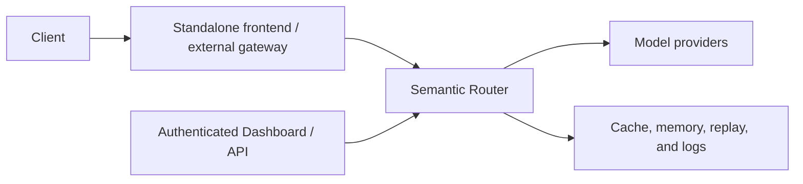

# 安全加固

Semantic Router 位于客户端和模型 provider 之间的请求路径上。将其视为应用信任边界的一部分：它可以检查提示词、选择 provider、改动请求，并可选地保留路由数据。

本指南强调需要显式生产决策的控制项。它不能替代周围平台的身份、网络、密钥管理和数据治理控制。

## 映射信任边界



分别复核每个边界：

- 谁可以调用推理端点；
- Router 信任哪些身份声明；
- 每个角色可以使用哪些模型和工具；
- provider 凭据存储在哪里；
- 哪些请求可以离开本地环境；
- 保留哪些提示词、响应和路由元数据；以及
- 谁可以更改配置或检查已存储的数据。

## 保护公共监听器 {#protect-the-public-listener}

standalone 前端会移除不受信任的身份和代理控制标头。请分别配置 listener API key、Chat 模型允许列表和原生模型访问权限，见 [Gateway 模式](gateway-modes)。Dashboard 登录凭据不能代替公网推理凭据。

维护中的 Envoy 配置也会移除内部控制标头。自定义 Envoy 或网关配置应保持该边界，例如：

```yaml
request_headers_to_remove:
  - x-authz-user-id
  - x-authz-user-groups
  - x-vsr-delegated-credential
```

不要将 Router 管理、指标、ExtProc 或支撑存储端口作为公共推理端点暴露。在受信任边界终止客户端身份验证，并仅允许该组件提供身份标头和下文所述的委托凭据。

相关控制面板权限包括：

| 权限 | 用途 | 默认角色 |
| --- | --- | --- |
| `feedback.submit` | 提交路由反馈。read 角色的反馈会记录在回放上，但不会更新模型经验。 | admin、write、read |
| `replay.read` | 列出回放记录。 | admin、write、read |
| `logs.read` | 读取有界的本地栈服务日志。 | admin、write |

Router 管理 API 区分回放元数据和回放详情。控制面板服务可以检索完整记录，然后为没有配置写入权限的用户移除已捕获的正文和工具载荷。它没有权限揭示已存储的密钥值。

端点和响应契约见[管理 API 参考](../api/apiserver)。

## 将凭据排除在配置之外 {#keep-credentials-out-of-configuration}

在 canonical YAML 中使用环境引用：

```yaml
api_key: ${MODEL_API_KEY}
```

不要提交字面 API 密钥、密码、授权标头、凭据查询参数，或包含用户信息的 URL。

对于 `vllm-sr serve --target kubernetes`，CLI 将敏感环境值放入限定到命名空间和 Helm release 的不可变 Secret revision：

- **只按名称引用。**Helm values 和 Deployment 按名称引用 Secret，不包含凭据值。
- **升级安全。**失败的升级会保持先前的工作负载和 Secret 处于活动状态。
- **清理。**release 拥有的旧 revision 只在不再被引用后才会移除。

现有的 chart 原生 Secret 引用（例如控制面板 JWT Secret）仍是外部对象，不会被复制到 CLI 管理的 Secret。对每个手动管理的 Secret 使用相同的命名空间和 release 所有权纪律。

### 把用户的凭据委托给上游 {#delegate-the-users-credential-to-an-upstream}

有些上游自行按用户授权：例如为每个用户签发虚拟密钥的 LiteLLM、one-api 或类似中转，或按用户计量的决策模型 API。当 Router 位于进行身份验证的部署层之后时，可以让身份验证器把它为该用户签发的凭据交给 Router，并把该上游的 auth 设为 `credential: delegated`。

向部署层验证客户端身份的凭据和发给上游的凭据是两个独立的信任对象：Router 从不转发客户端原始的 `Authorization` 标头。

```yaml
global:
  services:
    authz:
      delegated_credential:
        enabled: true
        header: x-vsr-delegated-credential   # 默认值；由身份验证器设置
  model_catalog:
    deployments:
      team-decisions:
        provider: systemone
        endpoint: https://decisions.example.com/v1/systemone
        model: vllm-sr/d3-ultra
        schema: vllm-sr/5.0
        auth:
          credential: delegated              # 决策模型部署
providers:
  models:
    - name: gpt-4o
      provider_model_id: gpt-4o
      api_format: openai
      backend_refs:
        - name: litellm
          endpoint: https://litellm.internal/v1
          provider: openai-compatible
          auth:
            credential: delegated            # 提供方后端
```

Router 调用的每个上游都使用同一种形状的 `auth` 块：提供方后端、决策模型或远程 embedding 部署、`escalate` 阶段的评审模型以及 `api_format: systemone` 目标都一样。它有三种模式之一：

| 模式 | 设置方式 | 调用携带 |
| --- | --- | --- |
| 静态密钥 | `auth.api_key_env` 或 `auth.api_key_file`，或后端的 `api_key` | Router 自己的密钥 |
| 委托 | `credential: delegated` | 发起请求的用户的凭据 |
| 无 | 两者都不设 | 不带凭据 |

无论哪种模式，调用都不带其他凭据：客户端自己的 `Authorization`、`api-key`、`x-api-key`、`x-goog-api-key`、`api-subscription-key` 或 `Ocp-Apim-Subscription-Key` 标头不会到达上游。位于外部网关之后、未声明后端的模型（`listeners: []`）会为该网关保留这些标头。

委托约定默认关闭。启用后，适用以下规则。

#### 凭据从哪里来 {#where-the-credential-comes-from}

委托凭据和身份标头一样，是身份验证的输出：

- **随附的 Envoy 配置**（`vllm-sr serve --gateway extproc` 和 `deploy/local/envoy.yaml`）在 ext_proc 之前的过滤器中移除客户端提供的副本。`vllm-sr` 模板也会移除自定义的 `header`；`deploy/local/envoy.yaml` 只列出默认名称。
- **身份验证器放在该过滤器之后。**两种配置都不运行身份验证器，因此签发该凭据的部署要把身份验证器放在该过滤器之后、ext_proc 之前，`delegated-credential` E2E 配置就是这样做的。
- **自定义网关**也必须如此：`request_headers_to_remove` 只在 ext_proc 之后生效。
- **standalone listener** 会从 Chat 和 System One 请求中一并丢弃该标头，除非设置了 `identity.trust_headers`。
- **必须知道用户。**只有请求同时携带已认证用户（`global.services.authz.identity.user_id_header`）时，Router 才保留该值。
- **专用标头。**配置会拒绝携带客户端凭据（`Authorization`、`api-key`、`x-api-key` 等）或身份信息的 `header`。

#### 凭据到哪里去 {#where-it-goes}

- **从其他所有请求中移除。**Router 在每个分支上都会从每个上游请求中移除该标头，并在日志中脱敏。
- **内部密钥。**它是 Router 从身份验证器读取、而不是丢弃的唯一 `x-vsr-*` 请求标头，标头注册表把它记为内部密钥：任何响应、`x-vsr-trace` 成员、Router Replay 记录和缓存键都不会携带它。
- **只有委托上游会收到它**，放在该上游的认证标头中并带上其前缀（OpenAI 兼容后端或 System One API 为 `Authorization: Bearer <credential>`），替换客户端在该标头中发送的内容。
- **不带客户端的其他凭据。**客户端的其他凭据标头会被移除，因此在 `x-api-key` 上认证的后端不会同时收到客户端的 `Authorization`。

#### 哪些调用携带它 {#which-calls-carry-it}

主体是调用的属性：

- **为客户端请求发起的调用**携带该请求的凭据：主分发、回退尝试、Looper 跳转、System One 决策模型调用、`escalate` 评审、`api_format: systemone` 目标、响应检查和召回 embedding。请求没有携带凭据时，Router 在调用之前返回 `401`，到达这类调用的回退链或 Looper 运行以该 `401` 结束，而不是返回另一个模型的回答。保持真正流式传输的守卫在客户端收到回答之后才发起检查，因此被拒绝的检查不会拒绝该回答，但响应缓存、记忆和存储的 Responses 对象都不会保留它。
- **Router 代表自己发起的调用**从不携带它，委托上游会拒绝这些调用：探测、模型列表读取、`router_replay.shadow` 副本、自动输出的 render、存储构建和管理诊断。

#### 配置会拒绝的情况 {#what-configuration-rejects}

- 同时设置静态密钥的委托上游，共享密钥因此永远不会悄悄顶替；
- 未启用约定的委托上游；
- 只有 Router 自身调用能到达的委托上游，或 Router 自身调用必须到达的委托上游：向量存储写入、记忆存储、`model_runtime` 端点的健康检查和准备、`router_replay.shadow`、自动输出；
- 未声明 `capabilities.dimensions` 的委托 `openai_embeddings` 部署；
- 同一集群中的委托后端和静态后端。

#### 答案只属于它的用户 {#answers-stay-with-their-user}

- **不跨用户共享。**用某个用户的凭据得到的答案只会返回给该用户。只要有上游是委托的，每个 `response_cache` 都保持默认的 `scope: user`，Router 也不会为其他请求保留委托部署的决策模型答案或 embedding。
- **一次调用只含一个请求。**Router 从不把两个客户端请求放进同一个上游调用，因此批量的 System One 调用只携带一个请求的问题和该请求的凭据。
- **策略留在上游。**调用方归属以及租户、配额、预算或支出策略都由上游负责。

### 隔离 sr-bench 凭据

Dashboard 代理服务器配置的 sr-bench origin，并传递已认证的用户身份：

- **服务 token。**`SR_BENCH_TOKEN_ENV` 指定它的环境变量名，默认 `SR_BENCH_TOKEN`。请把它与模型 API 凭据和 Router 管理凭据分开。
- **目标固定。**浏览器清单不能修改已登记目标的地址、价格、凭据引用或执行环境选项。

托管核心 worker 通过继承环境变量接收已登记模型的凭据和服务 token，密钥值不进入命令参数。私有 store 与相邻 token 文件位于 Router/Dashboard 共享挂载之外；worker 不挂载 Docker socket 或 GPU。Dashboard 只接收服务 token，不接收模型密钥。

代码和 Agent 评估应使用单独准备的 worker 主机，并把 `SR_BENCH_URL` 设为 Dashboard 可以访问的已认证地址。独立服务默认监听回环，要监听其他地址必须设置服务 token；它的源码、沙箱和模型凭据都只留在该主机上。参阅 [sr-bench 1.0](../benchmarking/sr-bench) 的前置条件和限额说明。

## 保护本地栈的存储凭据

`vllm-sr serve` 为本地栈预配 Redis 和 Postgres，因此它也拥有它们的凭据。每个栈在首次启动时生成自己的凭据。本仓库不附带任何值，也不会回退到共享默认值。

材料所在位置：

| 产物 | `<state-root>/.vllm-sr/storage-secrets/` 下的路径 | 模式 |
| --- | --- | --- |
| 凭据状态 | `secrets[.<stack>].json` | `0600` |
| Postgres 密码 | `postgres-password[.<stack>]` | `0600` |
| Redis 配置 | `redis[.<stack>].conf` | `0644` |

目录本身是 `0700` 且已验证所有者，因此其中的每个文件都无法被其他用户到达。Redis 配置有意是 `0644`：Redis 镜像在读取它之前会降到非特权用户，并且绑定挂载在容器内解析，而无需遍历主机的私有父目录。

这些值到达其消费者，而不会进入任何共享表面：

| 消费者 | 值的来源 |
| --- | --- |
| Postgres | 挂载的密码文件，通过 `POSTGRES_PASSWORD_FILE` |
| Redis | 其挂载配置中的 `requirepass` |
| Router | 继承的环境名称；生成的运行时配置只携带 `${VLLM_SR_STACK_POSTGRES_PASSWORD}` 和 `${VLLM_SR_STACK_REDIS_PASSWORD}` |
| 控制面板 | 永远拿不到它们 |

它们永远不会出现在 `docker` 命令行、生成的配置文件、日志记录或报告产物中。

这些凭据认证网络对等方。它们不约束能够直接到达容器运行时的调用者：Postgres 镜像信任本地套接字连接，因此任何能够 `docker exec` 的人都会绕过密码。相应地限制[容器运行时访问](#limit-container-runtime-access)。

### 网络分层

本地栈运行在两个桥接网络上。

| 容器 | `vllm-sr-network` | `vllm-sr-data-network` |
| --- | --- | --- |
| Redis、Postgres、Milvus | 否 | 是 |
| Router | 是 | 是 |
| Envoy、控制面板 | 是 | 否 |
| Jaeger、Prometheus、Grafana | 是 | 否 |

- **Router 是唯一同时位于两者上的容器。**请求通过应用网络到达它，它通过数据网络到达存储。
- **按栈隔离。**命名栈会为这两个网络名称加前缀，因此两个栈互不共享。
- **Milvus** 即使目前还没有自己的凭据，也会加入数据网络。

这关闭了东西向可达性。应用网络上的容器（例如 sidecar）根本无法打开到 `vllm-sr-redis:6379` 或 `vllm-sr-postgres:5432` 的连接。存储端口仅发布在 `127.0.0.1` 上，从而从主机侧关闭相同暴露。

它不约束能够到达容器运行时的调用者。这样的调用者可以将容器附加到任何网络，因此该拆分是工作负载的边界，而不是运行时套接字的边界。

拆分之前创建的栈，其存储位于应用网络上。下一次 `vllm-sr serve` 会将每个正在运行的存储附加到数据网络，并从应用网络分离它。如果该分离失败，`serve` 会停止而不是继续：报告隔离但实际上没有隔离的栈，比拒绝启动更糟。

### 轮换 {#rotate}

```bash
vllm-sr storage rotate
```

该命令限定到一个栈，并遵循 `VLLM_SR_STACK_NAME`，与 `serve` 和 `stop` 相同。分别轮换每个栈；有意没有跨栈模式，因为部分失败会让某些栈被撤销而另一些没有。

轮换有短暂的降级窗口，因此请把它安排在可以接受短暂 Router 重启的时刻：

- **Postgres** 就地更改其角色密码：现有连接继续，但新连接会失败，直到 Router 重启。
- **Redis** 对照其命名卷重建。

### 恢复

**凭据状态缺失或格式错误。** CLI 会失败关闭，而不是静默重新生成，因为重新生成的凭据会让 CLI 以为自己仍有它已经不再拥有的访问权。删除状态文件并重新运行 `vllm-sr serve`。栈会就地接管：Postgres 通过其受信任的本地套接字重新设置密钥，Redis 对照同一命名卷重建，并且不会丢失数据。

**较旧栈的数据没有被拾取。** 存储数据现在位于命名卷中，并且在接管栈时按名称采用现有容器的卷。被较旧 CLI 移除的容器会留下其卷，但没有记录它属于哪个容器，因此无法自动采用。手动恢复它：

```bash
docker system df -v --format '{{json .Volumes}}'
```

查找 `Links: 0` 的卷。通过其内容识别每个候选——Postgres 数据目录包含 `PG_VERSION`，Redis 目录包含 `dump.rdb`：

```bash
docker run --rm -v <volume>:/v:ro alpine ls /v
```

然后针对已识别的卷启动容器，或将其内容复制到栈的命名卷（`vllm-sr-postgres-data` / `vllm-sr-redis-data`，命名栈带栈前缀）。CLI 不会猜测哪个孤立卷是你的。

**对已轮换的栈使用较旧的 CLI。** 它将无法认证。这是预期结果。升级 CLI，或通过容器运行时手动重置密码。

## 保护本地栈的管理凭据

控制面板使用一个服务凭据（`dashboard_control_plane` 角色）调用 Router 管理 API。当配方开启 bearer 认证时，Router 只接受持有该凭据的控制面板。两个容器都由 `vllm-sr serve` 创建，因此由它拥有这个值：

- 如果你在它的环境中设置了 `VLLM_SR_DASHBOARD_RECIPE_TOKEN`（64 个小写十六进制字符，例如 `openssl rand -hex 32` 的输出），它就使用该值，并且从不把它写入磁盘。
- 否则，栈会在首次启动时生成一个，并保存在 `<state-root>/.vllm-sr/management-credential/dashboard[.<stack>].json`，模式 `0600`，位于已验证所有者的 `0700` 目录中。
- 控制面板总会收到它；当 Router 的运行时配置绑定它时，Router 也会收到。两者都以继承的环境名称接收，它不会出现在 `docker` 命令行、生成的配置文件、配方存储或日志记录中，控制面板也不在磁盘上保留副本。配方不能把这个名称绑定为自己的环境输入。

能读取它的是：运行 `vllm-sr serve` 的用户、Router 和控制面板进程，以及任何能通过容器运行时检查这些容器的人。要轮换它，删除状态文件并运行 `vllm-sr serve`：它会生成新值，并用新值重建 Router 和控制面板。

### 配方存储权限 {#recipe-store-permissions}

`vllm-sr serve` 在启动栈之前读取控制面板的配方存储，并完成中断的激活，使用的是运行它的用户。因此存储 `<state-root>/.vllm-sr/recipe-store/<stack>` 与该用户的组共享：其中的文件组可读，目录组可写。外层的 `.vllm-sr` 只对其所有者和控制面板开放，所以其他主机用户无法到达存储；存储中只有包和配置文档，没有凭据。

较早版本的控制面板写入的存储只对控制面板的账户开放。如果 `vllm-sr serve` 报告无法读取它，请用它打印的命令（`chgrp -R` 到你的组并 `chmod -R g+rwX`）共享一次；此后控制面板会保持共享。无 root 的 Docker 和 Podman 会把容器用户映射到其他主机 ID，因此在那里这种共享到达不了主机用户。

## 复核已存储的请求数据 {#review-stored-request-data}

回放、响应缓存、记忆、响应历史、服务日志和 provider 日志都可能保留从请求派生的数据。它们的设置独立于模型的放置。到本地模型的路由仍可能将提示词或响应写入共享存储。

对于每个已启用的存储：

- 识别哪些路由向它写入；
- 检查是否捕获请求或响应正文；
- 设置保留和删除策略；
- 限制读取和备份访问；
- 使用与数据相称的加密和传输安全；以及
- 在存储不可用时测试行为。

配方 Model Card 描述每个维护中配方的签入回放和缓存行为。部署指南见[数据与存储](storage-overview)。

## 复核决策模型读取的内容 {#review-what-the-decision-model-reads}

每个路由判断都是向决策模型提出的问题，所以问题解析到的模型会看到该问题读取的请求部分：

- **默认在本地。** 什么都不配置时，每个问题都询问本地的 `primary` 部署，个人数据规则也在那里运行。绑定或规则的 `deployment` 会把问题移到别处；决策模型在远程时，请显式绑定 `pii` 和 `hallucination`。
- **远程模型会收到它评判的内容。** `systemone` 部署会收到其问题读取的状态部分：请求、之前的轮次、工具结果、模型的答案、候选，以及图片问题中的图片。[哪些数据会离开本机](../system-one/deploy/deployments#what-leaves-the-host)按信号列出了这些部分。远程嵌入提供方会收到它要嵌入的文本。
- **防护可以失败开放或失败关闭。** 模型没有给出答案的 `jailbreak` 或 `pii` 规则不匹配，除非设置了 `on_unknown: match`；模型没能读到的文本按攻击或个人数据计入。
- **遮蔽覆盖最终请求。** `masking` 插件替换发往提供方的请求中每个文本位置的个人数据，包括检索到的文档和工具结果；拿不到 span 时以失败关闭。
- **Router 自有的请求头受保护。** `header_mutation` 不能写入 Router 自有的请求头或路由键，客户端发送的内部请求头会被丢弃，调试细节只发给 `global.router.headers.debug` 允许的调用方。
- **授权是一个信号。** `role_bindings` 条件根据网关声明的身份，决定谁可以到达哪些路由和工具；只有设置了 `identity.trust_headers: true` 时，才信任客户端发送的身份请求头。

## 限制容器运行时访问 {#limit-container-runtime-access}

`vllm-sr serve` 是本地栈中唯一使用容器运行时的部分。它创建、重建和停止栈的容器，并应用控制面板中保存的、需要重新创建容器的每项更改。

- **栈内没有套接字。**没有任何栈容器挂载运行时套接字，控制面板镜像中也没有容器 CLI。
- **控制面板以非 root 用户运行。**它从 Router 和 Envoy 的 HTTP 探测以及 CLI 在运行时配置旁保存的文件读取服务状态，从有界日志 spool 读取服务日志。

请把对运行时的访问视为对栈的管理员访问。能到达运行时的调用者可以读取容器环境（包括管理凭据），也可以绕过存储密码。只把套接字留给运行时的管理员，不要把它挂载进栈容器。

## 生产检查清单

| 检查项 | 做法 | 详情 |
| --- | --- | --- |
| 对公共推理监听器和管理表面进行身份验证 | listener API key；管理 API 上的 bearer 认证 | [保护公共监听器](#protect-the-public-listener) |
| 在受信任代理处剥离内部控制和身份标头 | `request_headers_to_remove`；在 ext_proc 之前移除委托凭据 | [委托用户的凭据](#delegate-the-users-credential-to-an-upstream) |
| 将 Router 管理、ExtProc、指标和存储端口绑定到私有接口 | 只暴露推理监听器 | [保护公共监听器](#protect-the-public-listener) |
| 按角色或租户限制模型访问和速率限制 | Chat 模型允许列表、原生模型访问权限、`role_bindings` | [Gateway 模式](gateway-modes) |
| 将 provider 和存储凭据保留在密钥管理器或 Kubernetes Secret 中 | YAML 中使用 `${ENV}` 引用 | [将凭据排除在配置之外](#keep-credentials-out-of-configuration) |
| 复核每条路由的 provider 本地性、工具和数据保留行为 | 每个问题的决策模型在哪里运行；每条路由写入哪些存储 | [复核决策模型读取的内容](#review-what-the-decision-model-reads)、[复核已存储的请求数据](#review-stored-request-data) |
| 仅向受信任的运维人员授予回放详情、日志和配置写入权限 | `replay.read`、`logs.read`、配置写入权限 | [保护公共监听器](#protect-the-public-listener) |
| 在绕过策略不可接受的地方设置严格的失败行为 | 在 `jailbreak` 和 `pii` 规则上设置 `on_unknown: match` | [复核决策模型读取的内容](#review-what-the-decision-model-reads) |
| 按与其他凭据相同的计划轮换本地栈的存储凭据 | `vllm-sr storage rotate` | [轮换](#rotate) |
| 测试备份、恢复、凭据轮换、升级和回滚 | 每次生产变更前先演练 | [升级与回滚](upgrade-rollback) |
| 不要把容器运行时套接字挂载进任何栈容器 | 只有 `vllm-sr serve` 使用运行时 | [限制容器运行时访问](#limit-container-runtime-access) |
