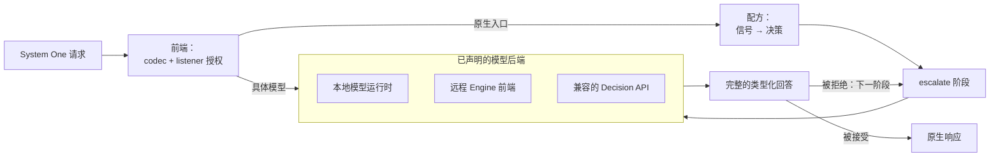

import Tabs from '@theme/Tabs'
import TabItem from '@theme/TabItem'

# 组件架构 {#component-architecture}

vLLM-SR 由请求前端、决策引擎和模型运行时组成。可以把它们组合起来路由模型调用，也可以不接任何对话后端，单独提供决策模型服务。

- **前端：** listener、访问控制和协议适配器。
- **决策引擎：** 入口、配方、信号、决策和算法，用于 Router 模式。
- **模型运行时：** Router 的决策模型和嵌入模型，以受管或挂接的 worker 运行。
- **对话后端：** 你的 vLLM、Ollama 或托管模型。

:::note
这些图展示的是原生 HTTP 前端的逻辑组件，而不是容器布局。Envoy 与 ExtProc 拓扑见[网关模式](../installation/gateway-modes)。点击图示可打开完整尺寸的 SVG。
:::

## 组合服务路径 {#compose-the-serving-path}

[](/img/architecture/system-one/01-component-composition.svg)

| 组件 | 职责 |
| --- | --- |
| **Frontend（前端）** | 接收请求、执行 listener 访问控制、适配 API 协议。 |
| **Decision Engine（决策引擎）** | 把入口解析到配方，评估信号和决策，调用对话后端或原生决策模型后端。 |
| **Serving Engine / 模型运行时** | 通过受管或挂接的 worker 服务决策模型和嵌入模型。 |
| **对话后端** | 用你的 vLLM、Ollama 或提供方服务生成回答。 |

### Router 模式与 Engine 模式 {#router-mode-and-engine-mode}

<Tabs groupId="startup-mode">
<TabItem value="router" label="Router 模式" default>

```bash
# MODEL 覆盖默认决策模型；对话后端仍在 YAML 中配置。
vllm-sr serve vllm-sr/vela3-fast --config config.yaml
```

- 配方路由和对话后端处于启用状态。
- 同时为 listener 发布的模型提供 System One API。

</TabItem>
<TabItem value="engine" label="Engine 模式">

```bash
# 不需要对话后端或路由 YAML。
vllm-sr serve vllm-sr/d3-edge -e
```

- 前端通过 System One API 提供决策模型服务。
- 已保存的路由配置会保留，但不生效。

</TabItem>
</Tabs>

不带 `--engine`（`-e`）的 `vllm-sr serve` 都以 Router 模式启动；仅传入 MODEL 不会选择 Engine 模式。Dashboard 会显示当前模式并管理部署，但不负责切换模式。

### 模型按需启动 {#models-start-on-demand}

- **只启动用到的模型。** 只有当原生模型授权、路由信号或已启用的模型功能用到某个部署时，它才会获得 worker。
- **纯规则路由无需模型。** 规则不向模型提问的对话路由器，可以不运行任何模型 worker。
- **召回会启动嵌入模型。** 响应缓存、记忆和 RAG 用它做召回时，会启动嵌入模型。

“按需”指配置中的需求：用到的模型会在第一个请求到来之前就绪，而不是由第一个请求触发加载。

## 分开处理协议与路由策略 {#separate-protocol-handling-from-routing-policy}

[](/img/architecture/system-one/02-frontend-and-decision-engine.svg)

经过路由的请求分五步处理：

1. 把公开模型名解析为入口和配方。
2. 评估所需的 **signals（信号）**，并计算 **projections（投影）**。
3. 匹配一个 **decision（决策）** 及其候选集。
4. 运行它的 **algorithm（算法）**，选出一个后端或有界的多模型方案。
5. 派发请求，并通过对应的协议适配器返回响应。

插件在各自的请求、执行或响应钩子处运行，而不是统一放在最后一步。依赖模型的信号自行解析其部署，与它帮助选择的对话后端无关。策略编写见[路由流水线](signal-driven-decisions)。

| 请求 | 处理方 | 路由 |
| --- | --- | --- |
| Chat Completions、Responses、Messages | 协议 codec | 入口对应的配方 |
| Images API | Images codec | 只有输出为图片的决策 |
| System One，具体模型 ID | 类型化的 System One handler | 无 |
| System One，已发布的原生入口 | 类型化的 System One handler | 对应的 System One 配方 |
| 具体对话后端 ID | 协议 codec | 无：跳过信号、决策和插件 |

原生配方支持的信号和算法比对话配方少，见 [System One 上的 Escalate](../tutorials/algorithm/looper/escalate.md#on-system-one)。

### 区分公共 API 与 worker API {#keep-public-and-worker-apis-distinct}

| 接口 | 端点 | 访问方式与用途 |
| --- | --- | --- |
| 公共 Chat API | `/v1/chat/completions`、`/v1/responses`、`/v1/messages`；通过 `/v1/models` 发现模型 | Router 模式。受 listener 访问控制和该 API 自身要求约束。 |
| 公共 System One API | `/v1/systemone`，别名 `/v1/decisions`；通过 `/v1/systemone/models` 发现模型 | 两种模式均可用。需要在 `listeners[].apis.systemone.models` 中显式发布；listener 设置了 API key 时还需相应凭据。 |
| Worker API | 已加载模型支持的 classify、embeddings、rerank、decisions 和 bundle API | 独立运行的 `vllm-srun` 端点或受管 worker 的私有 socket。前端从不发布这些接口。 |

- Dashboard 会话不能替代 listener 凭据。
- 原生模型授权与 listener 的对话 `models` 允许列表相互独立。

完整请求示例见 [System One 快速开始](../model-runtime/get-started/quickstart.md)。

## 用副本扩展部署 {#scale-a-deployment-through-replicas}

[](/img/architecture/system-one/03-serving-engine-and-workers.svg)

每次模型调用都包含两个独立的选择：

| 问题 | 由谁回答 |
| --- | --- |
| 哪个模型适合这项任务？ | 模型选择：配方中的决策和算法 |
| 该部署的哪个就绪 worker 来执行？ | 副本调度，在部署内部完成 |

- **受管副本**是由 vLLM-SR 启动和监管的进程。
- **挂接副本**指向独立运维的运行时。
- **一个池，一个模型。** 同一池中的 worker 共享模型身份、revision、引擎参数和能力。图中以 GPU 为例，CPU worker 同样支持。

调度选择未完成请求字节数最少的就绪 worker，相同时选择最久未被分配的那个。每个 worker 最多接收 32 个在途请求；池满时报告过载，而不是排队等待。

:::note
未完成字节数是本地估算值，既不是 token 数，也不是 GPU forward 并发数。
:::

在 worker 内部，模型家族定义输入和类型化输出，批次规划器依据部署的引擎参数组织 forward，再由执行引擎和加速器运行。多个问题可以共享一次 forward，但一次 API 调用仍可能需要多次 forward。

```bash title="在两块 GPU 上运行两个副本"
vllm-sr serve vllm-sr/d3-edge -e --platform rocm -dp 2 --device-ids 0,1
```

:::warning 数据并行不是分片
`-dp` 在每个设备上放置一份完整的模型副本，不会用张量并行或流水线并行拆分权重。增加副本前，请针对你的输入长度测量吞吐和尾延迟，多个 worker 共享一块 GPU 时尤其如此。
:::

参见[前端与运行时部署](../model-runtime/deploy/connect-the-router.md)和[引擎参数](../model-runtime/deploy/engine-args.md)。

## 在决策模型之间路由 System One {#route-system-one-across-decision-models}



- **原生配方。** `api: systemone` 入口选择一个隔离的 System One 配方。
- **升级阶段。** 它的决策运行 `escalate`：快速阶段先回答，只有回答未通过接受条件时才运行后续阶段。
- **任意后端。** 每个阶段可以调用本地部署、独立的 vLLM-SR Engine，或兼容的外部 System One API。
- **一份预算。** 信号和所有阶段共享一个请求截止时间和调用上限；决策自己的预算可以进一步收紧两者。
- **可选的评审。** LLM 评审可以选出之前某个完整回答，或者弃权；它从不编造原生概率。

配方负责在模型之间选择；每个部署仍各自在其副本之间选择。

`/v1/systemone/models` 以 `routing: false` 列出具体模型，以 `routing: true` 列出原生配方，两者都需要 listener 授权。对话默认的 `vllm-sr/auto` 不会启用原生 auto，Engine 模式只服务具体模型。

## 下一步 {#next}

- [系统概览](semantic-router-overview)：配置与部署背景。
- [快速开始](../installation/installation.md)：发送一个经过路由的对话请求。
- [模型运行时快速开始](../model-runtime/get-started/quickstart.md)：直接提出类型化问题。
- [前端与运行时部署](../model-runtime/deploy/connect-the-router.md)：绑定、放置与就绪。
