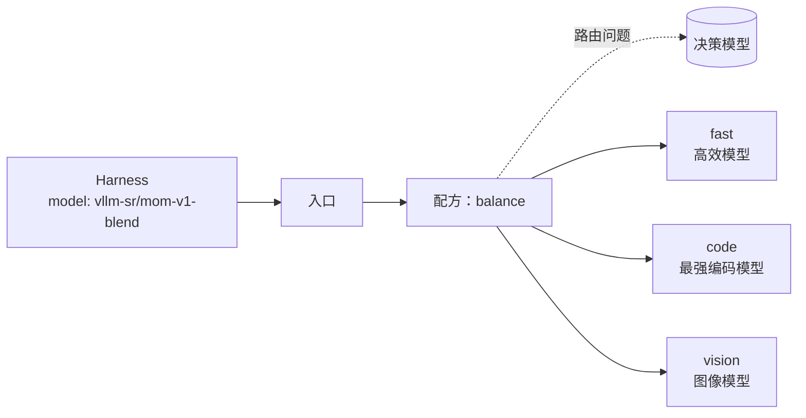

import Tabs from '@theme/Tabs'
import TabItem from '@theme/TabItem'

# 多模型混合 {#mixture-of-models}

**Mixture of Models（MoM，多模型混合）** 是一个代表一组独立服务模型的模型名。Harness 调用这个稳定的名字；名字背后的配方为每个请求选出模型、逐级升级，或协调多个模型。

- **一个名字，多个模型。** 客户端调用 `vllm-sr/mom-v1-blend` 这样的虚拟模型，无需写死某个后端。
- **用策略，而不是改接线。** 配方依据决策模型对每个请求的回答来路由，再检查每个候选模型的能力。
- **现成的配方。** MoM V1 自带五个配方，每个对应一个目标。你只需连接它们要路由到的模型。



## MoM 不是 Mixture of Experts {#mom-is-not-mixture-of-experts}

Mixture of Experts（MoE，混合专家）发生在一个模型内部；Mixture of Models 发生在服务系统中，作用于整个模型：

| | Mixture of Experts（MoE） | Mixture of Models（MoM） |
| --- | --- | --- |
| **是什么** | 一种模型架构 | 一种服务系统架构 |
| **选择什么** | 同一检查点内的专家层 | 各自独立服务的完整模型 |
| **何时选择** | 每个 token，在一次前向计算中 | 每个请求，在任何模型运行之前 |
| **组合什么** | 一起训练的专家 | 稠密模型、MoE 模型、本地模型和托管模型 |

MoM 模型池可以包含 MoE 模型；它们的内部设计不影响 Router 如何路由到它们。

## 三类模型 {#three-kinds-of-model}

| 种类 | 示例 | 作用 |
| --- | --- | --- |
| **提供方模型** | vLLM、Ollama 或托管端点 | 生成用户看到的回答。 |
| **虚拟模型** | `vllm-sr/mom-v1-blend` | 为客户端提供代表某个配方的稳定名字。 |
| **Router 系统模型** | 决策模型（默认为 vela3-fast）和嵌入模型 | 服务 Router 自身：决策模型回答路由问题，嵌入模型为缓存和记忆提供召回。 |

Router 在内置[模型运行时](../model-runtime/overview)上运行这些系统模型。[System One](../system-one/overview) 介绍决策模型及其回答的问题。

## 执行模式 {#execution-patterns}

配方中的决策会选择以下三种模式之一：

| 模式 | 过程 | 适用于 | 算法 |
| --- | --- | --- | --- |
| **选择一个模型** | 选择器选出一个候选，只调用一次。 | 大多数流量 | `static`、`random`、`multi_factor`、`systemone` |
| **逐级升级** | 先用高效模型，检查答案，只有检查不通过时才升级。 | 答案可检查时，降低平均成本 | [`escalate`](../tutorials/algorithm/looper/escalate) |
| **编排** | 多个模型回答、比较或分步协作，最终返回一条响应。 | 选定的高精度任务 | `fusion`、`remom`、`ratings`、`workflows` |

:::tip 从简单开始
逐级升级和编排会增加调用次数、延迟和 token。只在实测收益值得这些成本的请求上使用它们，其余请求选择一个模型即可。[算法](../tutorials/algorithm/overview)对它们做了比较。
:::

## 发布虚拟模型 {#publish-a-virtual-model}

入口把公开模型名映射到配方。配方中的决策指定为每条通道服务的提供方模型：

```yaml title="config.yaml"
entrypoints:
  - model_names: [vllm-sr/auto]
    recipe: default
    default: true
  - model_names: ["acme/assistant-fast"]
    recipe: fast
recipes:
  - name: default
  - name: fast
    strategy: priority
    decisions:
      - name: default-fast-route
        description: Route eligible requests through the fast model pool.
        priority: 10
        rules:
          operator: AND
          conditions: []
        modelRefs:
          - model: local/small
            use_reasoning: false
          - model: local/vision
            use_reasoning: false
        algorithm:
          type: static
```

对每个请求，Router 评估配方的信号、匹配一个决策，并剔除缺少所需能力或上下文不足的候选。随后，公开模型名解析为选中的提供方模型。

完整 schema 和隔离规则见[入口与配方](../tutorials/global/entrypoints-and-recipes)。

## MoM V1 {#mom-v1}

MoM V1 是内置的五个配方，每个对应一个目标。你连接自己的后端，再把它们分配给各配方的决策：

| 公开模型 | 配方 | 目标 | 决策 |
| --- | --- | --- | --- |
| `vllm-sr/mom-v1-blend` | **Balance** | 只在请求需要时投入推理 | `long_context`、`vision`、`recovery`、`agentic`、`facts`、`frontier`、`code`、`hard`、`standard`、`fast` |
| `vllm-sr/mom-v1-lite` | **Cost** | 经济地服务，按需升级 | `economy`、`tools`、`reasoning` |
| `vllm-sr/mom-v1-flash` | **Speed** | 快速对话和流式输出 | `fast`、`tools`、`reasoning` |
| `vllm-sr/mom-v1-ultra` | **Accuracy** | 高质量回答，仅在用户要求时使用多个模型 | `simple`、`reasoning`、`review`、`agent` |
| `vllm-sr/mom-v1-vault` | **Vault** | 在你的私有部署内处理 | `private`、`sensitive`、`guard` |

### MoM V1 如何路由 {#how-mom-v1-routes}

- **每个请求一次调用。** 每个配方向决策模型提出几个具名问题，全部放在一次调用中。
- **请求事实。** 决策还会读取请求声明的内容：工具、进行中的工具循环，或之前的助手回答。
- **不使用旧式信号。** 没有配方使用关键词、嵌入或分类器信号。
- **声明的决策模型。** 该套件把 Vela 2.0 0.8B 设为决策模型，它的探针就是在这个模型上校准的。

:::warning 线上流量请在 GPU 上运行决策模型
在 CPU 上，决策调用很慢：使用 4 个 CPU 时，一条短消息的中位耗时约 4 秒，长输入约 75 秒。在一块 AMD Instinct MI300X 上，中位耗时为 0.25 秒。在决策模型的部署上设置 `device: rocm` 或 `device: cuda`，即可要求使用 GPU。
:::

### 五个配方 {#the-five-recipes}

<Tabs groupId="mom-v1-recipe">
<TabItem value="balance" label="Balance" default>

**Balance** 只在请求需要时投入推理。决策模型在一次调用中回答关于最新消息的六个问题：

- 工作的类型，以及需要多少推理；
- 正确回答是否依赖大多数人需要查证的事实；
- 好的回答需要什么：深思、工具、校验、长输出或创造力；
- 用户是否指出上一轮回答有误；
- 用户是否要求现在调用工具。

然后按优先级从高到低应用各条通道：

1. 长输入和图片优先进入 `long_context` 和 `vision`。
2. 纠错进入 `recovery`，工具任务进入 `agentic`，依赖事实的问题进入 `facts`。
3. 由回答得出的推理强度分数在 `frontier`、`code`、`hard`、`standard` 和 `fast` 中选择。

在 `frontier` 中，决策模型还会根据描述，从分配的模型中选出作答的那一个。

**需要：** `frontier` 需要两个不同的模型。Balance 会提出 `score` 问题，vela3-fast 无法回答；请保留套件自带的 Vela 2.0 决策模型，或换用其他能回答 `score` 的模型。

</TabItem>
<TabItem value="speed" label="Speed">

**Speed** 对对话和工具调用优先考虑首 token 延迟，对推理优先考虑每 token 延迟。

- `tools`：用户要求现在调用工具，且请求声明了工具。
- `reasoning`：需要细致多步推理的难题。
- `fast`：其他所有请求。

`depth` 问题未得到回答时，请求同样进入 `reasoning`，因此故障不会降低质量。

</TabItem>
<TabItem value="cost" label="Cost">

**Cost** 让每个请求只用一个模型，并在每个决策的质量区间内优先选择估算请求成本最低的模型。

- 它提出与 Speed 相同的问题，另加两个：用户是否指出回答有误，以及消息是否只是引用了需要翻译或解释的文本。
- 指出回答有误会升级到 `reasoning`；出现在引用文本中的纠错则不会。
- `economy` 处理既不需要工具也不需要推理的所有请求。

</TabItem>
<TabItem value="accuracy" label="Accuracy">

**Accuracy** 通常用一个强模型作答。

- `reasoning` 处理难题、校验请求、高风险问题和纠错。
- `review` 比较两个独立回答并加以综合，只在用户要求多位专家作答时使用。
- `agent` 最多运行三步，两个工作模型并行，只在用户要求多个工作者时使用。
- `simple` 处理其他所有请求。

**需要：** `review` 和 `agent` 各需要两个不同的工作模型。客户端工具循环中两者都不会展开，这类请求进入 `reasoning`。

</TabItem>
<TabItem value="vault" label="Vault">

**Vault** 把流量留在你分配的部署内，普通请求和敏感请求使用不同的模型池。

- `guard` 立即应答提示攻击，不调用任何后端。
- `sensitive` 处理个人标识、机密材料、伤害风险或个人建议请求。
- `private` 处理其他所有请求。

Vault 的每条路径都禁用客户端工具和工具历史、记忆、响应缓存、学习自适应以及新的 Responses 对象写入。回放采集单独配置，默认开启，详见 [Router Replay](../tutorials/plugin/router-replay)。

Vault 失败时关闭。若某项判断未得到回答，或输入超出决策模型的扫描预算，请求会得到 HTTP 503，且不调用任何后端。

:::warning
配方无法决定模型的部署位置，也无法改变提供方的数据保留策略。只把 Vault 的决策分配给满足你隐私要求的后端。
:::

</TabItem>
</Tabs>

### 试用 MoM V1 {#try-mom-v1}

1. 启动或恢复服务：

   ```bash
   vllm-sr serve
   ```

2. 在 Dashboard 中打开 **Models**，连接你的推理端点。
3. 打开 **Build → Mixture-of-Models → Recipes**，在内置配方上选择 **Create model**。
4. 为它的入口命名，并为每个决策分配模型。Vault 的 `guard` 不需要分配。
5. 用 **Preview** 查看信号、决策和选中的候选；再发送真实请求，检查执行情况和延迟。

每个模型都需要声明能力、上下文窗口和输出上限。`multi_factor` 决策还会比较模型在所分配推理强度下的质量指标。

:::note
[MoM V1 Model Card](https://github.com/vllm-project/semantic-router/blob/main/config/recipes/built-in/latest/mom-v1/README.md) 列出了每个问题、阈值和要求、数据处理策略，以及策略 4.0 的变化。
:::

## 何时 MoM 不是合适的抽象 {#when-mom-is-the-wrong-abstraction}

以下情况请直接调用模型端点：

- 一个后端就能很好地服务全部工作负载；
- 策略不太可能变化；
- 你暂时还无法度量路由带来的收益。

多模型系统会增加配置、评估和运维成本。只有存在清晰的能力边界、目标或可度量的改进时，才值得引入。

## 下一步 {#next}

- [模型、入口与服务](../tutorials/global/models-entrypoints-serving)：用 CLI 连接后端并发布入口。
- [路由流水线](signal-driven-decisions)：信号、决策和算法如何组合。
- [使用场景](use-cases)：适用于云、数据中心、边缘和企业模型池的模式。
- [算法](../tutorials/algorithm/overview)：所有选择器和执行器。
