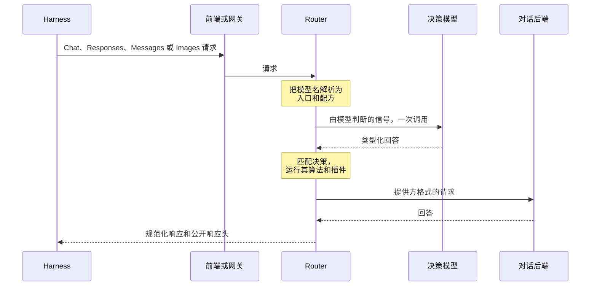

# 系统概览 {#system-overview}

Semantic Router 位于 agent harness 与你的模型之间。它对每次模型调用应用策略，选择一个模型或协调多个模型，再把请求转发给选中的后端。

- **数据面。** 前端接收请求，Router 做出决定，模型运行时回答 Router 自己的问题，对话后端生成回答。
- **控制面。** 一个规范的 YAML 文件，通过 CLI、Dashboard、Helm 或 Operator 管理。
- **两种接入方式。** Router 默认直接提供自己的 listener，也可以通过 ExtProc 运行在基于 Envoy 的网关之后。

## 架构 {#architecture}


[组件架构](component-architecture)介绍协议路径、模型运行时的副本和 Engine 模式。

### 数据面 {#data-plane}

| 组件 | 负责什么 |
| --- | --- |
| **Agent harness** | 任务循环、工具执行和任务状态。每次模型调用都经过 Router，响应回到 harness，由它推进下一步。 |
| **前端** | Listener、访问控制和协议适配。使用 `--gateway extproc` 时，由外部网关负责入口，并通过 ExtProc 调用 Router。 |
| **Semantic Router** | 信号、策略、路由行为，以及模型的选择或协调。 |
| **模型运行时** | Router 自己的模型：决策模型，以及召回功能需要时的嵌入模型。Worker 可以受管，也可以挂接。 |
| **对话后端** | 生成回答。权重和容量由 vLLM、Ollama 或托管提供方负责。 |

### 控制面 {#control-plane}

| 工具 | 用途 |
| --- | --- |
| **规范 YAML** | 用一个可移植的文件描述路由行为。 |
| **CLI 和 Dashboard** | 搭建、校验、发现模型、配置和运维。 |
| **Helm 和 Operator** | 把 Router 部署到 Kubernetes。 |
| **评估与可观测性** | 查看路由结果，测试并改进策略。 |

## 核心对象 {#core-objects}

| 对象 | 用途 |
| --- | --- |
| **入口** | 把一个或多个公开模型名映射到配方。 |
| **配方** | 一条完整的路由策略，拥有自己隔离的运行时状态。 |
| **信号** | 关于请求、身份、对话或内容的具名事实。 |
| **投影** | 由信号导出的可复用分数、分区或区间。 |
| **决策** | 选出合格路由及其候选模型的规则。 |
| **算法** | 决策如何选择或协调候选模型。 |
| **插件** | 路由特定的行为，例如请求控制、检索、记忆或响应处理。 |
| **提供方模型** | 配方可以路由到的物理推理端点。 |

借助这些对象，你可以跨策略复用检测、独立于模型选择修改策略，并在稳定的公开名字背后演进模型池。

## 请求生命周期 {#request-lifecycle}



1. Harness 使用 OpenAI Chat Completions、OpenAI Responses、Anthropic Messages 或 OpenAI Images API 发送请求。
2. Standalone 前端或 ExtProc 网关把请求交给 Router。
3. 请求的模型名解析为入口及其配方。
4. Router 评估配方的信号并计算投影。启发式信号在代码中运行；由模型判断的信号在一次调用中发给决策模型。
5. 决策执行约束，选出合格的候选集。
6. 决策的算法选择一个模型，或运行有界的多模型策略。
7. 插件在各自的请求、执行或响应钩子处运行。
8. 前端的上游客户端或外部网关把提供方格式的请求发给选中的后端，并返回规范化响应。

有两种情况会跳过部分路径：

- **直接选择。** 运维人员可以暴露物理模型名供直接选择。这类请求不经过配方信号、决策、插件、缓存、学习和会话路由。
- **没有匹配。** 配方中没有决策匹配时，请求交给已配置的默认提供方模型。

:::note 工具仍由 harness 负责
这个生命周期描述的是 harness 任务循环中的一次模型调用。插件可以过滤模型能看到的工具，但工具的执行和授权仍由 harness 及其工具服务负责。
:::

## 协议与部署边界 {#protocol-and-deployment-boundaries}

Router 默认直接提供 listener，也可以通过 ExtProc 接入外部网关；[网关模式](../installation/gateway-modes)比较了这两种方式。同一套策略可在 Docker、Kubernetes 和混合环境中运行。

Router 负责选择模型，不替代后端的调度器。当 AI 网关也位于入口时，请求依次经过三个路由层：

```text
agent harness
  -> AI Gateway（如 Agent Router / LiteLLM / agentgateway）
  -> Semantic Router ExtProc
  -> Inference Router / 模型池调度器（如 llm-d / vLLM Router / AIBrix gateway）
  -> 模型副本
```

| 层 | 负责什么 | 示例 |
| --- | --- | --- |
| **AI Gateway** | 客户端入口、提供方转换、凭据、限流和流量策略。 | [Agent Router（原 Envoy AI Gateway）](../installation/k8s/ai-gateway)、[LiteLLM](https://docs.litellm.ai/docs/simple_proxy)、[agentgateway](../installation/k8s/agentgateway) |
| **Semantic Router** | 通过配方和决策，按请求意图和策略选出模型或模型池。网关依据 `x-vsr-route-model` 路由。 | vLLM Semantic Router |
| **Inference Router** | 在选中的模型池内选择健康的副本或端点。 | [llm-d](../installation/k8s/llm-d)、[vLLM Router](https://github.com/vllm-project/router)、[AIBrix gateway](../installation/k8s/aibrix) |

[Kubernetes 网关](../installation/k8s/gateways)和[推理平台](../installation/k8s/inference-platforms)列出了本项目维护的集成。

:::tip 客户端与后端的格式可以不同
客户端调用的 API 可以与后端使用的不同。支持的组合见[协议兼容性](../installation/protocol-compatibility)。
:::

## 下一步 {#next}

- [组件架构](component-architecture)：前端、模型运行时和 Engine 模式。
- [路由流水线](signal-driven-decisions)：策略的各个层次。
- [多模型混合](mom-model-family)：虚拟模型与多模型执行。
- [快速开始](/zh-hans/docs/installation)：运行本地服务。
