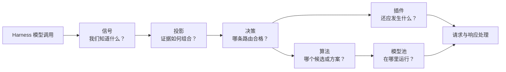

# 路由流水线 {#routing-pipeline}

每一次经过路由的模型调用都经历相同的阶段：理解请求、应用策略、运行选中的模型。入口选中的配方定义了每个阶段。

- **信号**为关于请求的事实命名。
- **投影**把信号组合成分数、分区和区间。
- **决策**应用策略并选出候选模型。
- **算法**选择一个模型或协调多个模型。
- **插件**作用于路由：改写、检索、缓存或防护。

## 信号：为事实命名 {#signals-name-the-facts}

信号为关于请求、对话、调用方或内容的某个事实命名。信号只描述事实，从不选择后端，因此一个信号可以服务多个决策。

| 层次 | 如何回答 | 示例 |
| --- | --- | --- |
| **`systemone` 基础信号** | 决策模型回答你用自然语言写的问题。 | “这个请求需要调用工具吗？” |
| **应用信号** | 决策模型回答十一个内置问题之一。 | `domains`、`jailbreak`、`pii`、`complexity` |
| **启发式信号** | 确定性代码，不使用模型。 | `keywords`、`language`、`context`、`role_bindings` |

:::tip 每个请求一次调用
Router 把一个请求中由模型判断的信号一起发给决策模型，每个部署只调用一次。[System One](../system-one/overview) 介绍这些问题以及回答它们的模型。
:::

嵌入只用于召回，服务于响应缓存、记忆和 RAG；没有任何信号读取嵌入。所有信号类型见[信号概览](../tutorials/signal/overview)。

## 投影：组合证据 {#projections-combine-evidence}

投影把多个信号结果变成一个可复用的结果：

- **分区**在相互重叠的匹配中选出一个胜者；
- **分数**组合加权输入；
- **映射**把分数转换为具名区间。

例如，领域证据可以组成一个互斥的分区，而复杂度、上下文和校验证据组成一个难度分数。决策随后引用这些结果，而不必重复组合逻辑。见[投影](../tutorials/projection/overview)。

## 决策：应用策略 {#decisions-apply-policy}

决策用 `AND`、`OR` 和 `NOT` 组合信号和投影的结果。多个决策同时匹配时，由它们的优先级和配方的策略选出一个。胜出的决策提供候选模型、算法、插件以及它必须产出的输出。

:::warning 把硬性要求放在决策中
授权、仅限本地处理、模态、上下文容量和工具兼容性，应在任何优化器比较成本或延迟之前，就决定一条路由是否合格。
:::

见[决策](../tutorials/decision/overview)。

## 算法：选择或协调模型 {#algorithms-select-or-coordinate-models}

决策匹配后，由它的算法处理候选：

| 类别 | 类型 | 作用 |
| --- | --- | --- |
| **选择器** | `static`、`random`、`multi_factor`、`systemone` | 调用前选出一个候选。 |
| **执行器** | `escalate`、`fusion`、`remom`、`ratings`、`workflows` | 调用多个候选，返回一条响应。 |

只有一个候选时，`static` 通常就是正确的选择。执行器只用于额外延迟和计算有实测回报的任务。见[算法](../tutorials/algorithm/overview)。

## 插件：作用于路由 {#plugins-act-on-the-route}

插件为选中的路由添加行为。按类型不同，插件可以在发往提供方之前、执行期间或处理响应时运行，例如请求参数限制、上下文检索与压缩、记忆、回放、响应缓存和响应防护。

:::note 检测不等于执行
`pii` 信号只报告匹配。由决策及其插件决定是拦截、改道、脱敏，还是仅做观察。
:::

见[插件](../tutorials/plugin/overview)。

## 模型池：执行请求 {#model-pools-run-the-request}

提供方把模型名绑定到推理端点：本地 vLLM 或 Ollama 服务、托管在 Kubernetes 上的模型，或远程的 OpenAI 兼容提供方。Router 负责选择模型；模型服务器或其调度器负责运行模型并放置副本。

- **能力优先。** 如果一个快速后端无法处理请求的模态、上下文、工具或位置要求，它就不合格。
- **独立的模型池。** 决策模型有自己的[副本池](component-architecture#scale-a-deployment-through-replicas)，它从不选择对话后端。

## 配方让策略彼此隔离 {#recipes-keep-policies-isolated}

一个入口选择一个配方。配方拥有自己的信号、投影、决策、算法、插件、缓存命名空间和路由状态。提供方、存储和 Router 自己的模型可以共享，而不会让一个配方的策略泄漏到另一个配方。

- **直接名字直通。** 具体的后端模型名会跳过配方信号、决策、插件、缓存、学习和会话路由。
- **无匹配时回退。** 配方中没有决策匹配时，Router 使用已配置的默认提供方模型。

配置契约见[入口与配方](/zh-hans/docs/tutorials/global/entrypoints-and-recipes)。

## 示例：携带工具的编码调用 {#example-a-coding-call-with-tools}

1. Harness 发送对话、工具定义和一个虚拟模型名。
2. 入口选中一个配方，配方的信号识别出编码请求和对话中的事实。
3. 决策确定路由；能力和上下文检查缩小候选范围，再由算法选出模型。
4. 配置了插件时，插件应用工具策略或上下文压缩。
5. 响应回到 harness，由它执行工具并推进下一步。

:::note 多轮路由
请谨慎配置会话标识和会话保护。进行中的工具循环或无法迁移的提供方状态会限制模型切换，但被策略排除的模型绝不会仅仅为了保持连续性而被恢复。见 [agent harness 指南](/zh-hans/docs/installation/agent-harness)。
:::

## 工作负载、Router 与模型池 {#workload-router-and-pool}

好的路由决策结合三种视角：

| 视角 | 示例 |
| --- | --- |
| **工作负载** | 意图、语言、复杂度、上下文、工具、模态、身份 |
| **Router 策略** | 资格、优先级、目标、插件、算法 |
| **模型池** | 能力、位置、健康状况、延迟、负载、相对成本 |

工作负载说明需要什么，策略说明允许和偏好什么，模型池说明当前有什么可用。把它们分开，系统更容易修改，也更容易评估。
